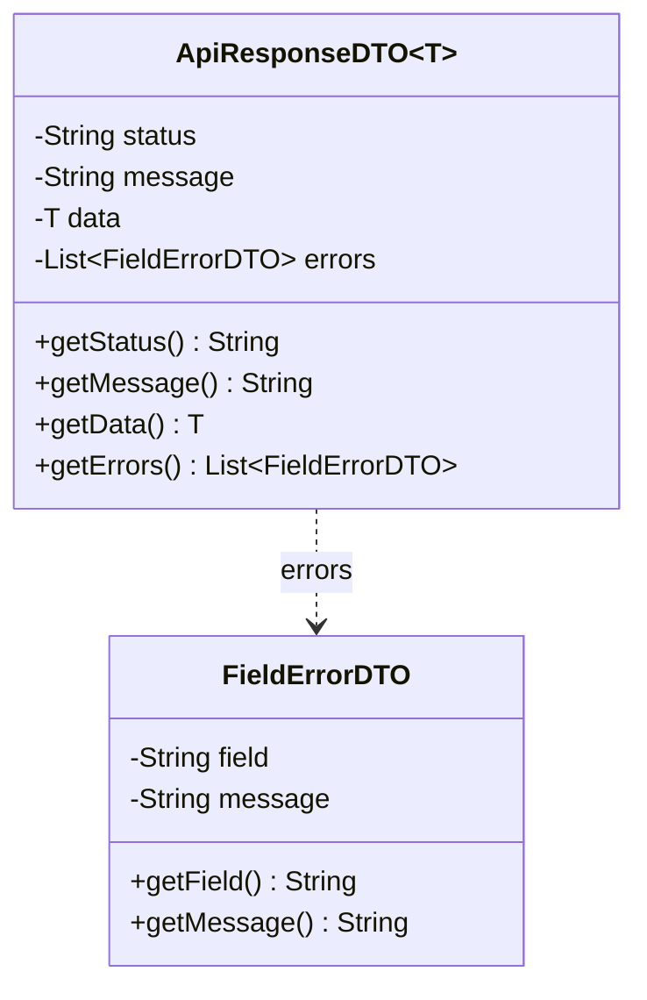

# API Conventions (ข้อตกลงกลางของทุก Task)

เอกสารนี้กำหนดรูปแบบที่ API, DTO และ DAO ของทุก task ใช้ร่วมกัน เพื่อให้ชื่อ รูปแบบ response และสถานะตรงกัน
ตารางฐานข้อมูลอ้างอิงจาก [docs/database/ERD.md](../database/ERD.md)

---

## 1. ข้อกำหนดทั่วไป

| หัวข้อ | ข้อกำหนด |
|---|---|
| Base path | `/api/v1` |
| Content-Type | `application/json` (ยกเว้นอัปโหลดรูปใช้ `multipart/form-data`) |
| รหัส (id) | `Long` |
| จำนวนเงิน | `BigDecimal` ทศนิยม 2 ตำแหน่ง เช่น `20.00` |
| วันและเวลา | `LocalDateTime` รูปแบบ ISO-8601 เช่น `2026-10-25T14:00:00` |
| Enum | ส่งเป็น `String` ตัวพิมพ์ใหญ่ เช่น `"OPEN"` |
| ภาษาของ `message` | อังกฤษ (ตรงกับ Bean Validation และเอกสาร Task04/08/16) หน้าเว็บเลือกแปลหรือแสดงตามที่ต้องการ |

---

## 2. Authentication และสิทธิ์การใช้งาน

- **ไม่มี role** ผู้ใช้ทุกคนฝากหิ้ว โพสต์ และเปิดรอบรับหิ้วได้ในบัญชีเดียว
- **Guest (ไม่ได้เข้าสู่ระบบ)** ดูได้อย่างเดียว ไม่ต้องแนบ token ใช้ได้เฉพาะ endpoint เหล่านี้: `GET /delivery-rounds`, `GET /delivery-rounds/{id}`, `GET /posts`, `GET /posts/{id}` และ endpoint กลุ่ม `/auth/*` (Task04)
- endpoint อื่นทั้งหมดต้องแนบ `Authorization: Bearer <JWT_TOKEN>` ไม่มี token → `401`
- JWT มีเฉพาะ `userId` ได้มาหลังยืนยัน OTP สำเร็จ (login 2 ขั้นตอน ดู Task04)
- ค่าที่บอกว่า "ใครเป็นคนทำ" (`runnerId`, `buyerId`, `confirmedBy`, `acceptedBy`) ดึงจาก JWT เสมอ **ห้ามรับจาก request body**
- สิทธิ์ตามความเป็นเจ้าของข้อมูล: เจ้าของรอบ = ผู้รับหิ้วของรอบนั้น, เจ้าของออเดอร์ = ผู้ฝากหิ้วของออเดอร์นั้น ทำรายการที่ไม่ใช่เจ้าของ → `403`
- กติกากันใช้ซ้ำซ้อน: สั่งของจากรอบของตัวเองไม่ได้ (`403`), รับโพสต์ของตัวเองไม่ได้ (`403`)

---

## 3. รูปแบบ Response (`ApiResponseDTO<T>`)

### สำเร็จ
```json
{
  "status": "SUCCESS",
  "message": "Delivery round created successfully",
  "data": { }
}
```
- `message` ใส่เมื่อมีการสร้างหรือเปลี่ยนข้อมูล (POST/PATCH) ส่วน GET ไม่ต้องมี
- `errors` ไม่ส่งเมื่อสำเร็จ

### ผิดพลาด
```json
{
  "status": "ERROR",
  "message": "Validation failed",
  "errors": [
    { "field": "items[0].quantity", "message": "must be greater than or equal to 1" }
  ]
}
```
- `errors` ใช้เมื่อบอกได้ว่าผิดที่ field ไหน (ชื่อ field ตรงกับ JSON ที่ส่งมา) ถ้าเป็นข้อผิดพลาดอื่น เช่น `401`, `403`, `404`, `409` ส่งแค่ `status` กับ `message`
- `data` ไม่ส่งเมื่อผิดพลาด



### HTTP Status ที่ใช้

| Status | ใช้เมื่อ |
|---|---|
| `200 OK` | อ่านข้อมูลหรืออัปเดตสำเร็จ |
| `201 Created` | สร้างข้อมูลใหม่สำเร็จ |
| `400 Bad Request` | ข้อมูลไม่ครบหรือไม่ถูกรูปแบบ (ไม่บันทึกข้อมูล) |
| `401 Unauthorized` | ไม่มี token หรือ token ไม่ถูกต้อง/หมดอายุ |
| `403 Forbidden` | ไม่ใช่เจ้าของข้อมูล หรือทำรายการกับของตัวเองที่ไม่อนุญาต |
| `404 Not Found` | ไม่พบข้อมูลตาม id |
| `429 Too Many Requests` | ขอ/กรอก OTP เกินกำหนด (ขอซ้ำก่อน 60 วินาที หรือกรอกผิดเกิน 5 ครั้ง) |
| `409 Conflict` | ข้อมูลซ้ำ หรือสถานะปัจจุบันไม่อนุญาตให้ทำรายการนี้ |

---

## 4. Enum และสถานะที่ใช้ร่วมกัน

| Enum | ค่าที่ใช้ | ใช้ที่ |
|---|---|---|
| `OtpPurpose` | `LOGIN`, `RESET_PASSWORD` | `OTP_VERIFICATIONS.purpose` |
| `RoundStatus` | `OPEN`, `CLOSED`, `COMPLETED`, `CANCELLED` | `DELIVERY_ROUNDS.status` |
| `HandoffMethod` | `MEETUP` (นัดรับ), `DELIVERY` (ส่งถึงที่) | `ORDERS.handoff_method` |
| `OrderStatus` | `PENDING` (รอชำระเงิน), `PAID` (ชำระแล้ว), `COMPLETED` (ปิดออเดอร์) | `ORDERS.status` |
| `PaymentStatus` | `PENDING`, `HELD` (ชำระสำเร็จ เงินพักไว้ที่ระบบกลาง), `FAILED`, `RELEASED` (โอนให้ผู้รับหิ้วแล้ว) | `PAYMENTS.payment_status` |
| `PostStatus` | `OPEN`, `ACCEPTED` | `POSTS.status` (Task12) |
| `PaymentMethod` | `QR_TRANSFER` (สแกน QR ระบบตัวกลาง + แนบสลิป) | `PAYMENTS.payment_method` |
| `CompletionStatus` | `COMPLETED` | `ORDER_COMPLETIONS.completion_status` |

### ลำดับสถานะตลอดกระบวนการ

| ขั้นตอน | Task | Round | Order | Payment |
|---|---|---|---|---|
| 1. ผู้รับหิ้วเปิดรอบ | Task08 | `OPEN` | - | - |
| 2. ผู้ฝากหิ้วสร้างออเดอร์ในรอบ | Task16 | `OPEN` | `PENDING` | - |
| 3. ผู้รับหิ้วระบุราคาสินค้า | Task20 | เดิม | `PENDING` | `PENDING` |
| 4. ผู้ฝากหิ้วสแกน QR แนบสลิป ยอดและสลิปถูกต้อง | Task20 | `OPEN` หรือ `CLOSED` | `PAID` | `HELD` |
| 5. ผู้ฝากหิ้วยืนยันรับสินค้าพร้อมรูป | Task24 | เดิม | `COMPLETED` | `RELEASED` |

---

## 5. โครงสร้าง package ในโค้ด

ใช้ package หลักตามโปรเจกต์ปัจจุบันคือ `com.example.demo`

| package | เก็บอะไร |
|---|---|
| `com.example.demo.controller` | Controller (API) |
| `com.example.demo.service` | Service (business logic) |
| `com.example.demo.repository` | Repository / DAO (`JpaRepository`) |
| `com.example.demo.entity` | Entity ที่ map กับตารางใน ERD |
| `com.example.demo.dto` | DTO ทั้ง request และ response |
| `com.example.demo.service` (ส่วน `FileStorageService`) | เก็บไฟล์รูปที่อัปโหลด (สลิป Task20, หลักฐานรับสินค้า Task24) คืนค่าที่อยู่ไฟล์ |
| `com.example.demo.exception` | Exception และตัวจัดการ error ให้ออกเป็นรูปแบบในข้อ 3 |

Entity ที่ map กับตารางชื่อ `orders` ต้องระบุ `@Table(name = "orders")` เพราะ `order` เป็นคำสงวนของ SQL

---

## 6. Dependency ที่ต้องมีใน `pom.xml`

`pom.xml` ปัจจุบันมีแค่ web MVC, devtools, tomcat และ test ตามที่ design ไว้ต้องเพิ่ม (ให้คนดูแล `pom.xml` เป็นคนเพิ่มคนเดียว และตรวจชื่อ artifact ให้ตรงกับ Spring Boot 4.1.1)

- Spring Data JPA (`JpaRepository`)
- Bean Validation (`@NotBlank`, `@Min`, `@Future` ฯลฯ)
- Spring Security (ใช้ `PasswordEncoder` สำหรับ BCrypt และตรวจ JWT)
- PostgreSQL JDBC driver
- ไลบรารี JWT (เช่น `jjwt`)

---

## 7. โค้ดชั้น API ที่มีอยู่แล้ว (Controller, DTO, Entity, Repository)

| เรื่อง | ข้อตกลง |
|---|---|
| ผู้ใช้จาก JWT | Controller อ่านด้วย `@RequestAttribute("userId")` (ค่าคงที่ `RequestAttributes.USER_ID`) JWT filter ของ Task04 ต้องตรวจ token แล้วเรียก `request.setAttribute("userId", userId)` ถ้าไม่มี attribute นี้ระบบตอบ `401 Invalid or missing token` ให้เอง |
| endpoint ของ Guest | ไม่ใช้ `userId` ใน Controller (ดูข้อ 2) JWT filter ต้องไม่ปฏิเสธคำขอที่ไม่มี token บน endpoint เหล่านี้ |
| error จาก Service | โยน `ApiException` ด้วย factory เช่น `ApiException.notFound("Order not found")`, `forbidden(...)`, `conflict(...)`, `tooManyRequests(...)`, `validation("paidAmount", "must equal the total amount (100.00)")` `GlobalExceptionHandler` แปลงเป็นรูปแบบในข้อ 3 |
| Validation | ใช้ Bean Validation ใน DTO (error ออกเป็น `400` พร้อม `errors`) ไฟล์รูปใช้ `@ImageFile` (ต้องแนบ, JPEG/PNG, ไม่เกิน 5 MB) |
| Service ชั่วคราว | `config/Default*ServiceConfig` ให้ Service ที่ยังไม่เขียนตอบ `501 Not implemented yet` เมื่อมี `@Service` จริงของ interface นั้น ตัวชั่วคราวจะถูกข้ามเอง |
| ฐานข้อมูล | ตารางสร้างจาก `docs/database/schema.sql` และ `schema_orders.sql` (`spring.jpa.hibernate.ddl-auto=none`) Entity map ชื่อ column ตรงกับไฟล์ SQL |

