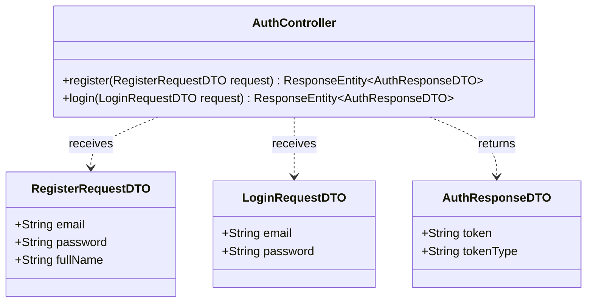
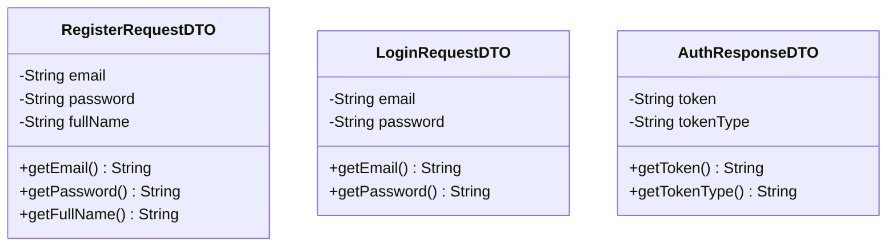
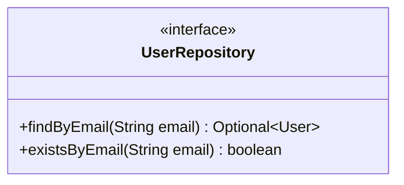
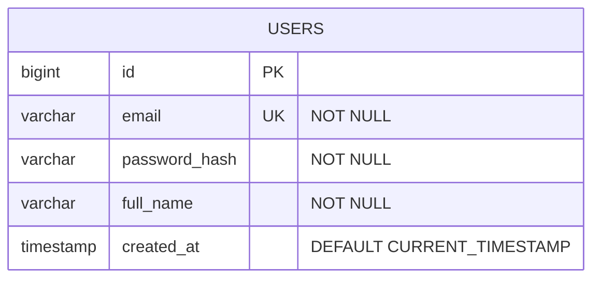
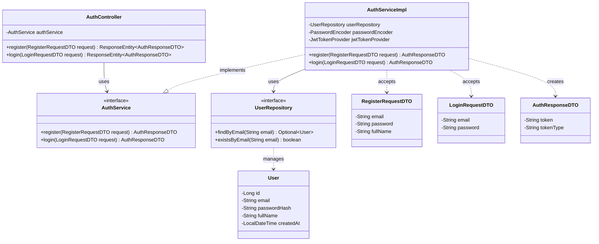

# Task04: U11 - Define Details, Design UI, API, DB Schema & Sequence Diagram

## 1. User Story Details (U11)
- **Role:** ผู้ใช้งานทั่วไป (Guest / Unauthenticated User)
- **Goal:** ต้องการสมัครสมาชิก (Register) และเข้าสู่ระบบ (Login)
- **Benefit:** เพื่อให้สามารถสร้างบัญชีผู้ใช้งาน และเข้าถึงฟีเจอร์สำหรับสมาชิกในระบบได้
- **Acceptance Criteria:**
  1. ระบบต้องตรวจสอบไม่ให้ใช้ Email ที่มีอยู่ในระบบแล้วสมัครซ้ำ
  2. รหัสผ่านต้องมีความยาวอย่างน้อย 8 ตัวอักษร
  3. ระบบทำการเข้ารหัสรหัสผ่าน (Password Hashing) ก่อนบันทึกลง Database
  4. เมื่อเข้าสู่ระบบสำเร็จ ระบบต้องส่งคืน JWT Access Token เพื่อใช้ยืนยันตัวตนใน API ถัดไป

---

## 2. UI Prototype
- **Figma Design Link:** [Task04 - Register & Login UI Prototype](https://www.figma.com/)

---

## 3. API Specification
### Endpoint 1: Register (สมัครสมาชิก)
- **URL:** `/api/v1/auth/register`
- **Method:** `POST`
- **Content-Type:** `application/json`
- **Request Body:**
```json
{
  "email": "user@example.com",
  "password": "password123",
  "fullName": "Naphat Thongkao"
}
```
- **Response (201 Created):**
```json
{
  "status": "SUCCESS",
  "message": "User registered successfully",
  "data": {
    "userId": 1,
    "email": "user@example.com"
  }
}
```

### Endpoint 2: Login (เข้าสู่ระบบ)
- **URL:** `/api/v1/auth/login`
- **Method:** `POST`
- **Content-Type:** `application/json`
- **Request Body:**
```json
{
  "email": "user@example.com",
  "password": "password123"
}
```
- **Response (200 OK):**
```json
{
  "status": "SUCCESS",
  "data": {
    "token": "eyJhbGciOiJIUzI1NiIsIn...",
    "tokenType": "Bearer"
  }
}
```

---

## 4. API Class Diagram


---

## 5. DTO Class Specification & Diagram
### DTO Specifications
1. **`RegisterRequestDTO`**
   - `email`: String (Not Null, Valid Email)
   - `password`: String (Not Null, Min 8 characters)
   - `fullName`: String (Not Null)
2. **`LoginRequestDTO`**
   - `email`: String (Not Null)
   - `password`: String (Not Null)
3. **`AuthResponseDTO`**
   - `token`: String
   - `tokenType`: String ("Bearer")

### DTO Class Diagram


---

## 6. DAO / Repository Specification & Diagram
- **Interface:** `UserRepository` (extends `JpaRepository<User, Long>`)
- **Methods:**
  - `Optional<User> findByEmail(String email)`
  - `boolean existsByEmail(String email)`



---

## 7. ER Diagram (DB Schema)


---

## 8. Extended API Class Diagram (Full Layered Architecture)


---

## 9. Sequence Diagrams
### Sequence Diagram 1: Register (สมัครสมาชิก)
```mermaid
sequenceDiagram
    autonumber
    actor Client as Frontend