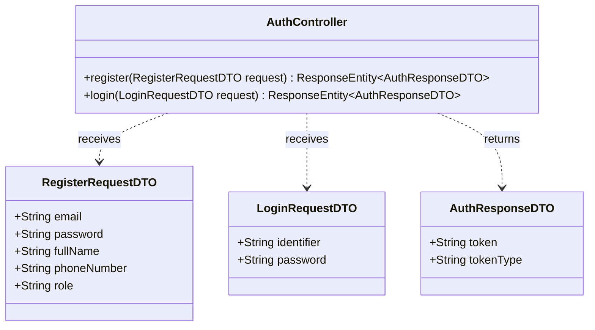
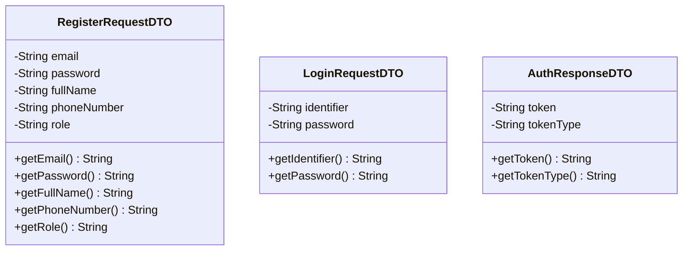
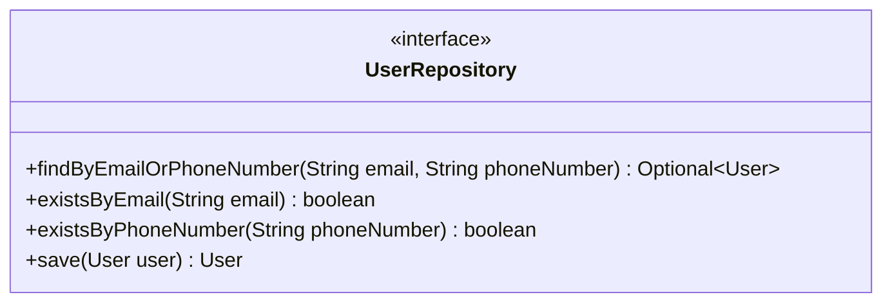
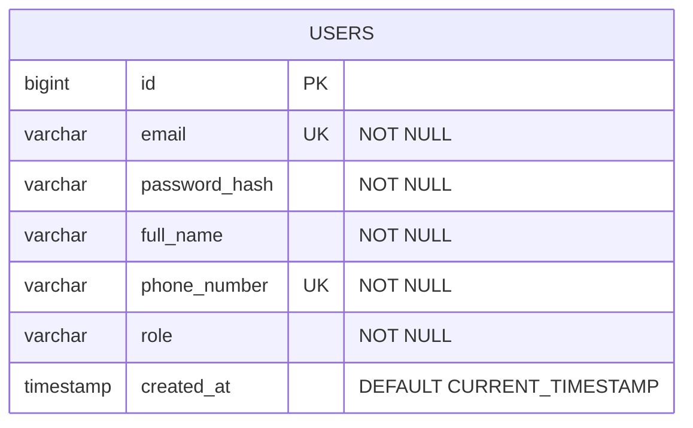
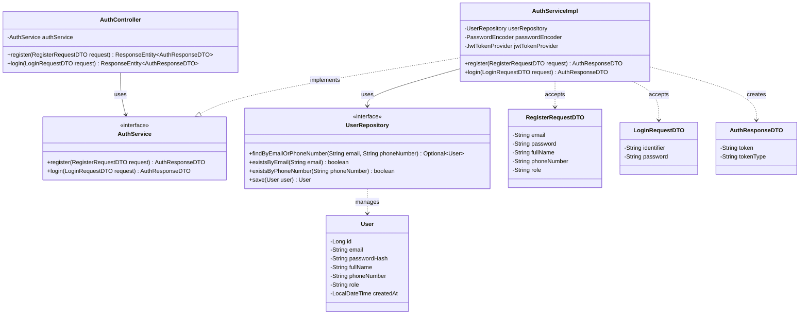
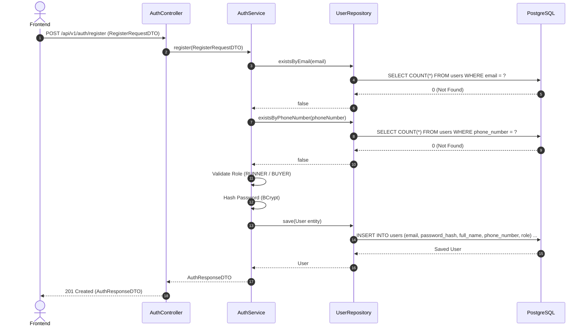
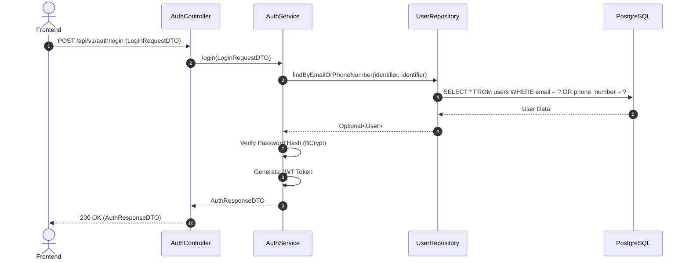

# Task04: U11 - Define Details, Design UI, API, DB Schema & Sequence Diagram

## 1. User Story Details (U11)
- **Role:** ผู้ใช้งานทั่วไป (Guest / Unauthenticated User)
- **Goal:** ต้องการสมัครสมาชิก (Register) โดยบังคับเลือกบทบาทเป็นผู้รับหิ้วหรือผู้ฝากหิ้ว และเข้าสู่ระบบ (Login) ด้วย Email หรือ เบอร์โทรศัพท์
- **Benefit:** เพื่อให้สามารถสร้างบัญชีผู้ใช้งาน และเข้าถึงฟีเจอร์ตามบทบาทในระบบได้อย่างถูกต้อง
- **Acceptance Criteria:**
  1. การสมัครสมาชิก (Register): บังคับระบุทั้ง Email และ เบอร์โทรศัพท์ โดยระบบต้องตรวจสอบไม่ให้ซ้ำกับที่มีในระบบ
  2. ต้องระบุชื่อ-นามสกุล และ รหัสผ่าน (ความยาวอย่างน้อย 8 ตัวอักษร)
  3. **บังคับเลือกบทบาทผู้ใช้งาน (Mandatory Role Selection):** ผู้ใช้ **ต้องเลือก** บทบาทอย่างใดอย่างหนึ่งระหว่าง `RUNNER` (ผู้รับหิ้ว) หรือ `BUYER` (ผู้ฝากหิ้ว) เสมอ (ห้ามปล่อยว่าง)
  4. ระบบทำการเข้ารหัสรหัสผ่าน (Password Hashing) ก่อนบันทึกลง Database
  5. การเข้าสู่ระบบ (Login): สามารถระบุ **Email หรือ เบอร์โทรศัพท์** อย่างใดอย่างหนึ่ง คู่กับ รหัสผ่านได้
  6. เมื่อเข้าสู่ระบบสำเร็จ ระบบต้องส่งคืน JWT Access Token เพื่อใช้ยืนยันตัวตนใน API ถัดไป

---

## 2. UI Prototype
- **Figma Design Link:** [Task04 - Register & Login UI Prototype](https://www.figma.com/)

---

## 3. API Specification
### Endpoint 1: Register (สมัครสมาชิก)
- **URL:** `/api/v1/auth/register`
- **Method:** `POST`
- **Content-Type:** `application/json`
- **Request Body:**
```json
{
  "email": "user@example.com",
  "password": "password123",
  "fullName": "Naphat Thongkao",
  "phoneNumber": "0812345678",
  "role": "RUNNER"
}
```
*(หมายเหตุ: ฟิลด์ `role` **บังคับส่ง** โดยเลือกได้เพียง 2 ค่าเท่านั้น คือ `"RUNNER"` สำหรับผู้รับหิ้ว หรือ `"BUYER"` สำหรับผู้ฝากหิ้ว)*

- **Response (201 Created):**
```json
{
  "status": "SUCCESS",
  "message": "User registered successfully",
  "data": {
    "userId": 1,
    "email": "user@example.com",
    "fullName": "Naphat Thongkao",
    "phoneNumber": "0812345678",
    "role": "RUNNER"
  }
}
```

### Endpoint 2: Login (เข้าสู่ระบบ)
- **URL:** `/api/v1/auth/login`
- **Method:** `POST`
- **Content-Type:** `application/json`
- **Request Body:**
```json
{
  "identifier": "user@example.com",
  "password": "password123"
}
```
*(หมายเหตุ: `identifier` ระบุได้ทั้ง Email เช่น `"user@example.com"` หรือ เบอร์โทรศัพท์ เช่น `"0812345678"`)*

- **Response (200 OK):**
```json
{
  "status": "SUCCESS",
  "data": {
    "token": "eyJhbGciOiJIUzI1NiIsIn...",
    "tokenType": "Bearer"
  }
}
```

---

## 4. API Class Diagram


---

## 5. DTO Class Specification & Diagram
### DTO Specifications
1. **`RegisterRequestDTO`**
   - `email`: String (Not Null, Valid Email)
   - `password`: String (Not Null, Min 8 characters)
   - `fullName`: String (Not Null)
   - `phoneNumber`: String (Not Null, Valid Phone Number)
   - `role`: String (Not Null, Required Choice: `"RUNNER"` หรือ `"BUYER"`)
2. **`LoginRequestDTO`**
   - `identifier`: String (Not Null - ใส่ Email หรือ เบอร์โทรศัพท์)
   - `password`: String (Not Null)
3. **`AuthResponseDTO`**
   - `token`: String
   - `tokenType`: String ("Bearer")

### DTO Class Diagram


---

## 6. DAO / Repository Specification & Diagram
- **Interface:** `UserRepository` (extends `JpaRepository<User, Long>`)
- **Methods:**
  - `Optional<User> findByEmailOrPhoneNumber(String email, String phoneNumber)` - ค้นหาผู้ใช้ด้วย Email หรือ เบอร์โทรศัพท์ (ใช้ตอน Login)
  - `boolean existsByEmail(String email)` - เช็ค Email ซ้ำ
  - `boolean existsByPhoneNumber(String phoneNumber)` - เช็คเบอร์โทรศัพท์ซ้ำ
  - `User save(User user)` - บันทึกข้อมูลผู้ใช้ใหม่ (Register)



---

## 7. ER Diagram (DB Schema)


---

## 8. Extended API Class Diagram (Full Layered Architecture)


---

## 9. Sequence Diagrams
### Sequence Diagram 1: Register (สมัครสมาชิก)


### Sequence Diagram 2: Login (เข้าสู่ระบบด้วย Email หรือ เบอร์โทรศัพท์)

```

---

### 🚀 สเต็ปดันขึ้น GitHub หลังวางไฟล์เรียบร้อย:

1. บันทึกไฟล์ใน VS Code (**`Cmd + S`**)
2. พิมพ์คำสั่งใน Terminal:
   ```bash
   git add .
   git commit -m "docs: enforce mandatory role selection (RUNNER or BUYER) during registration"
   git push
   ```