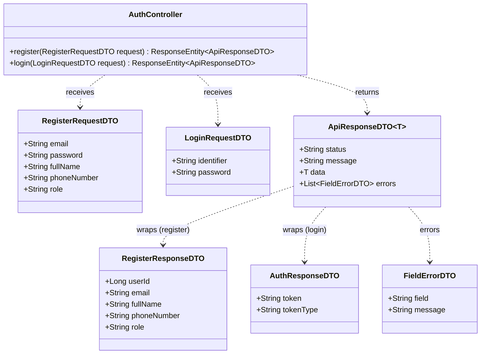
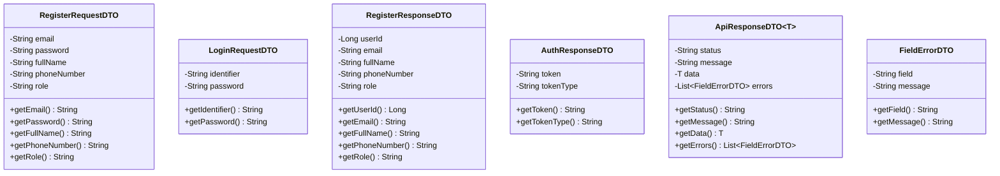
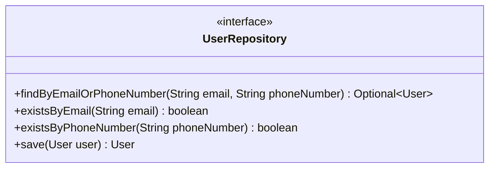
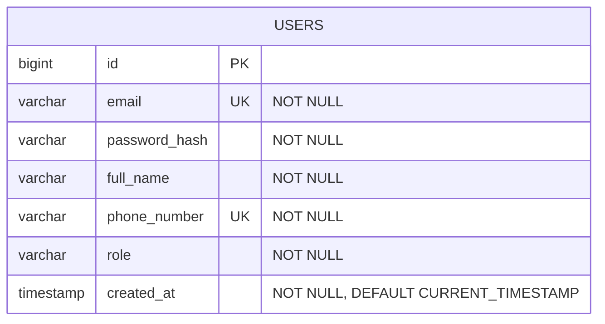
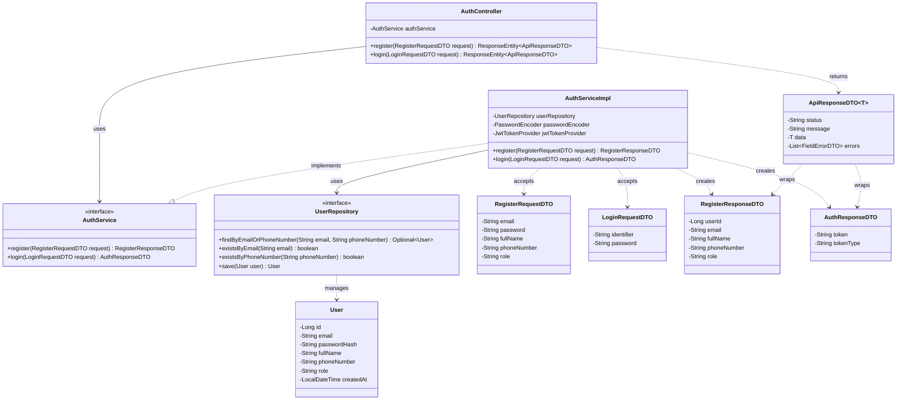
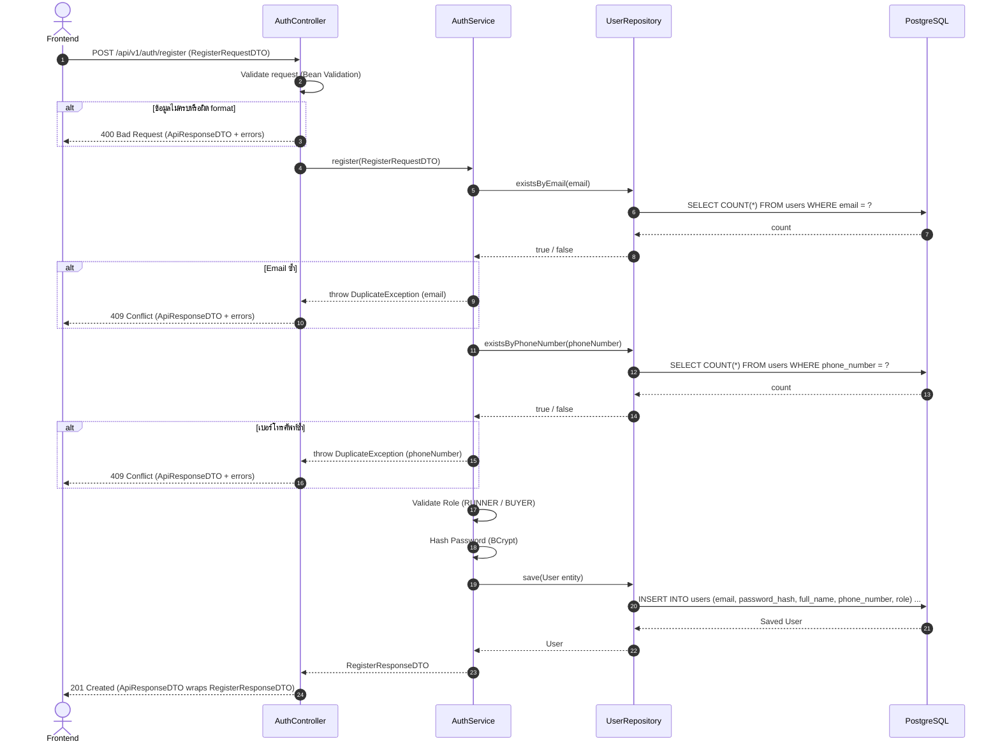
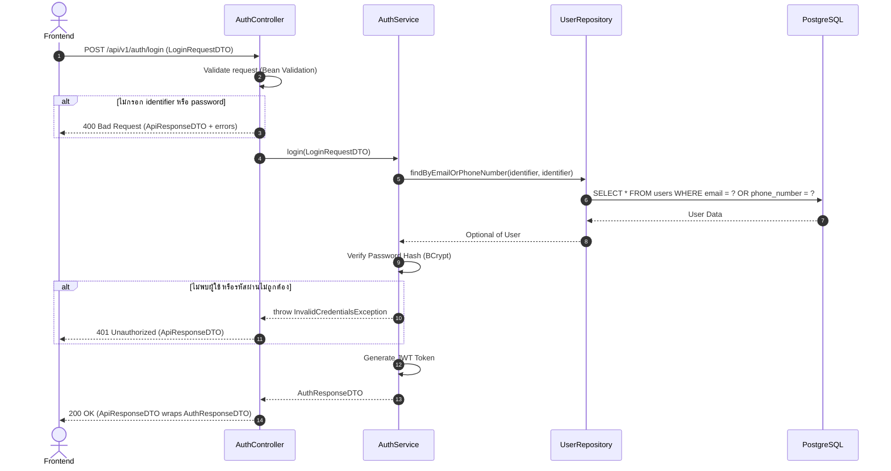

# Task04: U11 - Define Details, Design UI, API, DB Schema & Sequence Diagram

> ใช้ร่วมกับ [API Conventions](../common/API-CONVENTIONS.md) (รูปแบบ response, JWT, enum) และ [ERD](../database/ERD.md) (ตาราง `USERS`)

## 1. User Story Details (U11)
- **Role:** ผู้ใช้งานทั่วไป (Guest / Unauthenticated User)
- **Goal:** ต้องการสมัครสมาชิก (Register) โดยบังคับเลือกบทบาทเป็นผู้รับหิ้วหรือผู้ฝากหิ้ว และเข้าสู่ระบบ (Login) ด้วย Email หรือ เบอร์โทรศัพท์
- **Benefit:** เพื่อให้สามารถสร้างบัญชีผู้ใช้งาน และเข้าถึงฟีเจอร์ตามบทบาทในระบบได้อย่างถูกต้อง
- **Acceptance Criteria:**
  1. การสมัครสมาชิก (Register): บังคับระบุทั้ง Email และ เบอร์โทรศัพท์ โดยระบบต้องตรวจสอบไม่ให้ซ้ำกับที่มีในระบบ
  2. ต้องระบุชื่อ-นามสกุล และ รหัสผ่าน (ความยาวอย่างน้อย 8 ตัวอักษร)
  3. **บังคับเลือกบทบาทผู้ใช้งาน (Mandatory Role Selection):** ผู้ใช้ **ต้องเลือก** บทบาทอย่างใดอย่างหนึ่งระหว่าง `RUNNER` (ผู้รับหิ้ว) หรือ `BUYER` (ผู้ฝากหิ้ว) เสมอ (ห้ามปล่อยว่าง)
  4. ระบบทำการเข้ารหัสรหัสผ่าน (Password Hashing) ก่อนบันทึกลง Database
  5. การเข้าสู่ระบบ (Login): สามารถระบุ **Email หรือ เบอร์โทรศัพท์** อย่างใดอย่างหนึ่ง คู่กับ รหัสผ่านได้
  6. เมื่อเข้าสู่ระบบสำเร็จ ระบบต้องส่งคืน JWT Access Token เพื่อใช้ยืนยันตัวตนใน API ถัดไป
  7. หากกรอกข้อมูลไม่ครบหรือไม่ถูกต้อง ระบบต้องแสดงข้อความแจ้งเตือนชัดเจนที่ช่องนั้น ๆ และไม่บันทึกข้อมูลลงระบบ
- **หมายเหตุ:** ผู้ดูแลระบบ (Admin) ไม่ได้สมัครผ่านหน้านี้ รับสมัครเฉพาะ `RUNNER` และ `BUYER`

---

## 2. UI Prototype
- **Figma Design Link:** [Task04 - Register & Login UI Prototype](https://www.figma.com/)

---

## 3. API Specification

> **รูปแบบ Response ที่ใช้ร่วมกันทุก endpoint (`ApiResponseDTO<T>`)** ดูรายละเอียดที่ [API Conventions](../common/API-CONVENTIONS.md)
> - สำเร็จ: `{ "status": "SUCCESS", "message": "...", "data": ... }`
> - ผิดพลาด: `{ "status": "ERROR", "message": "...", "errors": [ { "field": "...", "message": "..." } ] }`
>   (`errors` ใช้เมื่อต้องบอกว่าช่องไหนผิด ตามเกณฑ์ข้อ 7)

### Endpoint 1: Register (สมัครสมาชิก)
- **URL:** `/api/v1/auth/register`
- **Method:** `POST`
- **Content-Type:** `application/json`
- **Request Body:**
```json
{
  "email": "user@example.com",
  "password": "password123",
  "fullName": "Naphat Thongkao",
  "phoneNumber": "0812345678",
  "role": "RUNNER"
}
```
*(หมายเหตุ: ฟิลด์ `role` **บังคับส่ง** โดยเลือกได้เพียง 2 ค่าเท่านั้น คือ `"RUNNER"` สำหรับผู้รับหิ้ว หรือ `"BUYER"` สำหรับผู้ฝากหิ้ว)*

- **Response (201 Created):** ข้อมูลผู้ใช้ที่สมัครสำเร็จ (`RegisterResponseDTO`) ไม่ส่งรหัสผ่านกลับ
```json
{
  "status": "SUCCESS",
  "message": "User registered successfully",
  "data": {
    "userId": 1,
    "email": "user@example.com",
    "fullName": "Naphat Thongkao",
    "phoneNumber": "0812345678",
    "role": "RUNNER"
  }
}
```

- **Response (400 Bad Request):** ข้อมูลไม่ครบหรือผิด format (ไม่บันทึกข้อมูล)
```json
{
  "status": "ERROR",
  "message": "Validation failed",
  "errors": [
    { "field": "phoneNumber", "message": "must be a valid phone number" },
    { "field": "role", "message": "must not be blank" }
  ]
}
```

- **Response (409 Conflict):** Email หรือ เบอร์โทรศัพท์ซ้ำกับที่มีในระบบ
```json
{
  "status": "ERROR",
  "message": "Duplicate data",
  "errors": [
    { "field": "email", "message": "Email is already in use" }
  ]
}
```

### Endpoint 2: Login (เข้าสู่ระบบ)
- **URL:** `/api/v1/auth/login`
- **Method:** `POST`
- **Content-Type:** `application/json`
- **Request Body:**
```json
{
  "identifier": "user@example.com",
  "password": "password123"
}
```
*(หมายเหตุ: `identifier` ระบุได้ทั้ง Email เช่น `"user@example.com"` หรือ เบอร์โทรศัพท์ เช่น `"0812345678"`)*

- **Response (200 OK):**
```json
{
  "status": "SUCCESS",
  "message": "Login successful",
  "data": {
    "token": "eyJhbGciOiJIUzI1NiIsIn...",
    "tokenType": "Bearer"
  }
}
```

- **Response (400 Bad Request):** ไม่กรอก `identifier` หรือ `password`
```json
{
  "status": "ERROR",
  "message": "Validation failed",
  "errors": [
    { "field": "password", "message": "must not be blank" }
  ]
}
```

- **Response (401 Unauthorized):** ไม่พบผู้ใช้หรือรหัสผ่านไม่ถูกต้อง (ใช้ข้อความเดียวกัน ไม่บอกว่าผิดที่ตัวไหน)
```json
{
  "status": "ERROR",
  "message": "Invalid email/phone number or password"
}
```

- **JWT ที่ออกให้:** ต้องมีข้อมูล `userId` และ `role` (`RUNNER` / `BUYER`) เพราะ endpoint ของ task อื่นใช้ค่านี้ระบุตัวผู้ใช้และตรวจสิทธิ์ (ดู [API Conventions](../common/API-CONVENTIONS.md))

---

## 4. API Class Diagram


---

## 5. DTO Class Specification & Diagram
### DTO Specifications
1. **`RegisterRequestDTO`**
   - `email`: String (Not Blank, Valid Email)
   - `password`: String (Not Blank, Min 8 characters)
   - `fullName`: String (Not Blank)
   - `phoneNumber`: String (Not Blank, Valid Phone Number เช่น 10 หลัก ขึ้นต้นด้วย 0)
   - `role`: String (Not Blank, Required Choice: `"RUNNER"` หรือ `"BUYER"`)
2. **`LoginRequestDTO`**
   - `identifier`: String (Not Blank - ใส่ Email หรือ เบอร์โทรศัพท์)
   - `password`: String (Not Blank)
3. **`RegisterResponseDTO`** (ตอบกลับหลังสมัครสำเร็จ ไม่มีรหัสผ่าน)
   - `userId`: Long
   - `email`: String
   - `fullName`: String
   - `phoneNumber`: String
   - `role`: String
4. **`AuthResponseDTO`** (ตอบกลับหลัง Login สำเร็จ)
   - `token`: String
   - `tokenType`: String ("Bearer")
5. **`ApiResponseDTO<T>`** (wrapper ของทุก response)
   - `status`: String (`"SUCCESS"` / `"ERROR"`)
   - `message`: String
   - `data`: T (ใช้เมื่อสำเร็จ)
   - `errors`: List&lt;FieldErrorDTO&gt; (ใช้เมื่อผิดพลาดและต้องระบุช่อง ไม่มีค่าเมื่อสำเร็จ)
6. **`FieldErrorDTO`**
   - `field`: String (ชื่อ field ที่ผิด เช่น `"phoneNumber"`)
   - `message`: String (ข้อความแจ้งเตือนที่ช่องนั้น)

### DTO Class Diagram


---

## 6. DAO / Repository Specification & Diagram
- **Interface:** `UserRepository` (extends `JpaRepository<User, Long>`)
- **Methods:**
  - `Optional<User> findByEmailOrPhoneNumber(String email, String phoneNumber)` - ค้นหาผู้ใช้ด้วย Email หรือ เบอร์โทรศัพท์ (ใช้ตอน Login)
  - `boolean existsByEmail(String email)` - เช็ค Email ซ้ำ
  - `boolean existsByPhoneNumber(String phoneNumber)` - เช็คเบอร์โทรศัพท์ซ้ำ
  - `User save(User user)` - บันทึกข้อมูลผู้ใช้ใหม่ (Register)



---

## 7. ER Diagram (DB Schema)


---

## 8. Extended API Class Diagram (Full Layered Architecture)


---

## 9. Sequence Diagrams
### Sequence Diagram 1: Register (สมัครสมาชิก)


### Sequence Diagram 2: Login (เข้าสู่ระบบด้วย Email หรือ เบอร์โทรศัพท์)

