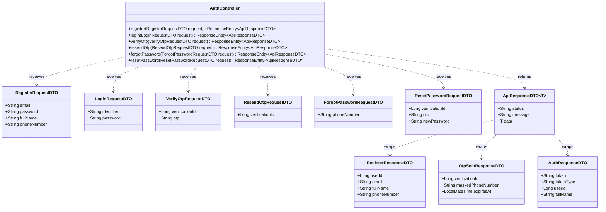
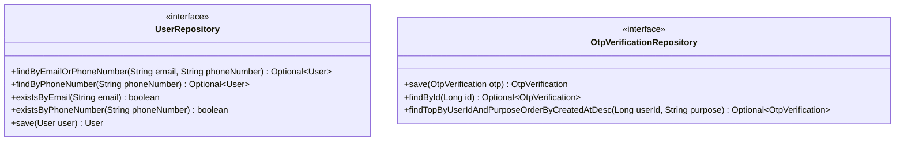
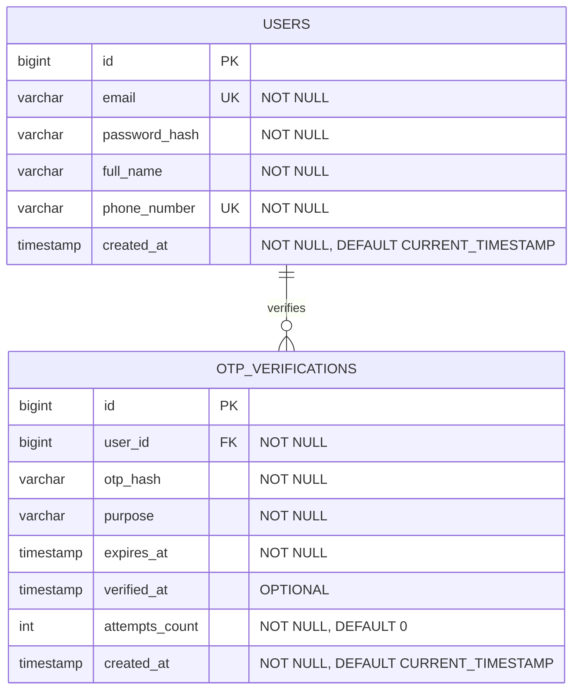
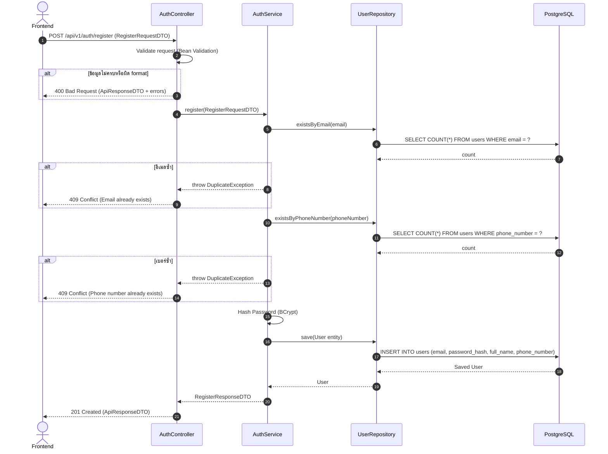
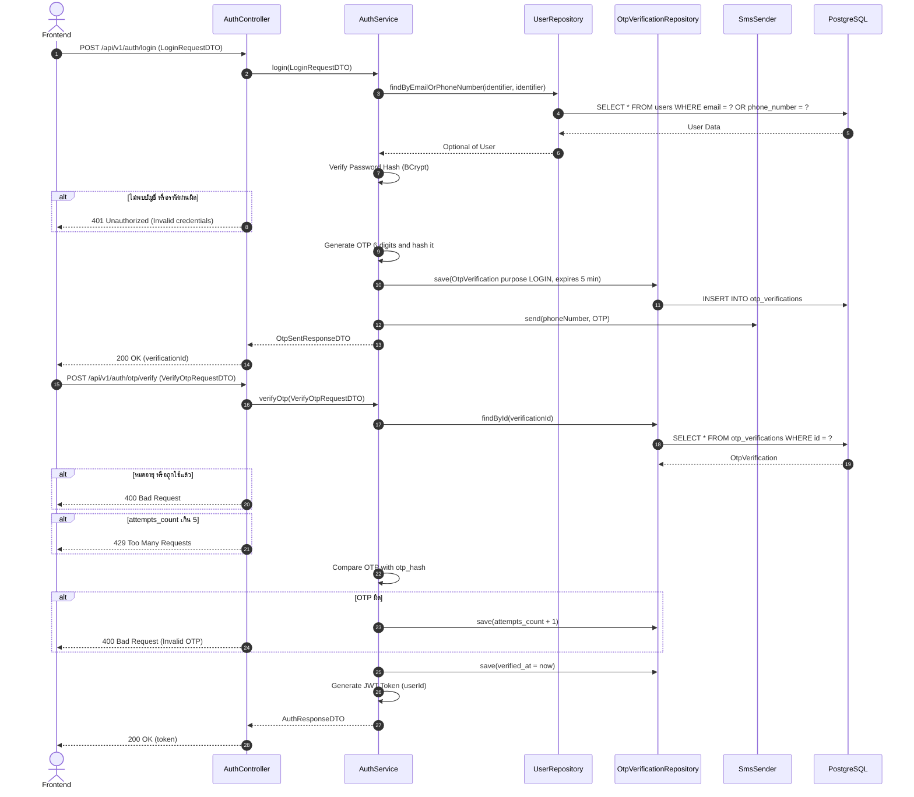

# Task04: U11 - Define Details, Design UI, API, DB Schema & Sequence Diagram

> ใช้ร่วมกับ [API Conventions](../common/API-CONVENTIONS.md) (รูปแบบ response, JWT, กติกาสิทธิ์) และ [ERD](../database/ERD.md) (ตาราง `USERS`, `OTP_VERIFICATIONS`)

## 1. User Story Details (U11)
- **Role:** ผู้ใช้งานทั่วไป (Guest / Unauthenticated User)
- **Goal:** ต้องการสมัครสมาชิก (Register) และเข้าสู่ระบบ (Login) ด้วย Email หรือ เบอร์โทรศัพท์ พร้อมยืนยันตัวตนด้วย OTP
- **Benefit:** เพื่อให้สามารถสร้างบัญชีผู้ใช้งาน และเข้าถึงฟีเจอร์ของระบบได้อย่างปลอดภัย
- **Acceptance Criteria:**
  1. การสมัครสมาชิก (Register): บังคับระบุทั้ง Email และ เบอร์โทรศัพท์ โดยระบบต้องตรวจสอบไม่ให้ซ้ำกับที่มีในระบบ
  2. ต้องระบุชื่อ-นามสกุล และ รหัสผ่าน (อย่างน้อย 8 ตัวอักษร ประกอบด้วยตัวพิมพ์ใหญ่ ตัวพิมพ์เล็ก และตัวเลข)
  3. **ไม่มีการเลือกบทบาท:** ผู้ใช้ทุกคนใช้งานได้ทั้งการฝากหิ้ว (โพสต์/ฝากซื้อ) และการรับหิ้ว (เปิดรอบ) ในบัญชีเดียวกัน
  4. ระบบทำการเข้ารหัสรหัสผ่าน (Password Hashing) ก่อนบันทึกลง Database
  5. การเข้าสู่ระบบ (Login): ระบุ **Email หรือ เบอร์โทรศัพท์** อย่างใดอย่างหนึ่ง คู่กับ รหัสผ่าน
  6. **ยืนยัน OTP ทุกครั้งที่เข้าสู่ระบบ:** เมื่อรหัสผ่านถูกต้อง ระบบส่ง OTP 6 หลักทาง SMS ไปยังเบอร์โทรของบัญชี และส่ง JWT Access Token ให้ต่อเมื่อกรอก OTP ถูกต้องเท่านั้น
  7. หากกรอกข้อมูลไม่ครบหรือไม่ถูกต้อง ระบบต้องแสดงข้อความแจ้งเตือนชัดเจนที่ช่องนั้น ๆ และไม่บันทึกข้อมูลลงระบบ
  8. ลืมรหัสผ่าน: ขอ OTP ทางเบอร์โทรที่ลงทะเบียนไว้ แล้วตั้งรหัสผ่านใหม่ได้
<<<<<<< HEAD
  9. **ผู้ที่ยังไม่เข้าสู่ระบบ (Guest)** ดูรอบหิ้วและโพสต์ได้อย่างเดียว ฝากซื้อ รับหิ้ว หรือโพสต์ไม่ได้ (ระบบตอบ `401`)
=======
  9. **ผู้ที่ยังไม่เข้าสู่ระบบ (Guest)** ดูรอบหิ้ว โพสต์ และหน้ารายละเอียดได้อย่างเดียว ฝากซื้อ รับหิ้ว หรือโพสต์ไม่ได้ (ระบบตอบ `401`); หน้าและ action ที่ต้องยืนยันตัวตนจะพาไปหน้าเข้าสู่ระบบ และหลังยืนยัน OTP จะกลับไปยังหน้าที่ต้องการ
>>>>>>> 10b82eb6ded120badb3d7bdd0d4d523182b57962
- **หมายเหตุ:** ผู้ดูแลระบบ (Admin) ไม่ได้สมัครผ่านหน้านี้

### กติกา OTP
| หัวข้อ | ค่า |
|---|---|
| รูปแบบ | ตัวเลข 6 หลัก |
| อายุ | 5 นาที |
| ลองผิดได้ | 5 ครั้งต่อ OTP เกินแล้วต้องขอใหม่ |
| ขอรหัสใหม่ | ได้หลังผ่านไป 60 วินาที |
| การเก็บ | เก็บแบบ hash (`otp_hash`) ไม่เก็บรหัสจริง |
| การส่ง SMS (Sprint 1) | จำลอง พิมพ์รหัสลง log ของ server ไม่ส่ง SMS จริง ไม่ส่งรหัสกลับใน response |
| `purpose` | `LOGIN` หรือ `RESET_PASSWORD` |

---

## 2. UI Prototype
<<<<<<< HEAD
- หน้าที่เกี่ยวข้อง: `register`, `login`, `verify` (กรอกเบอร์), `verify-otp` (กรอก OTP 6 หลัก), `forgot-password`, `reset-password`
=======
- หน้าที่เกี่ยวข้อง: `register`, `login`, `verify-otp` (กรอก OTP 6 หลัก), `forgot-password`, `reset-password`
>>>>>>> 10b82eb6ded120badb3d7bdd0d4d523182b57962
- **Figma Design Link:** [Task04 - Register & Login UI Prototype](https://www.figma.com/)

---

## 3. API Specification

> **รูปแบบ Response ที่ใช้ร่วมกันทุก endpoint (`ApiResponseDTO<T>`)** ดูรายละเอียดที่ [API Conventions](../common/API-CONVENTIONS.md)
> - สำเร็จ: `{ "status": "SUCCESS", "message": "...", "data": ... }`
> - ผิดพลาด: `{ "status": "ERROR", "message": "...", "errors": [ { "field": "...", "message": "..." } ] }`

ทุก endpoint ในไฟล์นี้ไม่ต้องใช้ token (เป็นของ Guest)

### Endpoint 1: Register (สมัครสมาชิก)
- **URL:** `/api/v1/auth/register`
- **Method:** `POST`
- **Content-Type:** `application/json`
- **Request Body:**
```json
{
  "email": "user@example.com",
  "password": "Password123",
  "fullName": "Naphat Thongkao",
  "phoneNumber": "0812345678"
}
```
**กติกาตรวจข้อมูล**

| Field | กติกา | ตัวอย่าง message |
|---|---|---|
| `email` | ห้ามว่าง และเป็นอีเมลที่ถูกต้อง | `must be a valid email` |
| `password` | อย่างน้อย 8 ตัว มีตัวพิมพ์ใหญ่ ตัวพิมพ์เล็ก และตัวเลข | `must be at least 8 characters with upper, lower case letters and a digit` |
| `fullName` | ห้ามว่าง | `must not be blank` |
| `phoneNumber` | ห้ามว่าง ตัวเลข 10 หลัก | `must be a valid 10-digit phone number` |

- **Response (201 Created):** (ไม่ส่งรหัสผ่านกลับ และยังไม่ได้ token ต้อง login ก่อน)
```json
{
  "status": "SUCCESS",
  "message": "User registered successfully",
  "data": {
    "userId": 1,
    "email": "user@example.com",
    "fullName": "Naphat Thongkao",
    "phoneNumber": "0812345678"
  }
}
```

| HTTP Status | เงื่อนไข | ตัวอย่าง message |
|---|---|---|
| `400 Bad Request` | ข้อมูลไม่ครบหรือไม่ถูกรูปแบบ | `Validation failed` พร้อม `errors` |
| `409 Conflict` | อีเมลหรือเบอร์โทรซ้ำ | `Email already exists` / `Phone number already exists` |

### Endpoint 2: Login - ขั้นที่ 1 ตรวจรหัสผ่านและส่ง OTP
- **URL:** `/api/v1/auth/login`
- **Method:** `POST`
- **Content-Type:** `application/json`
- **Request Body:**
```json
{
  "identifier": "user@example.com",
  "password": "Password123"
}
```
*(หมายเหตุ: `identifier` ระบุได้ทั้ง Email หรือเบอร์โทรศัพท์)*

- **Response (200 OK):** รหัสผ่านถูกต้อง ระบบส่ง OTP ไปที่เบอร์ของบัญชี **ยังไม่ส่ง token**
```json
{
  "status": "SUCCESS",
  "message": "OTP sent to your phone number",
  "data": {
    "verificationId": 501,
    "maskedPhoneNumber": "081-xxx-5678",
    "expiresAt": "2026-10-17T16:35:00"
  }
}
```

| HTTP Status | เงื่อนไข | ตัวอย่าง message |
|---|---|---|
| `400 Bad Request` | ไม่กรอก `identifier` หรือ `password` | `Validation failed` พร้อม `errors` |
| `401 Unauthorized` | ไม่พบบัญชี หรือรหัสผ่านไม่ถูกต้อง | `Invalid credentials` (ไม่บอกว่าผิดช่องไหน เพื่อความปลอดภัย) |

### Endpoint 3: Verify OTP - ขั้นที่ 2 ยืนยัน OTP และรับ JWT
- **URL:** `/api/v1/auth/otp/verify`
- **Method:** `POST`
- **Content-Type:** `application/json`
- **Request Body:**
```json
{
  "verificationId": 501,
  "otp": "123456"
}
```
**กติกาตรวจข้อมูล:** `verificationId` ห้ามว่าง / `otp` ห้ามว่าง ตัวเลข 6 หลัก

- **Response (200 OK):**
```json
{
  "status": "SUCCESS",
  "message": "Login successful",
  "data": {
    "token": "eyJhbGciOiJIUzI1NiIsIn...",
    "tokenType": "Bearer",
    "userId": 1,
    "fullName": "Naphat Thongkao"
  }
}
```
*(JWT มีข้อมูล `userId` เท่านั้น ไม่มี role)*

| HTTP Status | เงื่อนไข | ตัวอย่าง message |
|---|---|---|
| `400 Bad Request` | รูปแบบ OTP ไม่ถูกต้อง / OTP ผิด / OTP หมดอายุ / OTP ถูกใช้แล้ว | `Validation failed` / `Invalid OTP` / `OTP has expired` |
| `404 Not Found` | ไม่พบ `verificationId` | `Verification not found` |
| `429 Too Many Requests` | ลอง OTP ผิดเกิน 5 ครั้ง | `Too many attempts. Please request a new OTP` |

### Endpoint 4: Resend OTP (ขอรหัสใหม่)
- **URL:** `/api/v1/auth/otp/resend`
- **Method:** `POST`
- **Request Body:**
```json
{
  "verificationId": 501
}
```
- **Response (200 OK):** สร้างรายการยืนยันใหม่ (OTP เดิมใช้ไม่ได้อีก) `data` รูปแบบเดียวกับ Endpoint 2 (ได้ `verificationId` ใหม่)

| HTTP Status | เงื่อนไข | ตัวอย่าง message |
|---|---|---|
| `404 Not Found` | ไม่พบ `verificationId` | `Verification not found` |
| `429 Too Many Requests` | ขอใหม่ก่อนครบ 60 วินาที | `Please wait before requesting a new OTP` |

### Endpoint 5: Forgot Password (ขอ OTP เพื่อรีเซ็ตรหัสผ่าน)
- **URL:** `/api/v1/auth/password/forgot`
- **Method:** `POST`
- **Request Body:**
```json
{
  "phoneNumber": "0812345678"
}
```
- **Response (200 OK):** ส่ง OTP (`purpose = RESET_PASSWORD`) `data` รูปแบบเดียวกับ Endpoint 2

| HTTP Status | เงื่อนไข | ตัวอย่าง message |
|---|---|---|
| `400 Bad Request` | เบอร์ไม่ถูกรูปแบบ | `Validation failed` |
| `404 Not Found` | ไม่พบเบอร์นี้ในระบบ | `Phone number is not registered` |

### Endpoint 6: Reset Password (ตั้งรหัสผ่านใหม่)
- **URL:** `/api/v1/auth/password/reset`
- **Method:** `POST`
- **Request Body:**
```json
{
  "verificationId": 502,
  "otp": "654321",
  "newPassword": "NewPassword123"
}
```
**กติกาตรวจข้อมูล:** `newPassword` ใช้กติกาเดียวกับ `password` ตอนสมัคร / `otp` ตัวเลข 6 หลัก

- **Response (200 OK):**
```json
{
  "status": "SUCCESS",
  "message": "Password reset successfully"
}
```

| HTTP Status | เงื่อนไข | ตัวอย่าง message |
|---|---|---|
| `400 Bad Request` | ข้อมูลไม่ถูกรูปแบบ / OTP ผิด / หมดอายุ / ใช้แล้ว / `purpose` ไม่ใช่ `RESET_PASSWORD` | `Validation failed` / `Invalid OTP` |
| `404 Not Found` | ไม่พบ `verificationId` | `Verification not found` |
| `429 Too Many Requests` | ลอง OTP ผิดเกิน 5 ครั้ง | `Too many attempts. Please request a new OTP` |

*(หมายเหตุสำหรับ UI: ผู้ใช้กรอก OTP ที่หน้า `verify-otp` แล้วไปหน้า `reset-password` ให้เก็บ `verificationId` และ `otp` ไว้ส่งพร้อมรหัสผ่านใหม่ใน request เดียว)*

---

## 4. API Class Diagram


---

## 5. DTO Class Specification & Diagram

`ApiResponseDTO<T>` และ `FieldErrorDTO` ใช้ร่วมกันทุก task ดูที่ [API Conventions](../common/API-CONVENTIONS.md)

### DTO Specifications
1. **`RegisterRequestDTO`**
   - `email`: String (Not Blank, Valid Email)
   - `password`: String (Not Blank, Min 8, ต้องมีตัวพิมพ์ใหญ่ ตัวพิมพ์เล็ก และตัวเลข)
   - `fullName`: String (Not Blank)
   - `phoneNumber`: String (Not Blank, ตัวเลข 10 หลัก)
2. **`LoginRequestDTO`**
   - `identifier`: String (Not Blank - Email หรือเบอร์โทรศัพท์)
   - `password`: String (Not Blank)
3. **`VerifyOtpRequestDTO`**
   - `verificationId`: Long (Not Null)
   - `otp`: String (Not Blank, ตัวเลข 6 หลัก)
4. **`ResendOtpRequestDTO`**
   - `verificationId`: Long (Not Null)
5. **`ForgotPasswordRequestDTO`**
   - `phoneNumber`: String (Not Blank, ตัวเลข 10 หลัก)
6. **`ResetPasswordRequestDTO`**
   - `verificationId`: Long (Not Null)
   - `otp`: String (Not Blank, ตัวเลข 6 หลัก)
   - `newPassword`: String (กติกาเดียวกับ `password`)
7. **`RegisterResponseDTO`**
   - `userId`: Long
   - `email`, `fullName`, `phoneNumber`: String
8. **`OtpSentResponseDTO`**
   - `verificationId`: Long
   - `maskedPhoneNumber`: String (เช่น `081-xxx-5678`)
   - `expiresAt`: LocalDateTime
9. **`AuthResponseDTO`**
   - `token`: String (JWT)
   - `tokenType`: String (`"Bearer"`)
   - `userId`: Long
   - `fullName`: String

### DTO Class Diagram

```mermaid
classDiagram
    class RegisterRequestDTO {
        -String email
        -String password
        -String fullName
        -String phoneNumber
        +getEmail() String
        +getPassword() String
        +getFullName() String
        +getPhoneNumber() String
    }
    class LoginRequestDTO {
        -String identifier
        -String password
        +getIdentifier() String
        +getPassword() String
    }
    class VerifyOtpRequestDTO {
        -Long verificationId
        -String otp
        +getVerificationId() Long
        +getOtp() String
    }
    class ResendOtpRequestDTO {
        -Long verificationId
        +getVerificationId() Long
    }
    class ForgotPasswordRequestDTO {
        -String phoneNumber
        +getPhoneNumber() String
    }
    class ResetPasswordRequestDTO {
        -Long verificationId
        -String otp
        -String newPassword
        +getVerificationId() Long
        +getOtp() String
        +getNewPassword() String
    }
    class RegisterResponseDTO {
        -Long userId
        -String email
        -String fullName
        -String phoneNumber
        +getUserId() Long
        +getEmail() String
        +getFullName() String
        +getPhoneNumber() String
    }
    class OtpSentResponseDTO {
        -Long verificationId
        -String maskedPhoneNumber
        -LocalDateTime expiresAt
        +getVerificationId() Long
        +getMaskedPhoneNumber() String
        +getExpiresAt() LocalDateTime
    }
    class AuthResponseDTO {
        -String token
        -String tokenType
        -Long userId
        -String fullName
        +getToken() String
        +getTokenType() String
        +getUserId() Long
        +getFullName() String
    }
```


---

## 6. DAO / Repository Specification & Diagram

### `UserRepository` (extends `JpaRepository<User, Long>`)
- `Optional<User> findByEmailOrPhoneNumber(String email, String phoneNumber)` - ค้นหาตอน Login (ส่ง `identifier` ทั้งสองช่อง)
- `Optional<User> findByPhoneNumber(String phoneNumber)` - ค้นหาตอนลืมรหัสผ่าน
- `boolean existsByEmail(String email)` - เช็ก Email ซ้ำ
- `boolean existsByPhoneNumber(String phoneNumber)` - เช็กเบอร์ซ้ำ
- `User save(User user)` - บันทึกผู้ใช้ใหม่ / อัปเดตรหัสผ่านใหม่

### `OtpVerificationRepository` (extends `JpaRepository<OtpVerification, Long>`)
- `OtpVerification save(OtpVerification otp)` - สร้าง OTP / บันทึกจำนวนครั้งที่ลองและเวลาที่ยืนยัน
- `Optional<OtpVerification> findById(Long id)` - ค้นรายการยืนยันตาม `verificationId`
- `Optional<OtpVerification> findTopByUserIdAndPurposeOrderByCreatedAtDesc(Long userId, String purpose)` - ดู OTP ล่าสุด ใช้ตรวจเวลาขอใหม่ (60 วินาที)



---

## 7. ER Diagram (DB Schema)

> ไม่มี column `role` ใน `USERS` แล้ว (ผู้ใช้ทุกคนทำได้ทั้งฝากหิ้วและรับหิ้ว) ถ้า ERD กลางยังมี `role` (`DEFAULT USER`) ให้ลบออก หรือคงไว้เป็นค่าคงที่ที่โค้ดไม่ใช้ก็ได้

---

## 8. Extended API Class Diagram (Full Layered Architecture)

```mermaid
classDiagram
    class AuthController {
        -AuthService authService
        +register(RegisterRequestDTO request) ResponseEntity~ApiResponseDTO~
        +login(LoginRequestDTO request) ResponseEntity~ApiResponseDTO~
        +verifyOtp(VerifyOtpRequestDTO request) ResponseEntity~ApiResponseDTO~
        +resendOtp(ResendOtpRequestDTO request) ResponseEntity~ApiResponseDTO~
        +forgotPassword(ForgotPasswordRequestDTO request) ResponseEntity~ApiResponseDTO~
        +resetPassword(ResetPasswordRequestDTO request) ResponseEntity~ApiResponseDTO~
    }
    class AuthService {
        <<interface>>
        +register(RegisterRequestDTO request) RegisterResponseDTO
        +login(LoginRequestDTO request) OtpSentResponseDTO
        +verifyOtp(VerifyOtpRequestDTO request) AuthResponseDTO
        +resendOtp(ResendOtpRequestDTO request) OtpSentResponseDTO
        +forgotPassword(ForgotPasswordRequestDTO request) OtpSentResponseDTO
        +resetPassword(ResetPasswordRequestDTO request) void
    }
    class AuthServiceImpl {
        -UserRepository userRepository
        -OtpVerificationRepository otpRepository
        -PasswordEncoder passwordEncoder
        -JwtTokenProvider jwtTokenProvider
        -SmsSender smsSender
    }
    class SmsSender {
        <<interface>>
        +send(String phoneNumber, String message) void
    }
    class MockSmsSender {
        +send(String phoneNumber, String message) void
    }
    class JwtTokenProvider {
        +generateToken(Long userId) String
        +validateToken(String token) boolean
        +getUserId(String token) Long
    }
    class UserRepository {
        <<interface>>
        +findByEmailOrPhoneNumber(String email, String phoneNumber) Optional~User~
        +findByPhoneNumber(String phoneNumber) Optional~User~
        +existsByEmail(String email) boolean
        +existsByPhoneNumber(String phoneNumber) boolean
        +save(User user) User
    }
    class OtpVerificationRepository {
        <<interface>>
        +save(OtpVerification otp) OtpVerification
        +findById(Long id) Optional~OtpVerification~
        +findTopByUserIdAndPurposeOrderByCreatedAtDesc(Long userId, String purpose) Optional~OtpVerification~
    }
    class User {
        -Long id
        -String email
        -String passwordHash
        -String fullName
        -String phoneNumber
        -LocalDateTime createdAt
    }
    class OtpVerification {
        -Long id
        -User user
        -String otpHash
        -String purpose
        -LocalDateTime expiresAt
        -LocalDateTime verifiedAt
        -Integer attemptsCount
        -LocalDateTime createdAt
    }
    class RegisterRequestDTO
    class LoginRequestDTO
    class VerifyOtpRequestDTO
    class ResendOtpRequestDTO
    class ForgotPasswordRequestDTO
    class ResetPasswordRequestDTO
    class RegisterResponseDTO
    class OtpSentResponseDTO
    class AuthResponseDTO
    class ApiResponseDTO~T~ {
        -String status
        -String message
        -T data
        -List~FieldErrorDTO~ errors
    }

    AuthController --> AuthService : uses
    AuthController ..> ApiResponseDTO : returns
    AuthServiceImpl ..|> AuthService : implements
    AuthServiceImpl --> UserRepository : uses
    AuthServiceImpl --> OtpVerificationRepository : uses
    AuthServiceImpl --> JwtTokenProvider : uses
    AuthServiceImpl --> SmsSender : uses
    MockSmsSender ..|> SmsSender : implements
    UserRepository ..> User : manages
    OtpVerificationRepository ..> OtpVerification : manages
    OtpVerification --> User : user
    AuthServiceImpl ..> RegisterRequestDTO : accepts
    AuthServiceImpl ..> LoginRequestDTO : accepts
    AuthServiceImpl ..> VerifyOtpRequestDTO : accepts
    AuthServiceImpl ..> ResendOtpRequestDTO : accepts
    AuthServiceImpl ..> ForgotPasswordRequestDTO : accepts
    AuthServiceImpl ..> ResetPasswordRequestDTO : accepts
    AuthServiceImpl ..> RegisterResponseDTO : creates
    AuthServiceImpl ..> OtpSentResponseDTO : creates
    AuthServiceImpl ..> AuthResponseDTO : creates
    ApiResponseDTO ..> RegisterResponseDTO : wraps
    ApiResponseDTO ..> OtpSentResponseDTO : wraps
    ApiResponseDTO ..> AuthResponseDTO : wraps
```


---

## Sequence Diagrams
### Sequence Diagram 1: Register (สมัครสมาชิก)


### Sequence Diagram 2: Login ด้วย Email หรือเบอร์โทร + ยืนยัน OTP


### Sequence Diagram 3: Forgot Password และ Reset Password
```mermaid
sequenceDiagram
    autonumber
    actor Client as Frontend
    participant Controller as AuthController
    participant Service as AuthService
    participant UserDAO as UserRepository
    participant OtpDAO as OtpVerificationRepository
    participant SMS as SmsSender
    participant DB as PostgreSQL

    %% Forgot Password
    Client->>Controller: POST /api/v1/auth/password/forgot (phoneNumber)
    activate Controller
    Controller->>Service: forgotPassword(ForgotPasswordRequestDTO)
    activate Service

    Service->>UserDAO: findByPhoneNumber(phoneNumber)
    activate UserDAO
    UserDAO->>DB: SELECT * FROM users WHERE phone_number = ?
    activate DB
    DB-->>UserDAO: User Data
    deactivate DB
    UserDAO-->>Service: Optional of User
    deactivate UserDAO

    alt ไม่พบเบอร์
        Controller-->>Client: 404 Not Found
    end

    Service->>OtpDAO: save(OtpVerification purpose RESET_PASSWORD)
    activate OtpDAO
    OtpDAO->>DB: INSERT INTO otp_verifications
    activate DB
    DB-->>OtpDAO: Saved OtpVerification
    deactivate DB
    OtpDAO-->>Service: OtpVerification
    deactivate OtpDAO

    Service->>SMS: send(phoneNumber, OTP)
    activate SMS
    SMS-->>Service: void
    deactivate SMS

    Service-->>Controller: OtpSentResponseDTO
    deactivate Service
    Controller-->>Client: 200 OK (verificationId)
    deactivate Controller

    %% Reset Password
    Client->>Controller: POST /api/v1/auth/password/reset (ResetPasswordRequestDTO)
    activate Controller
    Controller->>Service: resetPassword(ResetPasswordRequestDTO)
    activate Service

    Service->>OtpDAO: findById(verificationId)
    activate OtpDAO
    OtpDAO->>DB: SELECT * FROM otp_verifications WHERE id = ?
    activate DB
    DB-->>OtpDAO: OtpVerification
    deactivate DB
    OtpDAO-->>Service: OtpVerification
    deactivate OtpDAO

    Service->>Service: ตรวจ purpose, หมดอายุ, จำนวนครั้ง, เทียบ OTP กับ otp_hash
    alt ตรวจไม่ผ่าน
        Controller-->>Client: 400 or 429 Bad Request / Too Many Requests
    end

    Service->>Service: Hash new password (BCrypt)
    Service->>UserDAO: save(User with new password_hash)
    activate UserDAO
    UserDAO->>DB: UPDATE users SET password_hash = ?
    activate DB
    DB-->>UserDAO: Updated User
    deactivate DB
    UserDAO-->>Service: User
    deactivate UserDAO

    Service->>OtpDAO: save(verified_at = now)
    Service-->>Controller: success
    deactivate Service
    Controller-->>Client: 200 OK (Password reset successfully)
    deactivate Controller
<<<<<<< HEAD

=======
>>>>>>> 10b82eb6ded120badb3d7bdd0d4d523182b57962
