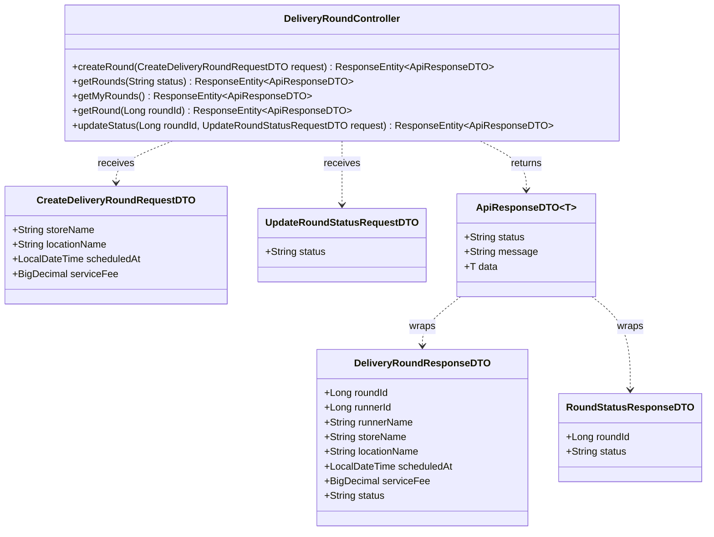
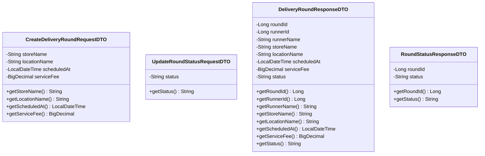
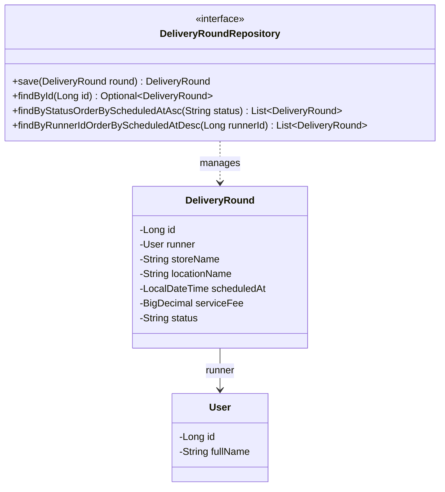

# Task08: US01 - เปิดรอบรับหิ้ว (API, API Class Diagram, DTO, DAO)

> ใช้ร่วมกับ [API Conventions](../common/API-CONVENTIONS.md) (รูปแบบ response, JWT, enum) และ [ERD](../database/ERD.md) (ตาราง `USERS`, `DELIVERY_ROUNDS`)

## 0. เงื่อนไขจาก User Story ที่ API ต้องรองรับ

| Test case ใน US01 | สิ่งที่ API ต้องทำ | Response |
|---|---|---|
| 1. ผู้รับหิ้วกรอกร้าน/สถานที่ วันเวลา และค่าหิ้วครบ ระบบเปิดรอบได้ | สร้างรอบสถานะ `OPEN` | `201 Created` |
| 2. กรอกร้าน/สถานที่ วันเวลา หรือค่าหิ้วไม่ครบ ระบบไม่อนุญาตให้เปิดรอบ | ไม่บันทึก และบอกว่าช่องไหนขาด | `400 Bad Request` |
| So that: ผู้ฝากหิ้วค้นหาและเข้าร่วมรอบที่ต้องการได้ | ให้ดูรายการรอบที่เปิดอยู่และดูรายละเอียดรอบ | Endpoint 2 และ 4 |

---

## 1. API Specification

### Endpoint 1: Create Delivery Round (สร้างรอบหิ้ว)
- **URL:** `/api/v1/delivery-rounds`
- **Method:** `POST`
- **Headers:** `Authorization: Bearer <JWT_TOKEN>` (ต้องเข้าสู่ระบบ ผู้ใช้ทุกคนเปิดรอบได้)
- **Content-Type:** `application/json`
- **Request Body:**
```json
{
  "storeName": "Starbucks - Central Plaza",
  "locationName": "อาคารเรียนรวมสังคมศาสตร์ (SC1) มธ.รังสิต",
  "scheduledAt": "2026-10-25T14:00:00",
  "serviceFee": 20.00
}
```
*(หมายเหตุ: ทั้ง 4 field บังคับส่ง `runnerId` ไม่ต้องส่ง ระบบอ่านจาก JWT และรอบที่สร้างใหม่มีสถานะ `OPEN` เสมอ)*

**กติกาตรวจข้อมูล**

| Field | กติกา | ตัวอย่าง message |
|---|---|---|
| `storeName` | ห้ามว่าง | `must not be blank` |
| `locationName` | ห้ามว่าง | `must not be blank` |
| `scheduledAt` | ห้ามว่าง และต้องเป็นเวลาในอนาคต | `must not be null` / `must be a future date` |
| `serviceFee` | ห้ามว่าง และต้อง ≥ 0.00 | `must not be null` / `must be greater than or equal to 0.00` |

- **Response (201 Created):**
```json
{
  "status": "SUCCESS",
  "message": "Delivery round created successfully",
  "data": {
    "roundId": 101,
    "runnerId": 1,
    "runnerName": "Naphat Thongkao",
    "storeName": "Starbucks - Central Plaza",
    "locationName": "อาคารเรียนรวมสังคมศาสตร์ (SC1) มธ.รังสิต",
    "scheduledAt": "2026-10-25T14:00:00",
    "serviceFee": 20.00,
    "status": "OPEN"
  }
}
```

**Error Responses**

| HTTP Status | เงื่อนไข | ตัวอย่าง message |
|---|---|---|
| `400 Bad Request` | ข้อมูลไม่ครบหรือไม่ถูกต้อง (ไม่บันทึกรอบ) | `Validation failed` พร้อม `errors` ระบุ field |
| `401 Unauthorized` | ไม่ส่ง token หรือ token ไม่ถูกต้อง | `Invalid or missing token` |

ตัวอย่าง `400`:
```json
{
  "status": "ERROR",
  "message": "Validation failed",
  "errors": [
    { "field": "storeName", "message": "must not be blank" },
    { "field": "serviceFee", "message": "must not be null" }
  ]
}
```

### Endpoint 2: Get Delivery Rounds (ดึงรายการรอบหิ้ว)
- **URL:** `/api/v1/delivery-rounds?status=OPEN`
- **Method:** `GET`
- **Headers:** ไม่ต้องใช้ token (Guest ดูได้)
- **Query Parameter:** `status` (ไม่บังคับ) ค่าที่ใช้ได้คือ `OPEN`, `CLOSED`, `COMPLETED`, `CANCELLED` ถ้าไม่ส่งมาจะได้เฉพาะรอบ `OPEN`
- **การเรียงลำดับ:** `scheduledAt` จากใกล้ที่สุดไปไกลที่สุด
- **Response (200 OK):**
```json
{
  "status": "SUCCESS",
  "data": [
    {
      "roundId": 101,
      "runnerId": 1,
      "runnerName": "Naphat Thongkao",
      "storeName": "Starbucks - Central Plaza",
      "locationName": "อาคารเรียนรวมสังคมศาสตร์ (SC1) มธ.รังสิต",
      "scheduledAt": "2026-10-25T14:00:00",
      "serviceFee": 20.00,
      "status": "OPEN"
    }
  ]
}
```
- **Error:** `400` เมื่อ `status` ไม่อยู่ในค่าที่กำหนด

### Endpoint 3: Get My Delivery Rounds (ประวัติรอบหิ้วของฉัน)
- **URL:** `/api/v1/delivery-rounds/my`
- **Method:** `GET`
- **Headers:** `Authorization: Bearer <JWT_TOKEN>` (ต้องเข้าสู่ระบบ)
- **ผลลัพธ์:** ทุกรอบของผู้รับหิ้วที่ล็อกอินอยู่ ทุกสถานะ เรียงจาก `scheduledAt` ล่าสุดไปเก่าสุด
- **Response (200 OK):** รูปแบบ `data` เป็น array ของรอบเหมือน Endpoint 2
- **Error:** `401` เมื่อไม่มี token

### Endpoint 4: Get Delivery Round Detail (รายละเอียดรอบหิ้ว)
- **URL:** `/api/v1/delivery-rounds/{roundId}`
- **Method:** `GET`
- **Headers:** ไม่ต้องใช้ token (Guest ดูได้)
- **Response (200 OK):** `data` เป็นรอบเดียว รูปแบบเหมือนใน Endpoint 1
- **Error:** `404` (`Delivery round not found`) เมื่อไม่พบรอบ

### Endpoint 5: Update Delivery Round Status (อัปเดตสถานะรอบหิ้ว)
- **URL:** `/api/v1/delivery-rounds/{roundId}/status`
- **Method:** `PATCH`
- **Headers:** `Authorization: Bearer <JWT_TOKEN>` (เจ้าของรอบเท่านั้น)
- **Content-Type:** `application/json`
- **Request Body:**
```json
{
  "status": "CLOSED"
}
```
- **Response (200 OK):**
```json
{
  "status": "SUCCESS",
  "message": "Delivery round status updated successfully",
  "data": {
    "roundId": 101,
    "status": "CLOSED"
  }
}
```

**การเปลี่ยนสถานะที่อนุญาต**

| จาก | เปลี่ยนเป็นได้ |
|---|---|
| `OPEN` | `CLOSED`, `CANCELLED` |
| `CLOSED` | `COMPLETED`, `CANCELLED` |
| `COMPLETED` | เปลี่ยนไม่ได้ |
| `CANCELLED` | เปลี่ยนไม่ได้ |

**Error Responses**

| HTTP Status | เงื่อนไข | ตัวอย่าง message |
|---|---|---|
| `400 Bad Request` | `status` ว่างหรือไม่อยู่ในค่าที่กำหนด | `Validation failed` |
| `401 Unauthorized` | ไม่ส่ง token หรือ token ไม่ถูกต้อง | `Invalid or missing token` |
| `403 Forbidden` | ไม่ใช่เจ้าของรอบนี้ | `You are not the owner of this delivery round` |
| `404 Not Found` | ไม่พบรอบตาม `roundId` | `Delivery round not found` |
| `409 Conflict` | เปลี่ยนสถานะไม่ตรงตามตารางด้านบน | `Cannot change status from COMPLETED to OPEN` |

---

## 2. API Class Diagram


---

## 3. DTO Class Specification & Diagram

`ApiResponseDTO<T>` และ `FieldErrorDTO` ใช้ร่วมกันทุก task ดูที่ [API Conventions](../common/API-CONVENTIONS.md)

### DTO Specifications
1. **`CreateDeliveryRoundRequestDTO`**
   - `storeName`: String (Not Blank)
   - `locationName`: String (Not Blank)
   - `scheduledAt`: LocalDateTime (Not Null, Future)
   - `serviceFee`: BigDecimal (Not Null, Min 0.00)
2. **`UpdateRoundStatusRequestDTO`**
   - `status`: String (Not Blank, Choices: `"OPEN"`, `"CLOSED"`, `"COMPLETED"`, `"CANCELLED"`)
3. **`DeliveryRoundResponseDTO`**
   - `roundId`: Long
   - `runnerId`: Long
   - `runnerName`: String (ดึงจาก `USERS.full_name` ของผู้รับหิ้ว)
   - `storeName`: String
   - `locationName`: String
   - `scheduledAt`: LocalDateTime
   - `serviceFee`: BigDecimal
   - `status`: String
4. **`RoundStatusResponseDTO`** (ตอบกลับหลังเปลี่ยนสถานะ)
   - `roundId`: Long
   - `status`: String

### DTO Class Diagram


---

## 4. DAO / Repository Specification & Diagram

### Entity `DeliveryRound` (ตาราง `delivery_rounds`)

| Field | Column ใน ERD | หมายเหตุ |
|---|---|---|
| `id` | `id` | PK |
| `runner` (`User`) | `runner_id` | FK → `USERS.id` (ใช้ `@ManyToOne`) |
| `storeName` | `store_name` | ต้อง NOT NULL ตรงกับ Test case 2 |
| `locationName` | `location_name` | ต้อง NOT NULL ตรงกับ Test case 2 |
| `scheduledAt` | `scheduled_at` | NOT NULL |
| `serviceFee` | `service_fee` | NOT NULL, >= 0 |
| `status` | `status` | NOT NULL |

> ใน ERD ตอนนี้ `store_name` และ `location_name` ยังไม่ได้ระบุ NOT NULL ควรเพิ่มให้ตรงกับกติกาตรวจข้อมูลด้านบน

### Repository
- **Interface:** `DeliveryRoundRepository` (extends `JpaRepository<DeliveryRound, Long>`)
- **Methods:**
  - `DeliveryRound save(DeliveryRound round)` - บันทึกรอบใหม่และอัปเดตสถานะ
  - `Optional<DeliveryRound> findById(Long id)` - ค้นหารอบด้วย id (Endpoint 4, 5)
  - `List<DeliveryRound> findByStatusOrderByScheduledAtAsc(String status)` - รอบตามสถานะ เรียงใกล้ไปไกล (Endpoint 2)
  - `List<DeliveryRound> findByRunnerIdOrderByScheduledAtDesc(Long runnerId)` - ประวัติรอบของผู้รับหิ้ว (Endpoint 3)
- **ใช้ร่วมกับ Task04:** `UserRepository.findById` ดึง `User` ผู้รับหิ้วจาก `userId` ใน JWT ก่อนบันทึกรอบ



---

## 5. Extended API Class Diagram (Full Layered Architecture)

Controller เรียก Service, Service ใช้ Repository และ `UserRepository` (Task04) ผู้รับหิ้วมาจาก JWT


