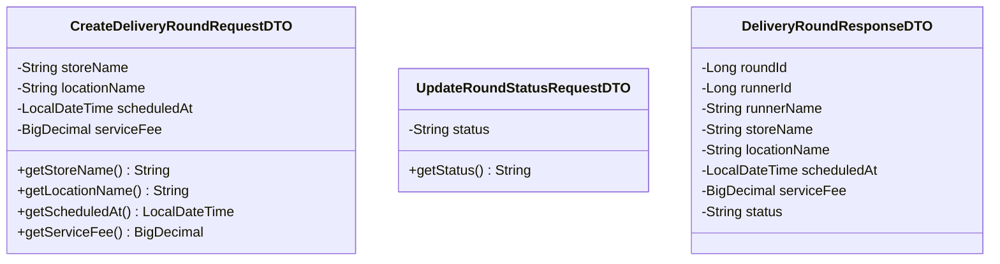
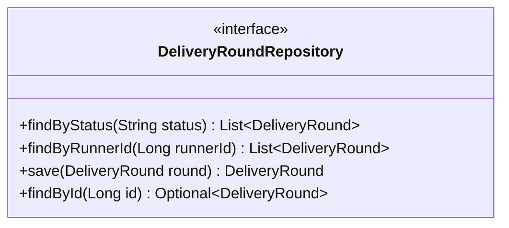

## 1. API Specification
 
### Endpoint 1: Create Delivery Round (สร้างรอบหิ้ว)
- **URL:** `/api/v1/delivery-rounds`
- **Method:** `POST`
- **Headers:** `Authorization: Bearer <JWT_TOKEN>` (RUNNER Only)
- **Content-Type:** `application/json`
- **Request Body:**
```json
{
  "storeName": "Starbucks - Central Plaza",
  "locationName": "อาคารเรียนรวมสังคมศาสตร์ (SC1) มธ.รังสิต",
  "scheduledAt": "2026-10-25T14:00:00",
  "serviceFee": 20.00
}
```
 
- **Response (201 Created):**
```json
{
  "status": "SUCCESS",
  "message": "Delivery round created successfully",
  "data": {
    "roundId": 101,
    "runnerId": 1,
    "runnerName": "Naphat Thongkao",
    "storeName": "Starbucks - Central Plaza",
    "locationName": "อาคารเรียนรวมสังคมศาสตร์ (SC1) มธ.รังสิต",
    "scheduledAt": "2026-10-25T14:00:00",
    "serviceFee": 20.00,
    "status": "OPEN"
  }
}
```
 
### Endpoint 2: Get Active Delivery Rounds (ดึงรายการรอบหิ้วที่เปิดอยู่)
- **URL:** `/api/v1/delivery-rounds?status=OPEN`
- **Method:** `GET`
- **Response (200 OK):**
```json
{
  "status": "SUCCESS",
  "data": [
    {
      "roundId": 101,
      "runnerId": 1,
      "runnerName": "Naphat Thongkao",
      "storeName": "Starbucks - Central Plaza",
      "locationName": "อาคารเรียนรวมสังคมศาสตร์ (SC1) มธ.รังสิต",
      "scheduledAt": "2026-10-25T14:00:00",
      "serviceFee": 20.00,
      "status": "OPEN"
    }
  ]
}
```
 
### Endpoint 3: Update Delivery Round Status (อัปเดตสถานะรอบหิ้ว)
- **URL:** `/api/v1/delivery-rounds/{roundId}/status`
- **Method:** `PATCH`
- **Headers:** `Authorization: Bearer <JWT_TOKEN>` (RUNNER Owner Only)
- **Content-Type:** `application/json`
- **Request Body:**
```json
{
  "status": "CLOSED"
}
```
- **Response (200 OK):**
```json
{
  "status": "SUCCESS",
  "message": "Delivery round status updated successfully",
  "data": {
    "roundId": 101,
    "status": "CLOSED"
  }
}
```
 
---
 
## 2. DTO Class Specification & Diagram
### DTO Specifications
1. **`CreateDeliveryRoundRequestDTO`**
   - `storeName`: String (Not Null)
   - `locationName`: String (Not Null)
   - `scheduledAt`: LocalDateTime (Not Null)
   - `serviceFee`: BigDecimal (Not Null, Min 0.00)
2. **`UpdateRoundStatusRequestDTO`**
   - `status`: String (Not Null, Choices: `"OPEN"`, `"CLOSED"`, `"COMPLETED"`, `"CANCELLED"`)
3. **`DeliveryRoundResponseDTO`**
   - `roundId`: Long
   - `runnerId`: Long
   - `runnerName`: String
   - `storeName`: String
   - `locationName`: String
   - `scheduledAt`: LocalDateTime
   - `serviceFee`: BigDecimal
   - `status`: String
### DTO Class Diagram

 
---
 
## 3. DAO / Repository Specification & Diagram
- **Interface:** `DeliveryRoundRepository` (extends `JpaRepository<DeliveryRound, Long>`)
- **Methods:**
  - `List<DeliveryRound> findByStatus(String status)` - ดึงรอบหิ้วตามสถานะ (เช่น `OPEN`)
  - `List<DeliveryRound> findByRunnerId(Long runnerId)` - ดึงประวัติรอบหิ้วของ Runner คนนั้นๆ
  - `DeliveryRound save(DeliveryRound round)` - บันทึกข้อมูลรอบหิ้ว
  - `Optional<DeliveryRound> findById(Long id)` - ค้นหารอบหิ้วด้วย ID
