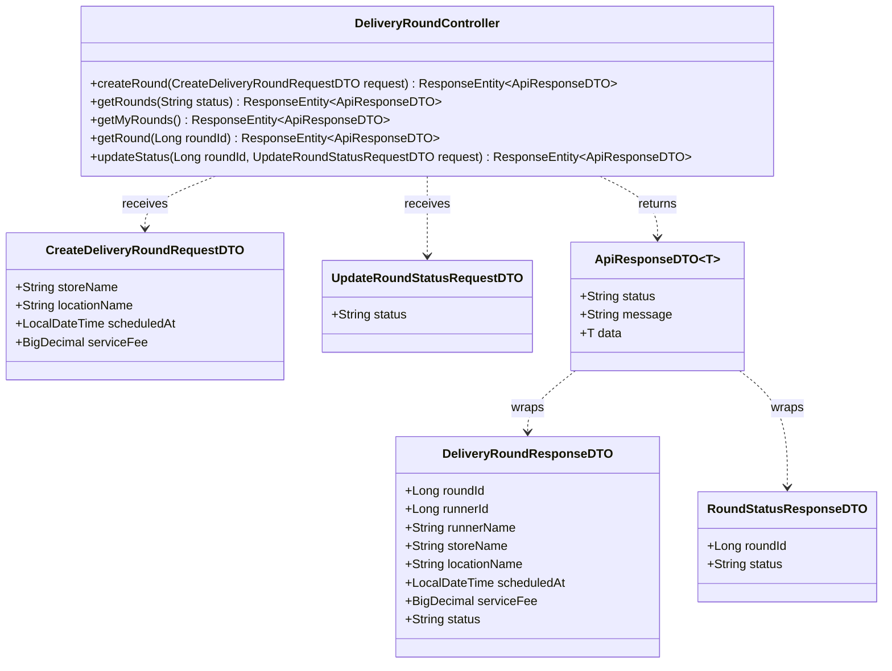
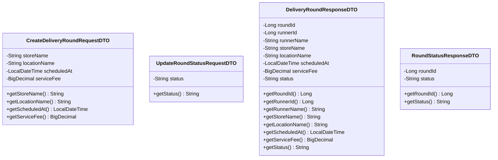
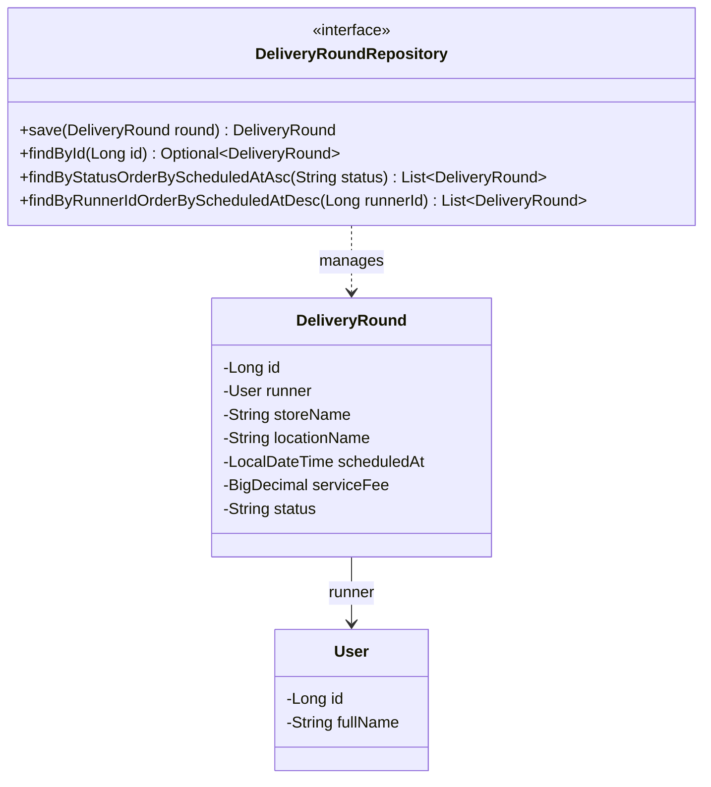
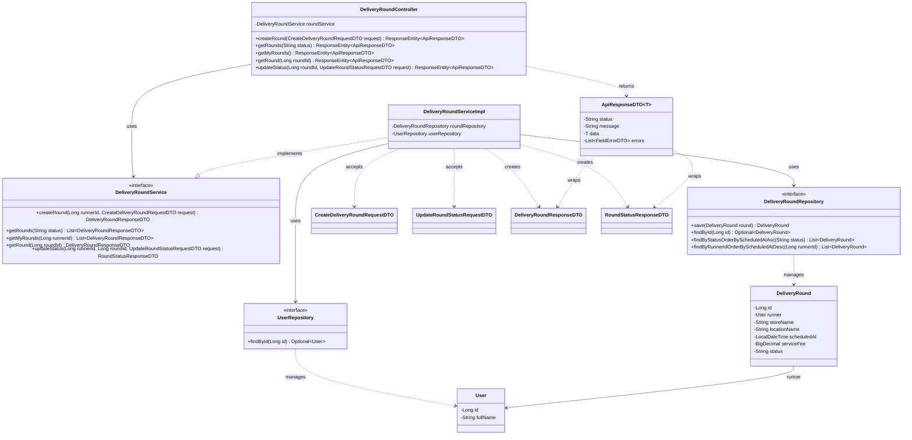

# Task08: US01 - เปิดรอบรับหิ้ว (API, API Class Diagram, DTO, DAO)

> ใช้ร่วมกับ [API Conventions](../common/API-CONVENTIONS.md) (รูปแบบ response, JWT, enum) และ [ERD](../database/ERD.md) (ตาราง `USERS`, `DELIVERY_ROUNDS`)

## 0. เงื่อนไขจาก User Story ที่ API ต้องรองรับ

| Test case ใน US01 | สิ่งที่ API ต้องทำ | Response |
|---|---|---|
| 1. ผู้รับหิ้วกรอกร้าน/สถานที่ วันเวลา และค่าหิ้วครบ ระบบเปิดรอบได้ | สร้างรอบสถานะ `OPEN` | `201 Created` |
| 2. กรอกร้าน/สถานที่ วันเวลา หรือค่าหิ้วไม่ครบ ระบบไม่อนุญาตให้เปิดรอบ | ไม่บันทึก และบอกว่าช่องไหนขาด | `400 Bad Request` |
| So that: ผู้ฝากหิ้วค้นหาและเข้าร่วมรอบที่ต้องการได้ | ให้ดูรายการรอบที่เปิดอยู่และดูรายละเอียดรอบ | Endpoint 2 และ 4 |

---

## 1. API Specification

### Endpoint 1: Create Delivery Round (สร้างรอบหิ้ว)
- **URL:** `/api/v1/delivery-rounds`
- **Method:** `POST`
- **Headers:** `Authorization: Bearer <JWT_TOKEN>` (ต้องเข้าสู่ระบบ ผู้ใช้ทุกคนเปิดรอบได้)
- **Content-Type:** `application/json`
- **Request Body:**
```json
{
  "storeName": "Starbucks - Central Plaza",
  "locationName": "อาคารเรียนรวมสังคมศาสตร์ (SC1) มธ.รังสิต",
  "scheduledAt": "2026-10-25T14:00:00",
  "serviceFee": 20.00
}
```
*(หมายเหตุ: ส่งทั้ง 4 field ตามตัวอย่าง ไม่ต้องส่ง `runnerId`; ระบบอ่านผู้รับหิ้วจาก JWT และรอบที่สร้างใหม่มีสถานะ `OPEN` เสมอ)*

**กติกาตรวจข้อมูล**

| Field | กติกา | ตัวอย่าง message |
|---|---|---|
| `storeName` | ห้ามว่าง | `must not be blank` |
| `locationName` | ห้ามว่าง | `must not be blank` |
| `scheduledAt` | ห้ามว่าง และต้องเป็นเวลาในอนาคต | `must not be null` / `must be a future date` |
| `serviceFee` | ห้ามว่าง และต้อง ≥ 0.00 | `must not be null` / `must be greater than or equal to 0.00` |

- **Response (201 Created):**
```json
{
  "status": "SUCCESS",
  "message": "Delivery round created successfully",
  "data": {
    "roundId": 101,
    "runnerId": 1,
    "runnerName": "Naphat Thongkao",
    "storeName": "Starbucks - Central Plaza",
    "locationName": "อาคารเรียนรวมสังคมศาสตร์ (SC1) มธ.รังสิต",
    "scheduledAt": "2026-10-25T14:00:00",
    "serviceFee": 20.00,
    "status": "OPEN"
  }
}
```

**Error Responses**

| HTTP Status | เงื่อนไข | ตัวอย่าง message |
|---|---|---|
| `400 Bad Request` | ข้อมูลไม่ครบหรือไม่ถูกต้อง (ไม่บันทึกรอบ) | `Validation failed` พร้อม `errors` ระบุ field |
| `401 Unauthorized` | ไม่ส่ง token หรือ token ไม่ถูกต้อง | `Invalid or missing token` |

ตัวอย่าง `400`:
```json
{
  "status": "ERROR",
  "message": "Validation failed",
  "errors": [
    { "field": "storeName", "message": "must not be blank" },
    { "field": "serviceFee", "message": "must not be null" }
  ]
}
```

### Endpoint 2: Get Delivery Rounds (ดึงรายการรอบหิ้ว)
- **URL:** `/api/v1/delivery-rounds?status=OPEN`
- **Method:** `GET`
- **Headers:** ไม่ต้องใช้ token (Guest ดูได้)
- **Query Parameter:** `status` (ไม่บังคับ) ค่าที่ใช้ได้คือ `OPEN`, `CLOSED`, `COMPLETED`, `CANCELLED` ถ้าไม่ส่งมาจะได้เฉพาะรอบ `OPEN`
- **การเรียงลำดับ:** `scheduledAt` จากใกล้ที่สุดไปไกลที่สุด
- **Response (200 OK):**
```json
{
  "status": "SUCCESS",
  "data": [
    {
      "roundId": 101,
      "runnerId": 1,
      "runnerName": "Naphat Thongkao",
      "storeName": "Starbucks - Central Plaza",
      "locationName": "อาคารเรียนรวมสังคมศาสตร์ (SC1) มธ.รังสิต",
      "scheduledAt": "2026-10-25T14:00:00",
      "serviceFee": 20.00,
      "status": "OPEN"
    }
  ]
}
```
- **Error:** `400` เมื่อ `status` ไม่อยู่ในค่าที่กำหนด

### Endpoint 3: Get My Delivery Rounds (ประวัติรอบหิ้วของฉัน)
- **URL:** `/api/v1/delivery-rounds/my`
- **Method:** `GET`
- **Headers:** `Authorization: Bearer <JWT_TOKEN>` (ต้องเข้าสู่ระบบ)
- **ผลลัพธ์:** ทุกรอบของผู้รับหิ้วที่ล็อกอินอยู่ ทุกสถานะ เรียงจาก `scheduledAt` ล่าสุดไปเก่าสุด
- **Response (200 OK):** รูปแบบ `data` เป็น array ของรอบเหมือน Endpoint 2
- **Error:** `401` เมื่อไม่มี token

### Endpoint 4: Get Delivery Round Detail (รายละเอียดรอบหิ้ว)
- **URL:** `/api/v1/delivery-rounds/{roundId}`
- **Method:** `GET`
- **Headers:** ไม่ต้องใช้ token (Guest ดูได้)
- **Response (200 OK):** `data` เป็นรอบเดียว รูปแบบเหมือนใน Endpoint 1
- **Error:** `404` (`Delivery round not found`) เมื่อไม่พบรอบ

### Endpoint 5: Update Delivery Round Status (อัปเดตสถานะรอบหิ้ว)
- **URL:** `/api/v1/delivery-rounds/{roundId}/status`
- **Method:** `PATCH`
- **Headers:** `Authorization: Bearer <JWT_TOKEN>` (เจ้าของรอบเท่านั้น)
- **Content-Type:** `application/json`
- **Request Body:**
```json
{
  "status": "CLOSED"
}
```
- **Response (200 OK):**
```json
{
  "status": "SUCCESS",
  "message": "Delivery round status updated successfully",
  "data": {
    "roundId": 101,
    "status": "CLOSED"
  }
}
```

**การเปลี่ยนสถานะที่อนุญาต**

| จาก | เปลี่ยนเป็นได้ |
|---|---|
| `OPEN` | `CLOSED`, `CANCELLED` |
| `CLOSED` | `COMPLETED`, `CANCELLED` |
| `COMPLETED` | เปลี่ยนไม่ได้ |
| `CANCELLED` | เปลี่ยนไม่ได้ |

**Error Responses**

| HTTP Status | เงื่อนไข | ตัวอย่าง message |
|---|---|---|
| `400 Bad Request` | `status` ว่างหรือไม่อยู่ในค่าที่กำหนด | `Validation failed` |
| `401 Unauthorized` | ไม่ส่ง token หรือ token ไม่ถูกต้อง | `Invalid or missing token` |
| `403 Forbidden` | ไม่ใช่เจ้าของรอบนี้ | `You are not the owner of this delivery round` |
| `404 Not Found` | ไม่พบรอบตาม `roundId` | `Delivery round not found` |
| `409 Conflict` | เปลี่ยนสถานะไม่ตรงตามตารางด้านบน | `Cannot change status from COMPLETED to OPEN` |

### หน้าเว็บที่เชื่อมต่อ API
- `rounds.html` เรียก Endpoint 2 และค้นหา/กรองข้อมูลที่โหลดแล้ว
- `round-detail.html?roundId=...` เรียก Endpoint 4
- `create-round.html` เรียก Endpoint 1 โดยส่ง JWT และข้อมูล 4 field ตามสัญญา
- ส่วน “รอบรับหิ้วของฉัน” ใน `orders.html` เรียก Endpoint 3
- `my-round-detailod.html?roundId=...` แสดงรายละเอียดและเรียก Endpoint 5 สำหรับเปลี่ยนสถานะตาม transition ที่อนุญาต

---

## 2. API Class Diagram


---

## 3. DTO Class Specification & Diagram

`ApiResponseDTO<T>` และ `FieldErrorDTO` ใช้ร่วมกันทุก task ดูที่ [API Conventions](../common/API-CONVENTIONS.md)

### DTO Specifications
1. **`CreateDeliveryRoundRequestDTO`**
   - `storeName`: String (Not Blank)
   - `locationName`: String (Not Blank)
   - `scheduledAt`: LocalDateTime (Not Null, Future)
   - `serviceFee`: BigDecimal (Not Null, Min 0.00)
2. **`UpdateRoundStatusRequestDTO`**
   - `status`: String (Not Blank, Choices: `"OPEN"`, `"CLOSED"`, `"COMPLETED"`, `"CANCELLED"`)
3. **`DeliveryRoundResponseDTO`**
   - `roundId`: Long
   - `runnerId`: Long
   - `runnerName`: String (ดึงจาก `USERS.full_name` ของผู้รับหิ้ว)
   - `storeName`: String
   - `locationName`: String
   - `scheduledAt`: LocalDateTime
   - `serviceFee`: BigDecimal
   - `status`: String
4. **`RoundStatusResponseDTO`** (ตอบกลับหลังเปลี่ยนสถานะ)
   - `roundId`: Long
   - `status`: String

### DTO Class Diagram


---

## 4. DAO / Repository Specification & Diagram

### Entity `DeliveryRound` (ตาราง `delivery_rounds`)

| Field | Column ใน ERD | หมายเหตุ |
|---|---|---|
| `id` | `id` | PK |
| `runner` (`User`) | `runner_id` | FK → `USERS.id` (ใช้ `@ManyToOne`) |
| `storeName` | `store_name` | ต้อง NOT NULL ตรงกับ Test case 2 |
| `locationName` | `location_name` | ต้อง NOT NULL ตรงกับ Test case 2 |
| `scheduledAt` | `scheduled_at` | NOT NULL |
| `serviceFee` | `service_fee` | NOT NULL, >= 0 |
| `status` | `status` | NOT NULL |

> ใน ERD ตอนนี้ `store_name` และ `location_name` ยังไม่ได้ระบุ NOT NULL ควรเพิ่มให้ตรงกับกติกาตรวจข้อมูลด้านบน

### Repository
- **Interface:** `DeliveryRoundRepository` (extends `JpaRepository<DeliveryRound, Long>`)
- **Methods:**
  - `DeliveryRound save(DeliveryRound round)` - บันทึกรอบใหม่และอัปเดตสถานะ
  - `Optional<DeliveryRound> findById(Long id)` - ค้นหารอบด้วย id (Endpoint 4, 5)
  - `List<DeliveryRound> findByStatusOrderByScheduledAtAsc(String status)` - รอบตามสถานะ เรียงใกล้ไปไกล (Endpoint 2)
  - `List<DeliveryRound> findByRunnerIdOrderByScheduledAtDesc(Long runnerId)` - ประวัติรอบของผู้รับหิ้ว (Endpoint 3)
- **ใช้ร่วมกับ Task04:** `UserRepository.findById` ดึง `User` ผู้รับหิ้วจาก `userId` ใน JWT ก่อนบันทึกรอบ



---

## 5. Extended API Class Diagram (Full Layered Architecture)

Controller เรียก Service, Service ใช้ Repository และ `UserRepository` (Task04) ผู้รับหิ้วมาจาก JWT



## Sequence Diagrams

```mermaid
sequenceDiagram
    autonumber
    actor Runner as User / Guest
    participant Ctrl as DeliveryRoundController<br/>(/api/v1/delivery-rounds)
    participant Svc as DeliveryRoundServiceImpl
    participant UserRepo as UserRepository
    participant RoundRepo as DeliveryRoundRepository
    participant DB as PostgreSQL Database (DELIVERY_ROUNDS)

    %% ==========================================
    %% 1. Endpoint 1: POST /api/v1/delivery-rounds (Create Delivery Round)
    %% ==========================================
    rect rgb(240, 255, 240)
    note over Runner, DB: 1. Endpoint 1: Create Delivery Round (POST /api/v1/delivery-rounds)
    Runner->>Ctrl: POST /api/v1/delivery-rounds (CreateDeliveryRoundRequestDTO)
    activate Ctrl
    note right of Runner: Header: Bearer <JWT_TOKEN> (ผู้ใช้ทุกคนเปิดรอบได้)<br/>Body: storeName, locationName, scheduledAt, serviceFee

    alt Missing/Invalid Token
        Ctrl-->>Runner: 401 Unauthorized (Invalid or missing token)
    else Validation Failed (Blank store/location, scheduledAt in past, serviceFee < 0)
        Ctrl-->>Runner: 400 Bad Request (ApiResponseDTO with FieldErrorDTO)
    else Authorization & Validation Passed
        Ctrl->>Svc: createRound(runnerId, requestDTO)
        activate Svc

        Svc->>UserRepo: findById(runnerId)
        activate UserRepo
        UserRepo->>DB: SELECT * FROM USERS WHERE id = runnerId
        activate DB
        DB-->>UserRepo: User Entity (Runner)
        deactivate DB
        UserRepo-->>Svc: Optional<User>
        deactivate UserRepo

        Svc->>Svc: Construct DeliveryRound entity (status = 'OPEN')
        Svc->>RoundRepo: save(deliveryRound)
        activate RoundRepo
        RoundRepo->>DB: INSERT INTO DELIVERY_ROUNDS (runner_id, store_name, location_name, scheduled_at, service_fee, status) VALUES (...)
        activate DB
        DB-->>RoundRepo: Saved DeliveryRound (with generated roundId)
        deactivate DB
        RoundRepo-->>Svc: DeliveryRound Entity
        deactivate RoundRepo

        Svc-->>Ctrl: DeliveryRoundResponseDTO
        deactivate Svc
        Ctrl-->>Runner: 201 Created<br/>ApiResponseDTO(status="SUCCESS", message="Delivery round created successfully", data=DeliveryRoundResponseDTO)
        deactivate Ctrl
    end
    end

    %% ==========================================
    %% 2. Endpoint 2: GET /api/v1/delivery-rounds (Get Delivery Rounds)
    %% ==========================================
    rect rgb(240, 248, 255)
    note over Runner, DB: 2. Endpoint 2: Get Delivery Rounds (GET /api/v1/delivery-rounds?status=OPEN)
    Runner->>Ctrl: GET /api/v1/delivery-rounds?status={status}
    activate Ctrl
    note right of Runner: Header: ไม่ต้องใช้ Token (Guest ดูได้)<br/>Query Param: status (Default 'OPEN')

    alt Invalid status parameter
        Ctrl-->>Runner: 400 Bad Request
    else Status Valid
        Ctrl->>Svc: getRounds(status)
        activate Svc
        Svc->>RoundRepo: findByStatusOrderByScheduledAtAsc(status)
        activate RoundRepo
        RoundRepo->>DB: SELECT * FROM DELIVERY_ROUNDS WHERE status = ? ORDER BY scheduled_at ASC
        activate DB
        DB-->>RoundRepo: List<DeliveryRound>
        deactivate DB
        RoundRepo-->>Svc: List<DeliveryRound>
        deactivate RoundRepo

        Svc-->>Ctrl: List<DeliveryRoundResponseDTO>
        deactivate Svc
        Ctrl-->>Runner: 200 OK<br/>ApiResponseDTO(status="SUCCESS", data=List<DeliveryRoundResponseDTO>)
        deactivate Ctrl
    end
    end

    %% ==========================================
    %% 3. Endpoint 3: GET /api/v1/delivery-rounds/my (Get My Delivery Rounds)
    %% ==========================================
    rect rgb(255, 250, 240)
    note over Runner, DB: 3. Endpoint 3: Get My Delivery Rounds (GET /api/v1/delivery-rounds/my)
    Runner->>Ctrl: GET /api/v1/delivery-rounds/my
    activate Ctrl
    note right of Runner: Header: Bearer <JWT_TOKEN> (ต้องล็อกอิน)

    alt Missing/Invalid Token
        Ctrl-->>Runner: 401 Unauthorized
    else Authorized
        Ctrl->>Svc: getMyRounds(runnerId)
        activate Svc
        Svc->>RoundRepo: findByRunnerIdOrderByScheduledAtDesc(runnerId)
        activate RoundRepo
        RoundRepo->>DB: SELECT * FROM DELIVERY_ROUNDS WHERE runner_id = ? ORDER BY scheduled_at DESC
        activate DB
        DB-->>RoundRepo: List<DeliveryRound>
        deactivate DB
        RoundRepo-->>Svc: List<DeliveryRound>
        deactivate RoundRepo

        Svc-->>Ctrl: List<DeliveryRoundResponseDTO>
        deactivate Svc
        Ctrl-->>Runner: 200 OK<br/>ApiResponseDTO(status="SUCCESS", data=List<DeliveryRoundResponseDTO>)
        deactivate Ctrl
    end
    end

    %% ==========================================
    %% 4. Endpoint 4: GET /api/v1/delivery-rounds/{roundId} (Get Delivery Round Detail)
    %% ==========================================
    rect rgb(245, 245, 245)
    note over Runner, DB: 4. Endpoint 4: Get Delivery Round Detail (GET /api/v1/delivery-rounds/{roundId})
    Runner->>Ctrl: GET /api/v1/delivery-rounds/{roundId}
    activate Ctrl
    note right of Runner: Header: ไม่ต้องใช้ Token (Guest ดูได้)

    Ctrl->>Svc: getRound(roundId)
    activate Svc
    Svc->>RoundRepo: findById(roundId)
    activate RoundRepo
    RoundRepo->>DB: SELECT * FROM DELIVERY_ROUNDS WHERE id = roundId
    activate DB
    DB-->>RoundRepo: DeliveryRound Entity / null
    deactivate DB
    RoundRepo-->>Svc: Optional<DeliveryRound>
    deactivate RoundRepo

    alt Delivery Round Not Found
        Svc-->>Ctrl: throw ResourceNotFoundException
        Ctrl-->>Runner: 404 Not Found (Delivery round not found)
    else Found
        Svc-->>Ctrl: DeliveryRoundResponseDTO
        deactivate Svc
        Ctrl-->>Runner: 200 OK<br/>ApiResponseDTO(status="SUCCESS", data=DeliveryRoundResponseDTO)
        deactivate Ctrl
    end
    end

    %% ==========================================
    %% 5. Endpoint 5: PATCH /api/v1/delivery-rounds/{roundId}/status (Update Delivery Round Status)
    %% ==========================================
    rect rgb(255, 240, 245)
    note over Runner, DB: 5. Endpoint 5: Update Delivery Round Status (PATCH /api/v1/delivery-rounds/{roundId}/status)
    Runner->>Ctrl: PATCH /api/v1/delivery-rounds/{roundId}/status (UpdateRoundStatusRequestDTO)
    activate Ctrl
    note right of Runner: Header: Bearer <JWT_TOKEN> (เจ้าของรอบเท่านั้น)<br/>Body: status ('CLOSED', 'COMPLETED', 'CANCELLED')

    alt Missing/Invalid Token
        Ctrl-->>Runner: 401 Unauthorized
    else Validation Failed (status is blank or invalid value)
        Ctrl-->>Runner: 400 Bad Request
    else Basic Validation Passed
        Ctrl->>Svc: updateStatus(runnerId, roundId, requestDTO)
        activate Svc

        Svc->>RoundRepo: findById(roundId)
        activate RoundRepo
        RoundRepo->>DB: SELECT * FROM DELIVERY_ROUNDS WHERE id = roundId
        activate DB
        DB-->>RoundRepo: DeliveryRound Entity / null
        deactivate DB
        RoundRepo-->>Svc: Optional<DeliveryRound>
        deactivate RoundRepo

        alt Delivery Round Not Found
            Svc-->>Ctrl: throw ResourceNotFoundException
            Ctrl-->>Runner: 404 Not Found (Delivery round not found)
        else User is NOT the owner of this delivery round
            Svc-->>Ctrl: throw AccessDeniedException
            Ctrl-->>Runner: 403 Forbidden (You are not the owner of this delivery round)
        else Invalid Status Transition (e.g., COMPLETED -> OPEN)
            Svc-->>Ctrl: throw IllegalStateException
            Ctrl-->>Runner: 409 Conflict (Cannot change status from current state)
        else Valid Transition
            Svc->>Svc: Update deliveryRound.status = newStatus
            Svc->>RoundRepo: save(deliveryRound)
            activate RoundRepo
            RoundRepo->>DB: UPDATE DELIVERY_ROUNDS SET status = ? WHERE id = ?
            activate DB
            DB-->>RoundRepo: Updated DeliveryRound
            deactivate DB
            RoundRepo-->>Svc: DeliveryRound Entity
            deactivate RoundRepo

            Svc-->>Ctrl: RoundStatusResponseDTO
            deactivate Svc
            Ctrl-->>Runner: 200 OK<br/>ApiResponseDTO(status="SUCCESS", message="Delivery round status updated successfully", data=RoundStatusResponseDTO)
            deactivate Ctrl
        end
    end
    end