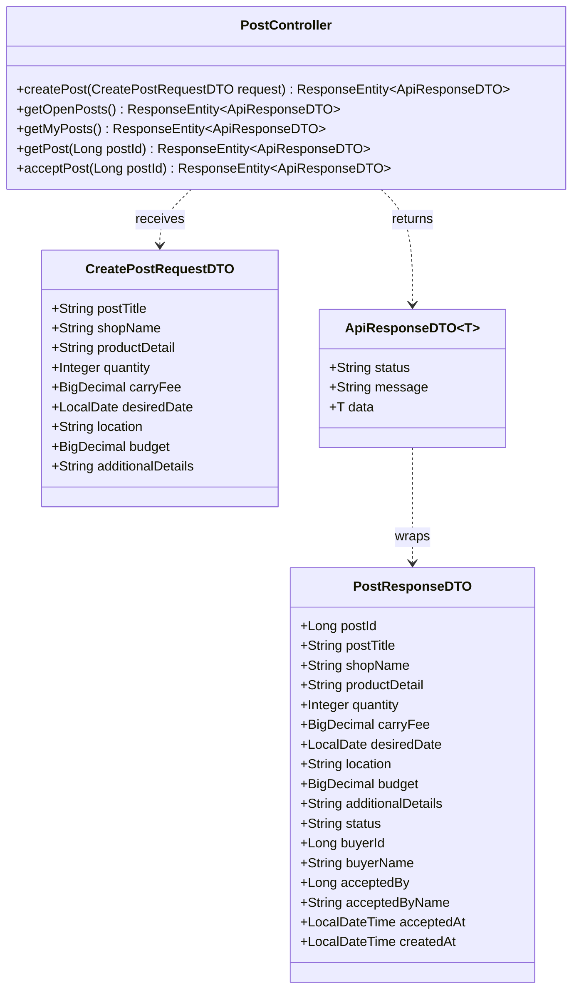
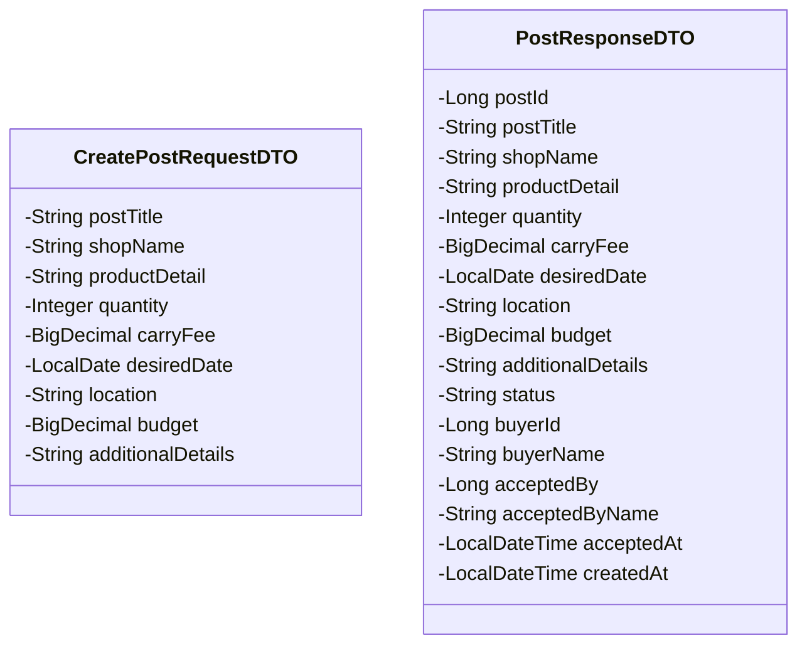
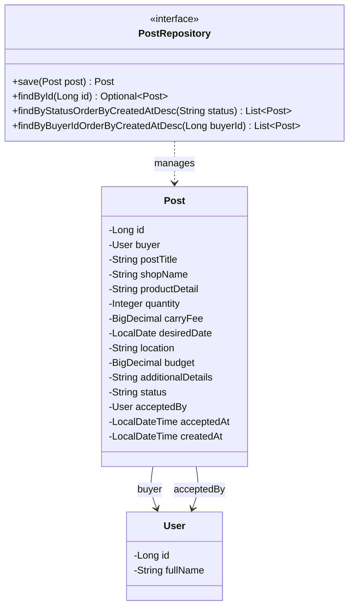
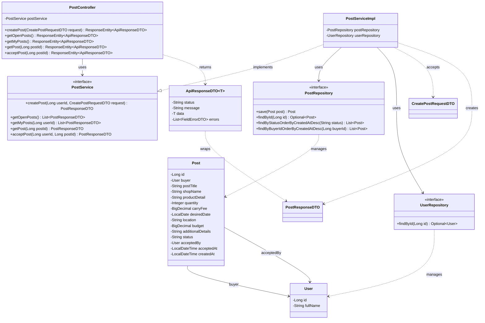

# Task12: US12 - ผู้ฝากหิ้วโพสต์หาคนรับหิ้ว (API, API Class Diagram, DTO, DAO)

> ใช้ร่วมกับ [API Conventions](../common/API-CONVENTIONS.md) และ [ERD](../database/ERD.md) / [schema.sql](../database/schema.sql) (ตาราง `POSTS`)
> โพสต์เป็นช่องทางแยกจากรอบหิ้ว (Task08) ผู้ใช้โพสต์ได้โดยไม่ต้องรอใครเปิดรอบ และผู้ใช้คนอื่นกด "รับงาน" ได้
> ฟิลด์ของโพสต์อ้างอิงตามหน้า `create-buyer-post` ของ UI และตาราง `posts` ใน `docs/database/schema.sql`

## 0. เงื่อนไขจาก User Story ที่ API ต้องรองรับ

| Test case ใน US12 | สิ่งที่ API ต้องทำ | Response |
|---|---|---|
| 1. กรอกรายละเอียดสินค้า ร้านค้า สถานที่ และรายละเอียดการรับสินค้าครบ สร้างโพสต์สำเร็จและผู้รับหิ้วมองเห็นโพสต์เพื่อเลือกติดต่อรับงาน | สร้างโพสต์สถานะ `OPEN` มี endpoint ให้ทุกคนดูโพสต์ และให้ผู้ใช้ที่เข้าสู่ระบบกดรับงานได้ | `201 Created` / Endpoint 2 / Endpoint 5 |
| 2. กรอกข้อมูลที่จำเป็นไม่ครบ ระบบแจ้งเตือนและไม่อนุญาตให้โพสต์ | ไม่บันทึก และบอกว่าช่องไหนขาด | `400 Bad Request` |

**กติกาสิทธิ์:** ไม่มี role ผู้ใช้ทุกคนโพสต์และรับงานได้ Guest (ยังไม่เข้าสู่ระบบ) ดูโพสต์ได้อย่างเดียว

> **หมายเหตุเรื่องรูปสินค้า:** หน้า `create-buyer-post` มีช่องอัปโหลดรูปสินค้า แต่ตาราง `posts` ยังไม่มี column เก็บรูป Sprint 1 จึงยังไม่รับรูปในโพสต์ ถ้าต้องการให้เก็บรูปต้องเพิ่ม column ในตารางก่อน แล้วค่อยเพิ่ม field ใน API

---

## 1. API Specification

### Endpoint 1: Create Post (โพสต์หาคนรับหิ้ว)
- **URL:** `/api/v1/posts`
- **Method:** `POST`
- **Headers:** `Authorization: Bearer <JWT_TOKEN>` (ต้องเข้าสู่ระบบ)
- **Content-Type:** `application/json`
- **Request Body:**
```json
{
  "postTitle": "ฝากซื้อชานมไข่มุก",
  "shopName": "ร้านชานมหน้าประตูทางเข้า",
  "productDetail": "ชานมไข่มุก หวานน้อย",
  "quantity": 2,
  "carryFee": 20.00,
  "desiredDate": "2026-10-25",
  "location": "ตึกวิศวกรรมศาสตร์ มธ.รังสิต",
  "budget": 120.00,
  "additionalDetails": "รับของช่วงเที่ยง"
}
```
*(หมายเหตุ: `buyerId` ไม่ต้องส่ง ระบบอ่านจาก JWT ส่วน `budget` และ `additionalDetails` ไม่บังคับ)*

**กติกาตรวจข้อมูล**

| Field | กติกา | ตัวอย่าง message |
|---|---|---|
| `postTitle` | ห้ามว่าง ไม่เกิน 255 ตัวอักษร | `must not be blank` |
| `shopName` | ห้ามว่าง ไม่เกิน 255 ตัวอักษร | `must not be blank` |
| `productDetail` | ห้ามว่าง | `must not be blank` |
| `quantity` | ห้ามว่าง และต้อง ≥ 1 | `must not be null` / `must be greater than or equal to 1` |
| `carryFee` | ห้ามว่าง และต้อง ≥ 0.00 | `must not be null` / `must be greater than or equal to 0.00` |
| `desiredDate` | ห้ามว่าง และต้องเป็นวันนี้หรืออนาคต (`yyyy-MM-dd`) | `must not be null` / `must be today or a future date` |
| `location` | ห้ามว่าง ไม่เกิน 255 ตัวอักษร | `must not be blank` |
| `budget` | ไม่บังคับ ถ้าส่งต้อง ≥ 0.00 | `must be greater than or equal to 0.00` |
| `additionalDetails` | ไม่บังคับ | - |

- **Response (201 Created):**
```json
{
  "status": "SUCCESS",
  "message": "Post created successfully",
  "data": {
    "postId": 1,
    "postTitle": "ฝากซื้อชานมไข่มุก",
    "shopName": "ร้านชานมหน้าประตูทางเข้า",
    "productDetail": "ชานมไข่มุก หวานน้อย",
    "quantity": 2,
    "carryFee": 20.00,
    "desiredDate": "2026-10-25",
    "location": "ตึกวิศวกรรมศาสตร์ มธ.รังสิต",
    "budget": 120.00,
    "additionalDetails": "รับของช่วงเที่ยง",
    "status": "OPEN",
    "buyerId": 2,
    "buyerName": "Somchai Jaidee",
    "acceptedBy": null,
    "acceptedByName": null,
    "acceptedAt": null,
    "createdAt": "2026-10-15T20:00:00"
  }
}
```

| HTTP Status | เงื่อนไข | ตัวอย่าง message |
|---|---|---|
| `400 Bad Request` | ข้อมูลไม่ครบหรือไม่ถูกรูปแบบ (ไม่บันทึกโพสต์) | `Validation failed` พร้อม `errors` |
| `401 Unauthorized` | ไม่มี token หรือ token ไม่ถูกต้อง | `Invalid or missing token` |

ตัวอย่าง `400`:
```json
{
  "status": "ERROR",
  "message": "Validation failed",
  "errors": [
    { "field": "postTitle", "message": "must not be blank" },
    { "field": "location", "message": "must not be blank" }
  ]
}
```

### Endpoint 2: Get Open Posts (ดูโพสต์ที่ยังเปิดอยู่)
- **URL:** `/api/v1/posts`
- **Method:** `GET`
- **Headers:** ไม่ต้องใช้ token (Guest ดูได้)
- **Response (200 OK):** โพสต์สถานะ `OPEN` ทั้งหมด เรียงใหม่สุดก่อน `data` เป็น array ของ `PostResponseDTO` (รูปแบบเดียวกับ `data` ของ Endpoint 1)

### Endpoint 3: Get My Posts (โพสต์ของฉัน)
- **URL:** `/api/v1/posts/my`
- **Method:** `GET`
- **Headers:** `Authorization: Bearer <JWT_TOKEN>` (ต้องเข้าสู่ระบบ)
- **Response (200 OK):** โพสต์ทุกสถานะของผู้ใช้ เรียงใหม่สุดก่อน
- **Error:** `401` เมื่อไม่มี token

### Endpoint 4: Get Post Detail (ดูรายละเอียดโพสต์)
- **URL:** `/api/v1/posts/{postId}`
- **Method:** `GET`
- **Headers:** ไม่ต้องใช้ token (Guest ดูได้)
- **Response (200 OK):** `data` เป็น `PostResponseDTO`
- **Error:** `404` (`Post not found`)

### Endpoint 5: Accept Post (กดรับงานโพสต์)
- **URL:** `/api/v1/posts/{postId}/accept`
- **Method:** `PATCH`
- **Headers:** `Authorization: Bearer <JWT_TOKEN>` (ต้องเข้าสู่ระบบ)
- **Request Body:** ไม่มี (ผู้รับงานอ่านจาก JWT)
- **สิ่งที่ระบบทำ:** เปลี่ยนสถานะโพสต์ `OPEN` เป็น `ACCEPTED` และบันทึก `accepted_by`, `accepted_at`
- **Response (200 OK):** `message` = `Post accepted successfully` และ `data` เป็น `PostResponseDTO` ที่ `status` = `ACCEPTED` พร้อม `acceptedBy`, `acceptedByName`, `acceptedAt`

| HTTP Status | เงื่อนไข | ตัวอย่าง message |
|---|---|---|
| `401 Unauthorized` | ไม่มี token | `Invalid or missing token` |
| `403 Forbidden` | รับโพสต์ของตัวเอง | `You cannot accept your own post` |
| `404 Not Found` | ไม่พบโพสต์ | `Post not found` |
| `409 Conflict` | โพสต์ไม่ใช่สถานะ `OPEN` (มีคนรับไปแล้ว) | `Post is no longer open` |

---

## 2. API Class Diagram


---

## 3. DTO Class Specification & Diagram

`ApiResponseDTO<T>` และ `FieldErrorDTO` ใช้ร่วมกันทุก task ดูที่ [API Conventions](../common/API-CONVENTIONS.md)

1. **`CreatePostRequestDTO`**
   - `postTitle`: String (Not Blank, Max 255)
   - `shopName`: String (Not Blank, Max 255)
   - `productDetail`: String (Not Blank)
   - `quantity`: Integer (Not Null, Min 1)
   - `carryFee`: BigDecimal (Not Null, Min 0.00)
   - `desiredDate`: LocalDate (Not Null, วันนี้หรืออนาคต)
   - `location`: String (Not Blank, Max 255)
   - `budget`: BigDecimal (ไม่บังคับ, Min 0.00)
   - `additionalDetails`: String (ไม่บังคับ)
2. **`PostResponseDTO`**
   - `postId`: Long
   - `postTitle`, `shopName`, `productDetail`, `location`: String
   - `quantity`: Integer
   - `carryFee`, `budget`: BigDecimal
   - `desiredDate`: LocalDate
   - `additionalDetails`: String
   - `status`: String (`OPEN` เมื่อสร้างใหม่, `ACCEPTED` เมื่อมีคนรับ)
   - `buyerId`: Long (เจ้าของโพสต์ จาก JWT)
   - `buyerName`: String (จาก `USERS.full_name`)
   - `acceptedBy`: Long (ว่างจนกว่าจะมีคนรับ)
   - `acceptedByName`: String (ว่างจนกว่าจะมีคนรับ)
   - `acceptedAt`: LocalDateTime (ว่างจนกว่าจะมีคนรับ)
   - `createdAt`: LocalDateTime



---

## 4. DAO / Repository Specification & Diagram

### Entity `Post` (ตาราง `posts`)

| Field | Column | หมายเหตุ |
|---|---|---|
| `id` | `id` | PK, auto increment |
| `buyer` (`User`) | `buyer_id` | FK → `USERS.id` (`@ManyToOne`), NOT NULL |
| `postTitle` | `post_title` | NOT NULL |
| `shopName` | `shop_name` | NOT NULL |
| `productDetail` | `product_detail` | NOT NULL (TEXT) |
| `quantity` | `quantity` | NOT NULL, > 0 |
| `carryFee` | `carry_fee` | NOT NULL, >= 0 |
| `desiredDate` | `desired_date` | NOT NULL |
| `location` | `location` | NOT NULL |
| `budget` | `budget` | ว่างได้ ถ้ามีต้อง >= 0 |
| `additionalDetails` | `additional_details` | ว่างได้ (TEXT) |
| `status` | `status` | NOT NULL, DEFAULT `OPEN` (Sprint 1 ใช้ `OPEN`, `ACCEPTED` ส่วน `COMPLETED`, `CANCELLED` มีใน schema สำหรับอนาคต) |
| `acceptedBy` (`User`) | `accepted_by` | FK → `USERS.id` (`@ManyToOne`), ว่างได้ ต้องไม่ใช่เจ้าของโพสต์ |
| `acceptedAt` | `accepted_at` | ว่างได้ ต้องมีค่าพร้อมกับ `accepted_by` |
| `createdAt` | `created_at` | NOT NULL, DEFAULT CURRENT_TIMESTAMP |

ความสัมพันธ์: `USERS` 1 ──< `POSTS` (เจ้าของโพสต์) และ `USERS` 0..1 ──< `POSTS` (ผู้รับงาน) ตรงกับ ERD กลาง

> **ER ต้องแก้ให้ตรง:** `ERD.md` ตาราง `POSTS` ยังเป็นฟิลด์ชุดเก่า (`product_detail`, `shop_name`, `location`, `receiving_detail`) ต้องปรับเป็นชุดเดียวกับตารางข้างบนและ `schema.sql` (เพิ่ม `post_title`, `quantity`, `carry_fee`, `desired_date`, `budget`, `additional_details` และเอา `receiving_detail` ออก)

### Repository
- **Interface:** `PostRepository` (extends `JpaRepository<Post, Long>`)
- **Methods:**
  - `Post save(Post post)` - สร้างโพสต์ (Endpoint 1) และบันทึกการรับงาน (Endpoint 5)
  - `List<Post> findByStatusOrderByCreatedAtDesc(String status)` - โพสต์ `OPEN` (Endpoint 2)
  - `List<Post> findByBuyerIdOrderByCreatedAtDesc(Long buyerId)` - โพสต์ของฉัน (Endpoint 3)
  - `Optional<Post> findById(Long id)` - รายละเอียด/รับงาน (Endpoint 4, 5)
- **ใช้ร่วมกับ Task04:** `UserRepository.findById` ดึงผู้ใช้จาก JWT



---

## 5. Extended API Class Diagram (Full Layered Architecture)

Controller เรียก Service, Service ใช้ `PostRepository` และ `UserRepository` (Task04) ผู้ใช้มาจาก JWT



## Sequence Diagrams

```mermaid
sequenceDiagram
    autonumber
    actor User as User (ผู้ใช้ทุกคน / Guest)
    participant Ctrl as PostController<br/>(/api/v1/posts)
    participant Svc as PostServiceImpl
    participant UserRepo as UserRepository
    participant PostRepo as PostRepository
    participant DB as PostgreSQL Database (posts)

    %% ==========================================
    %% 1. Endpoint 1: POST /api/v1/posts (Create Post)
    %% ==========================================
    rect rgb(240, 255, 240)
    note over User, DB: 1. Endpoint 1: Create Post (POST /api/v1/posts)
    User->>Ctrl: POST /api/v1/posts (CreatePostRequestDTO)
    activate Ctrl
    note right of User: Header: Bearer <JWT_TOKEN> (ต้องเข้าสู่ระบบ)<br/>Body: postTitle, shopName, productDetail, quantity, carryFee, desiredDate, location (+ budget, additionalDetails ไม่บังคับ)

    alt Missing/Invalid Token
        Ctrl-->>User: 401 Unauthorized (Invalid or missing token)
    else Validation Failed (Blank fields / Exceed length limits)
        Ctrl-->>User: 400 Bad Request (ApiResponseDTO with FieldErrorDTO)
    else Authorization & Validation Passed
        Ctrl->>Svc: createPost(buyerId, requestDTO)
        activate Svc

        Svc->>UserRepo: findById(buyerId)
        activate UserRepo
        UserRepo->>DB: SELECT * FROM USERS WHERE id = buyerId
        activate DB
        DB-->>UserRepo: User Entity (Buyer)
        deactivate DB
        UserRepo-->>Svc: Optional<User>
        deactivate UserRepo

        Svc->>Svc: Construct Post entity (status = 'OPEN', acceptedBy = null, acceptedAt = null)
        Svc->>PostRepo: save(post)
        activate PostRepo
        PostRepo->>DB: INSERT INTO posts (buyer_id, post_title, shop_name, product_detail, quantity, carry_fee, desired_date, location, budget, additional_details, status) VALUES (...)
        activate DB
        DB-->>PostRepo: Saved Post (with generated postId)
        deactivate DB
        PostRepo-->>Svc: Post Entity
        deactivate PostRepo

        Svc-->>Ctrl: PostResponseDTO
        deactivate Svc
        Ctrl-->>User: 201 Created<br/>ApiResponseDTO(status="SUCCESS", message="Post created successfully", data=PostResponseDTO)
        deactivate Ctrl
    end
    end

    %% ==========================================
    %% 2. Endpoint 2: GET /api/v1/posts (Get Open Posts)
    %% ==========================================
    rect rgb(240, 248, 255)
    note over User, DB: 2. Endpoint 2: Get Open Posts (GET /api/v1/posts)
    User->>Ctrl: GET /api/v1/posts
    activate Ctrl
    note right of User: Header: ไม่ต้องใช้ Token (Guest ดูได้)

    Ctrl->>Svc: getOpenPosts()
    activate Svc
    Svc->>PostRepo: findByStatusOrderByCreatedAtDesc("OPEN")
    activate PostRepo
    PostRepo->>DB: SELECT * FROM posts WHERE status = 'OPEN' ORDER BY created_at DESC
    activate DB
    DB-->>PostRepo: List<Post>
    deactivate DB
    PostRepo-->>Svc: List<Post>
    deactivate PostRepo

    Svc-->>Ctrl: List<PostResponseDTO>
    deactivate Svc
    Ctrl-->>User: 200 OK<br/>ApiResponseDTO(status="SUCCESS", data=List<PostResponseDTO>)
    deactivate Ctrl
    end

    %% ==========================================
    %% 3. Endpoint 3: GET /api/v1/posts/my (Get My Posts)
    %% ==========================================
    rect rgb(255, 250, 240)
    note over User, DB: 3. Endpoint 3: Get My Posts (GET /api/v1/posts/my)
    User->>Ctrl: GET /api/v1/posts/my
    activate Ctrl
    note right of User: Header: Bearer <JWT_TOKEN> (ต้องเข้าสู่ระบบ)

    alt Missing/Invalid Token
        Ctrl-->>User: 401 Unauthorized
    else Authorized
        Ctrl->>Svc: getMyPosts(buyerId)
        activate Svc
        Svc->>PostRepo: findByBuyerIdOrderByCreatedAtDesc(buyerId)
        activate PostRepo
        PostRepo->>DB: SELECT * FROM posts WHERE buyer_id = ? ORDER BY created_at DESC
        activate DB
        DB-->>PostRepo: List<Post>
        deactivate DB
        PostRepo-->>Svc: List<Post>
        deactivate PostRepo

        Svc-->>Ctrl: List<PostResponseDTO>
        deactivate Svc
        Ctrl-->>User: 200 OK<br/>ApiResponseDTO(status="SUCCESS", data=List<PostResponseDTO>)
        deactivate Ctrl
    end
    end

    %% ==========================================
    %% 4. Endpoint 4: GET /api/v1/posts/{postId} (Get Post Detail)
    %% ==========================================
    rect rgb(245, 245, 245)
    note over User, DB: 4. Endpoint 4: Get Post Detail (GET /api/v1/posts/{postId})
    User->>Ctrl: GET /api/v1/posts/{postId}
    activate Ctrl
    note right of User: Header: ไม่ต้องใช้ Token (Guest ดูได้)

    Ctrl->>Svc: getPost(postId)
    activate Svc
    Svc->>PostRepo: findById(postId)
    activate PostRepo
    PostRepo->>DB: SELECT * FROM posts WHERE id = postId
    activate DB
    DB-->>PostRepo: Post Entity / null
    deactivate DB
    PostRepo-->>Svc: Optional<Post>
    deactivate PostRepo

    alt Post Not Found
        Svc-->>Ctrl: throw ResourceNotFoundException
        Ctrl-->>User: 404 Not Found (Post not found)
    else Found
        Svc-->>Ctrl: PostResponseDTO
        deactivate Svc
        Ctrl-->>User: 200 OK<br/>ApiResponseDTO(status="SUCCESS", data=PostResponseDTO)
        deactivate Ctrl
    end
    end

    %% ==========================================
    %% 5. Endpoint 5: PATCH /api/v1/posts/{postId}/accept (Accept Post)
    %% ==========================================
    rect rgb(255, 240, 245)
    note over User, DB: 5. Endpoint 5: Accept Post (PATCH /api/v1/posts/{postId}/accept)
    User->>Ctrl: PATCH /api/v1/posts/{postId}/accept
    activate Ctrl
    note right of User: Header: Bearer <JWT_TOKEN> (ต้องเข้าสู่ระบบ)<br/>Body: ไม่มี (อ่านผู้รับงานจาก JWT)

    alt Missing/Invalid Token
        Ctrl-->>User: 401 Unauthorized
    else Authorized Token Passed
        Ctrl->>Svc: acceptPost(runnerId, postId)
        activate Svc

        Svc->>PostRepo: findById(postId)
        activate PostRepo
        PostRepo->>DB: SELECT * FROM posts WHERE id = postId
        activate DB
        DB-->>PostRepo: Post Entity / null
        deactivate DB
        PostRepo-->>Svc: Optional<Post>
        deactivate PostRepo

        alt Post Not Found
            Svc-->>Ctrl: throw ResourceNotFoundException
            Ctrl-->>User: 404 Not Found (Post not found)
        else User is the Owner of this Post (buyerId == runnerId)
            Svc-->>Ctrl: throw AccessDeniedException
            Ctrl-->>User: 403 Forbidden (You cannot accept your own post)
        else Post status is NOT 'OPEN' (e.g. ACCEPTED)
            Svc-->>Ctrl: throw IllegalStateException
            Ctrl-->>User: 409 Conflict (Post is no longer open)
        else Valid to Accept
            Svc->>UserRepo: findById(runnerId)
            activate UserRepo
            UserRepo->>DB: SELECT * FROM USERS WHERE id = runnerId
            activate DB
            DB-->>UserRepo: User Entity (Runner)
            deactivate DB
            UserRepo-->>Svc: User
            deactivate UserRepo

            Svc->>Svc: Update post.status = 'ACCEPTED'<br/>Set acceptedBy = runner, acceptedAt = NOW()
            Svc->>PostRepo: save(post)
            activate PostRepo
            PostRepo->>DB: UPDATE posts SET status = 'ACCEPTED', accepted_by = ?, accepted_at = NOW() WHERE id = ?
            activate DB
            DB-->>PostRepo: Updated Post
            deactivate DB
            PostRepo-->>Svc: Post Entity
            deactivate PostRepo

            Svc-->>Ctrl: PostResponseDTO
            deactivate Svc
            Ctrl-->>User: 200 OK<br/>ApiResponseDTO(status="SUCCESS", message="Post accepted successfully", data=PostResponseDTO)
            deactivate Ctrl
        end
    end
    end
```


