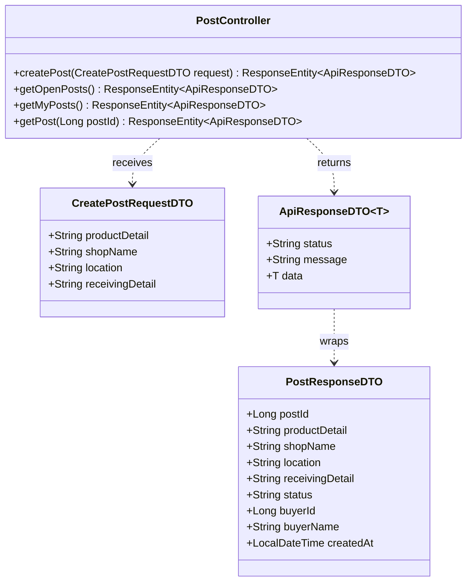
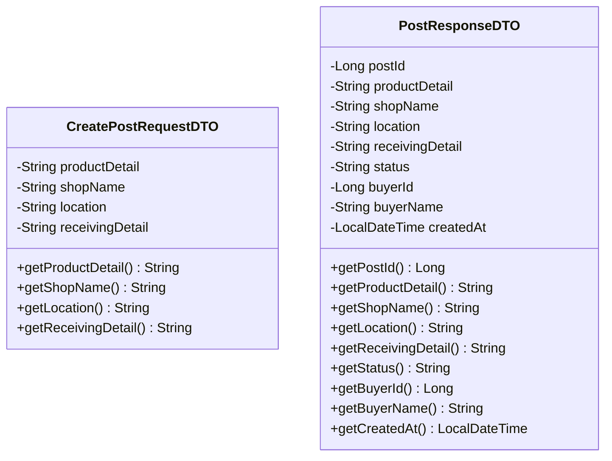
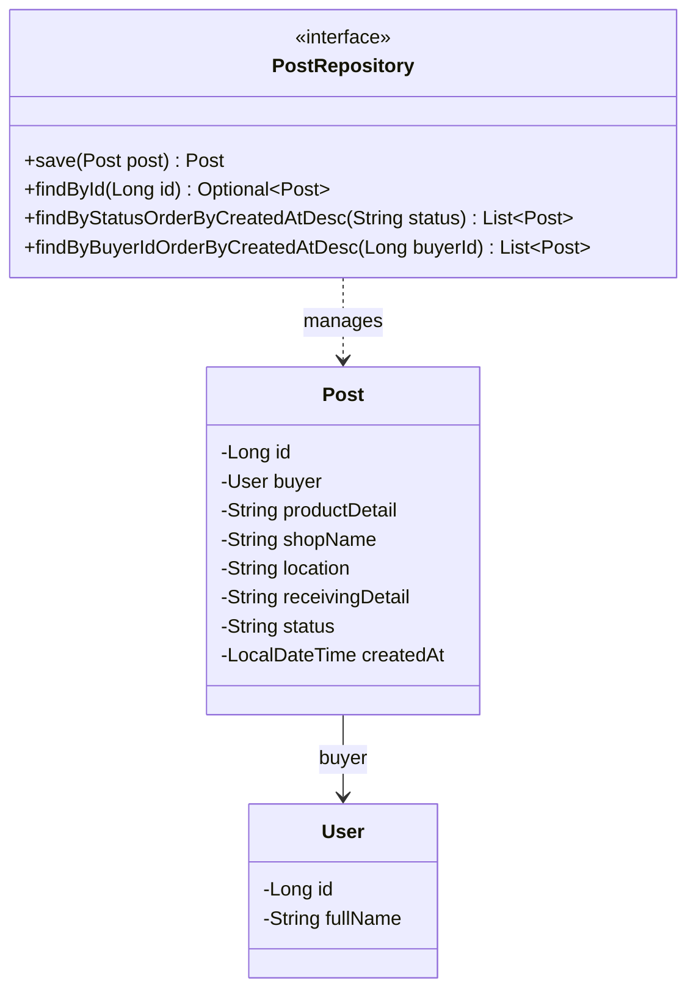
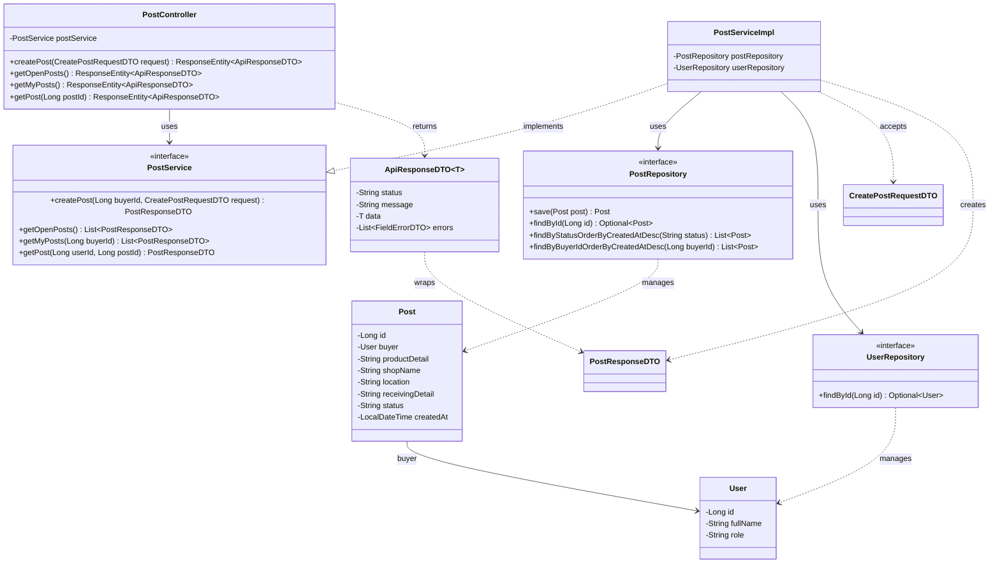

# Task12: US12 - ผู้ฝากหิ้วโพสต์หาคนรับหิ้ว (API, API Class Diagram, DTO, DAO)

> ใช้ร่วมกับ [API Conventions](../common/API-CONVENTIONS.md) และ [ERD](../database/ERD.md)
> โพสต์เป็นช่องทางแยกจากรอบหิ้ว (Task08) ผู้ฝากหิ้วโพสต์ได้โดยไม่ต้องรอผู้รับหิ้วเปิดรอบ จึงต้องเพิ่มตาราง `POSTS` ใน ERD (ดูหัวข้อ 4)

## 0. เงื่อนไขจาก User Story ที่ API ต้องรองรับ

| Test case ใน US12 | สิ่งที่ API ต้องทำ | Response |
|---|---|---|
| 1. กรอกรายละเอียดสินค้า ร้านค้า สถานที่ และรายละเอียดการรับสินค้าครบ สร้างโพสต์สำเร็จและผู้รับหิ้วมองเห็นโพสต์ | สร้างโพสต์สถานะ `OPEN` และมี endpoint ให้ผู้รับหิ้วดูโพสต์ | `201 Created` / Endpoint 2 |
| 2. กรอกข้อมูลที่จำเป็นไม่ครบ ระบบแจ้งเตือนและไม่อนุญาตให้โพสต์ | ไม่บันทึก และบอกว่าช่องไหนขาด | `400 Bad Request` |

---

## 1. API Specification

### Endpoint 1: Create Post (ผู้ฝากหิ้วโพสต์หาคนรับหิ้ว)
- **URL:** `/api/v1/posts`
- **Method:** `POST`
- **Headers:** `Authorization: Bearer <JWT_TOKEN>` (`BUYER` Only)
- **Content-Type:** `application/json`
- **Request Body:**
```json
{
  "productDetail": "ชานมไข่มุก 2 แก้ว หวานน้อย",
  "shopName": "ร้านชานมหน้าประตูทางเข้า",
  "location": "ประตูทางเข้ามหาวิทยาลัย",
  "receivingDetail": "รับของที่หน้าตึกวิศวกรรมศาสตร์ ช่วงเที่ยง"
}
```
*(หมายเหตุ: ทั้ง 4 field บังคับส่ง และ `buyerId` ไม่ต้องส่ง ระบบอ่านจาก JWT)*

**กติกาตรวจข้อมูล**

| Field | กติกา | ตัวอย่าง message |
|---|---|---|
| `productDetail` | ห้ามว่าง ไม่เกิน 500 ตัวอักษร | `must not be blank` |
| `shopName` | ห้ามว่าง ไม่เกิน 100 ตัวอักษร | `must not be blank` |
| `location` | ห้ามว่าง ไม่เกิน 255 ตัวอักษร | `must not be blank` |
| `receivingDetail` | ห้ามว่าง ไม่เกิน 500 ตัวอักษร | `must not be blank` |

- **Response (201 Created):**
```json
{
  "status": "SUCCESS",
  "message": "Post created successfully",
  "data": {
    "postId": 1,
    "productDetail": "ชานมไข่มุก 2 แก้ว หวานน้อย",
    "shopName": "ร้านชานมหน้าประตูทางเข้า",
    "location": "ประตูทางเข้ามหาวิทยาลัย",
    "receivingDetail": "รับของที่หน้าตึกวิศวกรรมศาสตร์ ช่วงเที่ยง",
    "status": "OPEN",
    "buyerId": 2,
    "buyerName": "Somchai Jaidee",
    "createdAt": "2026-10-15T20:00:00"
  }
}
```

| HTTP Status | เงื่อนไข | ตัวอย่าง message |
|---|---|---|
| `400 Bad Request` | ข้อมูลไม่ครบหรือไม่ถูกรูปแบบ (ไม่บันทึกโพสต์) | `Validation failed` พร้อม `errors` |
| `401 Unauthorized` | ไม่มี token หรือ token ไม่ถูกต้อง | `Invalid or missing token` |
| `403 Forbidden` | ผู้ใช้ไม่ใช่ `BUYER` | `Only buyers can create posts` |

ตัวอย่าง `400`:
```json
{
  "status": "ERROR",
  "message": "Validation failed",
  "errors": [
    { "field": "productDetail", "message": "must not be blank" },
    { "field": "location", "message": "must not be blank" }
  ]
}
```

### Endpoint 2: Get Open Posts (ผู้รับหิ้วดูโพสต์เพื่อเลือกติดต่อรับงาน)
- **URL:** `/api/v1/posts`
- **Method:** `GET`
- **Headers:** `Authorization: Bearer <JWT_TOKEN>` (`RUNNER` Only)
- **Response (200 OK):** โพสต์สถานะ `OPEN` ทั้งหมด เรียงใหม่สุดก่อน `data` เป็น array ของ `PostResponseDTO` (รูปแบบเดียวกับ `data` ของ Endpoint 1)
- **Error:** `401` ไม่มี token / `403` ไม่ใช่ `RUNNER` (`Only runners can view open posts`)

### Endpoint 3: Get My Posts (ผู้ฝากหิ้วดูโพสต์ของตนเอง)
- **URL:** `/api/v1/posts/my`
- **Method:** `GET`
- **Headers:** `Authorization: Bearer <JWT_TOKEN>` (`BUYER` Only)
- **Response (200 OK):** โพสต์ทุกสถานะของผู้ใช้ เรียงใหม่สุดก่อน
- **Error:** `401` / `403` (`Only buyers can view their own posts`)

### Endpoint 4: Get Post Detail (ดูรายละเอียดโพสต์)
- **URL:** `/api/v1/posts/{postId}`
- **Method:** `GET`
- **Headers:** `Authorization: Bearer <JWT_TOKEN>` (`RUNNER` ทุกคน หรือ `BUYER` เจ้าของโพสต์)
- **Response (200 OK):** `data` เป็น `PostResponseDTO`
- **Error:** `401` / `403` (`You are not allowed to view this post`) / `404` (`Post not found`)

> ขอบเขต: US12 ครอบคลุมเฉพาะการสร้างและดูโพสต์ ส่วนการกด "ติดต่อรับงาน" และการเปลี่ยนสถานะโพสต์เป็น `CLOSED` ยังไม่อยู่ใน Sprint 1 สถานะ `CLOSED` จึงถูกเตรียมไว้ใน enum แต่ยังไม่มี endpoint เปลี่ยนค่า

---

## 2. API Class Diagram


---

## 3. DTO Class Specification & Diagram

`ApiResponseDTO<T>` และ `FieldErrorDTO` ใช้ร่วมกันทุก task ดูที่ [API Conventions](../common/API-CONVENTIONS.md)

1. **`CreatePostRequestDTO`**
   - `productDetail`: String (Not Blank, Max 500)
   - `shopName`: String (Not Blank, Max 100)
   - `location`: String (Not Blank, Max 255)
   - `receivingDetail`: String (Not Blank, Max 500)
2. **`PostResponseDTO`**
   - `postId`: Long
   - `productDetail`, `shopName`, `location`, `receivingDetail`: String
   - `status`: String (`OPEN` เมื่อสร้างใหม่)
   - `buyerId`: Long (จาก JWT)
   - `buyerName`: String (จาก `USERS.full_name`)
   - `createdAt`: LocalDateTime



---

## 4. DAO / Repository Specification & Diagram

### Entity `Post` (ตาราง `posts` **ใหม่** ต้องเพิ่มใน ERD)

| Field | Column | หมายเหตุ |
|---|---|---|
| `id` | `id` | PK, auto increment |
| `buyer` (`User`) | `buyer_id` | FK → `USERS.id` (`@ManyToOne`), NOT NULL |
| `productDetail` | `product_detail` | VARCHAR(500), NOT NULL |
| `shopName` | `shop_name` | VARCHAR(100), NOT NULL |
| `location` | `location` | VARCHAR(255), NOT NULL |
| `receivingDetail` | `receiving_detail` | VARCHAR(500), NOT NULL |
| `status` | `status` | NOT NULL, DEFAULT `OPEN` (`OPEN`, `CLOSED`) |
| `createdAt` | `created_at` | NOT NULL, DEFAULT CURRENT_TIMESTAMP |

ความสัมพันธ์: `USERS` 1 ──< `POSTS` (ผู้ฝากหิ้วหนึ่งคนมีได้หลายโพสต์) ไม่ผูกกับ `DELIVERY_ROUNDS` และ `ORDERS` ใน Sprint 1

### Repository
- **Interface:** `PostRepository` (extends `JpaRepository<Post, Long>`)
- **Methods:**
  - `Post save(Post post)` - สร้างโพสต์ (Endpoint 1)
  - `List<Post> findByStatusOrderByCreatedAtDesc(String status)` - โพสต์ `OPEN` (Endpoint 2)
  - `List<Post> findByBuyerIdOrderByCreatedAtDesc(Long buyerId)` - โพสต์ของฉัน (Endpoint 3)
  - `Optional<Post> findById(Long id)` - รายละเอียดโพสต์ (Endpoint 4)
- **ใช้ร่วมกับ Task04:** `UserRepository.findById` ดึงผู้ฝากหิ้วจาก JWT



---

## 5. Extended API Class Diagram (Full Layered Architecture)

Controller เรียก Service, Service ใช้ `PostRepository` และ `UserRepository` (Task04) ผู้ฝากหิ้วมาจาก JWT


