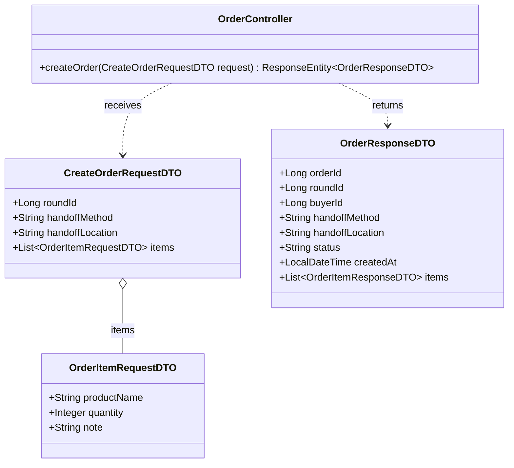
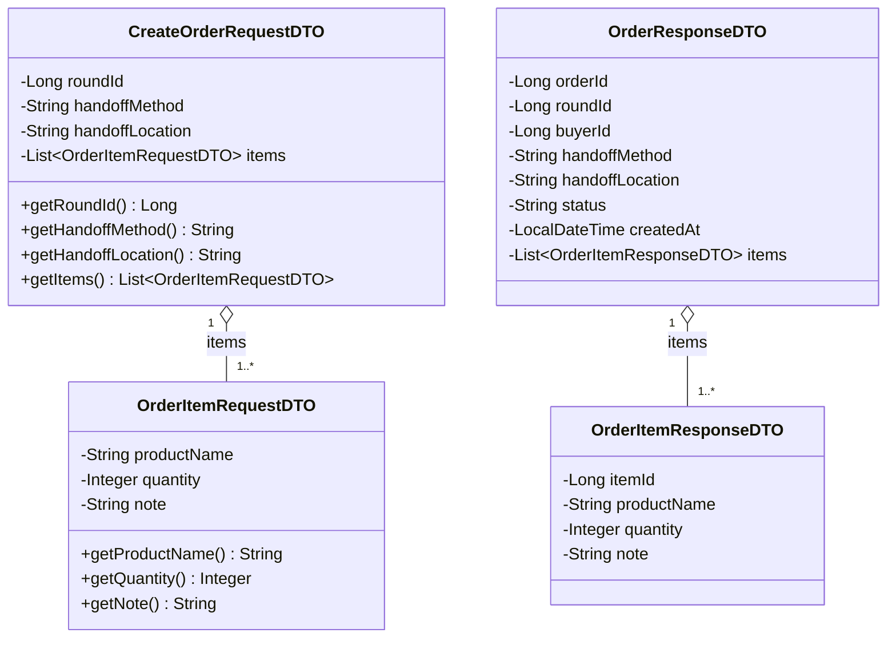

## 1. API Specification
### Endpoint 1: Create Order (ฝากซื้อสินค้า/อาหาร)

**URL:** `/api/v1/orders`
- 
**Method:** `POST`
- 
**Headers:** `Authorization: Bearer <JWT_TOKEN>` (BUYER Only)
- 
**Content-Type:** `application/json`
- 
**Request Body:**
```json
{
  "roundId": 101,
  "handoffMethod": "MEETUP",
  "handoffLocation": "หน้าอาคารเรียนรวมสังคมศาสตร์ (SC1) มธ.รังสิต",
  "items": [
    {
      "productName": "Iced Americano (Venti)",
      "quantity": 2,
      "note": "หวานน้อย"
    },
    {
      "productName": "Butter Croissant",
      "quantity": 1,
      "note": null
    }
  ]
}
```
*(หมายเหตุ: `handoffMethod` เลือกได้ `"MEETUP"` (นัดรับ) หรือ `"DELIVERY"` (ส่งถึงที่) และ `buyerId` ไม่ต้องส่งมา ระบบอ่านจาก JWT)*
 
- 
**Response (201 Created):**
```json
{
  "status": "SUCCESS",
  "message": "Order created successfully",
  "data": {
    "orderId": 5001,
    "roundId": 101,
    "buyerId": 2,
    "handoffMethod": "MEETUP",
    "handoffLocation": "หน้าอาคารเรียนรวมสังคมศาสตร์ (SC1) มธ.รังสิต",
    "status": "PENDING",
    "createdAt": "2026-10-15T21:30:00",
    "items": [
      {
        "itemId": 9001,
        "productName": "Iced Americano (Venti)",
        "quantity": 2,
        "note": "หวานน้อย"
      },
      {
        "itemId": 9002,
        "productName": "Butter Croissant",
        "quantity": 1,
        "note": null
      }
    ]
  }
}
```
 
- 
**Error Responses:**
| HTTP Status | เงื่อนไข | ตัวอย่าง message |
|---|---|---|
| `400 Bad Request` | ข้อมูลไม่ครบ/ไม่ถูกต้อง เช่น `items` ว่าง, `quantity` น้อยกว่า 1, `handoffMethod` ไม่อยู่ในค่าที่กำหนด | `Validation failed` (พร้อมรายการฟิลด์ที่ผิด) |
| `401 Unauthorized` | ไม่ส่ง token หรือ token ไม่ถูกต้อง/หมดอายุ | `Invalid or missing token` |
| `403 Forbidden` | ผู้ใช้ไม่ได้มี role `BUYER` | `Only BUYER can create orders` |
| `404 Not Found` | ไม่พบรอบหิ้วตาม `roundId` | `Delivery round not found` |
| `409 Conflict` | รอบหิ้วไม่ได้อยู่ในสถานะ `OPEN` | `Delivery round is not open` |
 
- 
**รูปแบบ Error Response:**
```json
{
  "status": "ERROR",
  "message": "Validation failed",
  "errors": [
    { "field": "items[0].quantity", "message": "must be greater than or equal to 1" }
  ]
}
```
 
---
 
## 2. API Class Diagram

 
---
 
## 3. DTO Class Specification & Diagram
### DTO Specifications
1. 
**`CreateOrderRequestDTO`**
-    
`roundId`: Long (Not Null)
-    
`handoffMethod`: String (Not Null, Choices: `"MEETUP"`, `"DELIVERY"`)
-    
`handoffLocation`: String (Not Blank)
-    
`items`: List&lt;OrderItemRequestDTO&gt; (Not Empty, Valid)
2. **`OrderItemRequestDTO`**
-    
`productName`: String (Not Blank)
-    
`quantity`: Integer (Not Null, Min 1)
-    
`note`: String (Optional)
3. **`OrderResponseDTO`**
-    
`orderId`: Long
-    
`roundId`: Long
-    
`buyerId`: Long
-    
`handoffMethod`: String
-    
`handoffLocation`: String
-    
`status`: String
-    
`createdAt`: LocalDateTime
-    
`items`: List&lt;OrderItemResponseDTO&gt;
4. **`OrderItemResponseDTO`**
-    
`itemId`: Long
-    
`productName`: String
-    
`quantity`: Integer
-    
`note`: String
### DTO Class Diagram

 
--- ครบมั้ย 