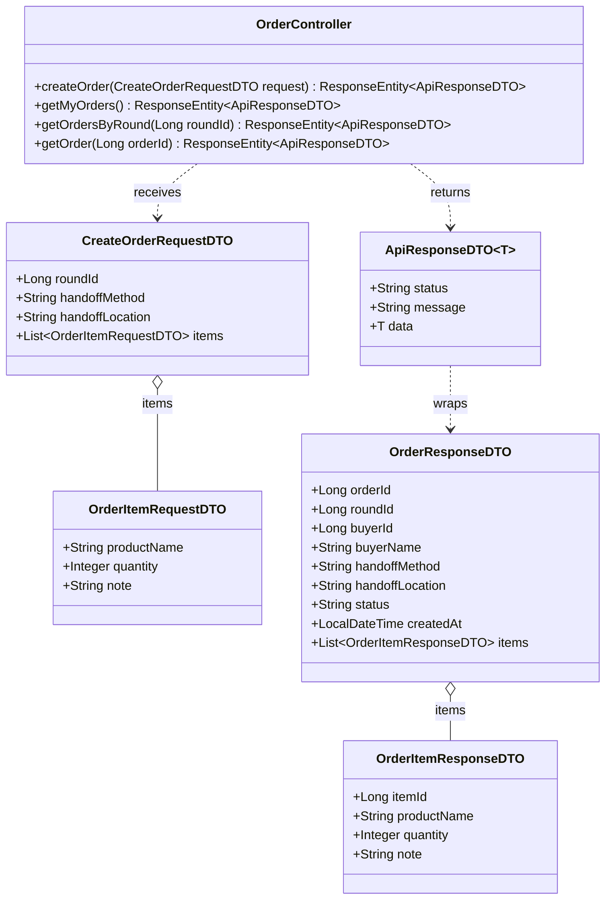
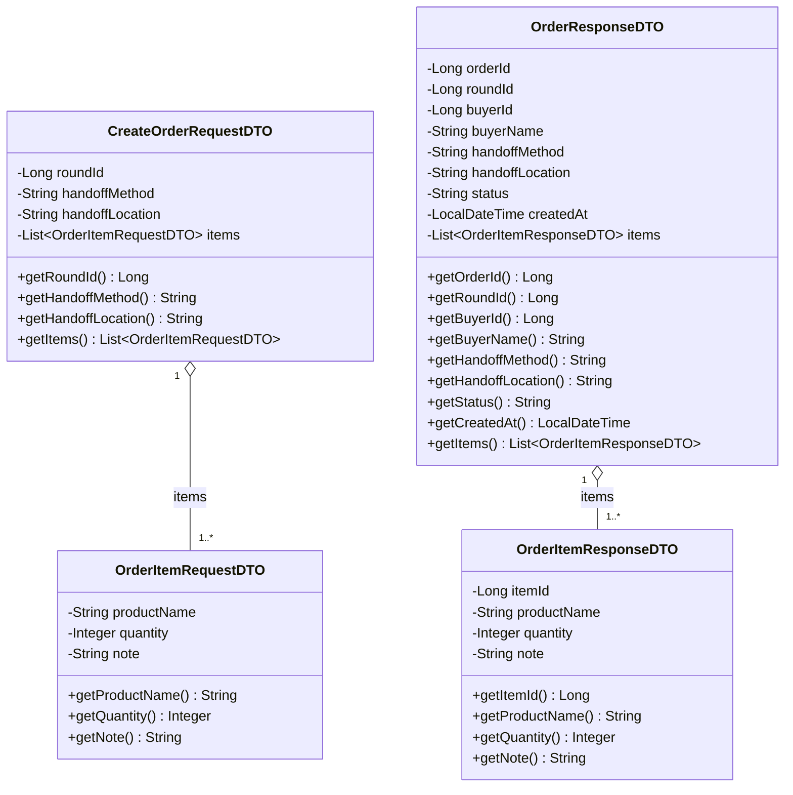
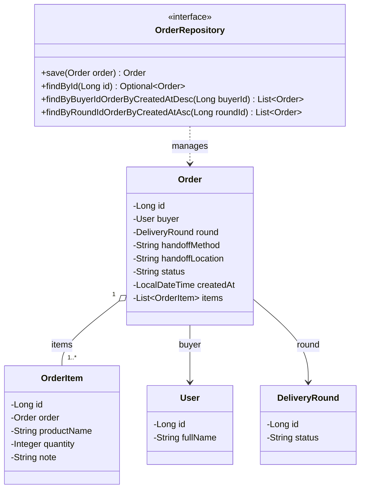
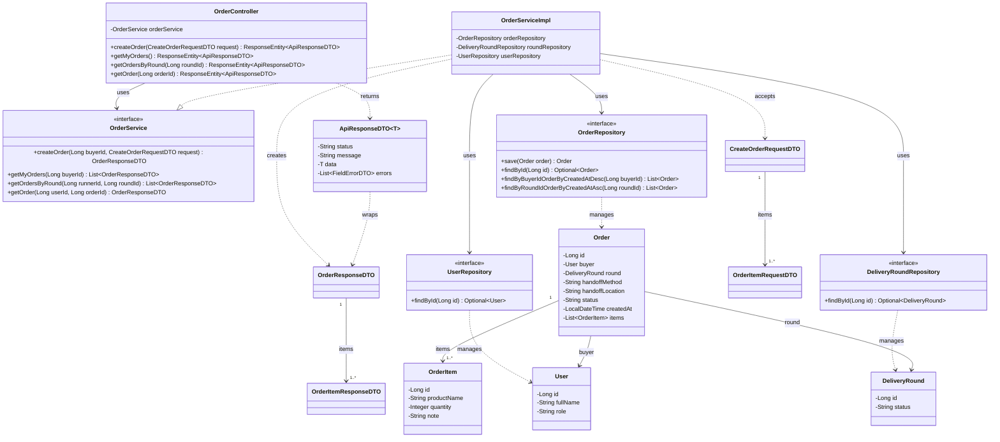

# Task16: US03 - ฝากซื้อสินค้า/อาหาร (API, API Class Diagram, DTO, DAO)

> ใช้ร่วมกับ [API Conventions](../common/API-CONVENTIONS.md) (รูปแบบ response, JWT, enum) และ [ERD](../database/ERD.md) (ตาราง `ORDERS`, `ORDER_ITEMS`)
> ต่อจาก Task04 (ผู้ใช้) และ Task08 (รอบหิ้ว) ผู้ฝากหิ้วต้องเลือกรอบที่ `OPEN` ก่อนจึงสร้างออเดอร์ได้

## 0. เงื่อนไขจาก User Story ที่ API ต้องรองรับ

| Test case ใน US03 | สิ่งที่ API ต้องทำ | Response |
|---|---|---|
| 1. ผู้ฝากหิ้วกรอกรายการสินค้า/อาหารและจุดนัดรับครบ ระบบบันทึกรายการฝากซื้อได้ | สร้างออเดอร์สถานะ `PENDING` พร้อมรายการสินค้า | `201 Created` |
| 2. กรอกรายการสินค้า/อาหารหรือจุดนัดรับไม่ครบ ระบบไม่อนุญาตให้ฝากซื้อ | ไม่บันทึก และบอกว่าช่องไหนขาด | `400 Bad Request` |
| So that: ผู้รับหิ้วทราบรายละเอียดสินค้าที่ต้องซื้ออย่างชัดเจน | ให้ผู้รับหิ้วดูออเดอร์ทั้งหมดในรอบของตน | Endpoint 3 |

---

## 1. API Specification

### Endpoint 1: Create Order (ฝากซื้อสินค้า/อาหาร)
- **URL:** `/api/v1/orders`
- **Method:** `POST`
- **Headers:** `Authorization: Bearer <JWT_TOKEN>` (`BUYER` Only)
- **Content-Type:** `application/json`
- **Request Body:**
```json
{
  "roundId": 101,
  "handoffMethod": "MEETUP",
  "handoffLocation": "หน้าอาคารเรียนรวมสังคมศาสตร์ (SC1) มธ.รังสิต",
  "items": [
    {
      "productName": "Iced Americano (Venti)",
      "quantity": 2,
      "note": "หวานน้อย"
    },
    {
      "productName": "Butter Croissant",
      "quantity": 1,
      "note": null
    }
  ]
}
```
*(หมายเหตุ: `handoffMethod` เลือกได้ `"MEETUP"` (นัดรับ) หรือ `"DELIVERY"` (ส่งถึงที่) และ `buyerId` ไม่ต้องส่งมา ระบบอ่านจาก JWT)*

**กติกาตรวจข้อมูล**

| Field | กติกา | ตัวอย่าง message |
|---|---|---|
| `roundId` | ห้ามว่าง | `must not be null` |
| `handoffMethod` | ห้ามว่าง และต้องเป็น `MEETUP` หรือ `DELIVERY` | `must be MEETUP or DELIVERY` |
| `handoffLocation` | ห้ามว่าง | `must not be blank` |
| `items` | ต้องมีอย่างน้อย 1 รายการ | `must not be empty` |
| `items[i].productName` | ห้ามว่าง | `must not be blank` |
| `items[i].quantity` | ห้ามว่าง และต้อง ≥ 1 | `must be greater than or equal to 1` |
| `items[i].note` | ไม่บังคับ | - |

- **Response (201 Created):**
```json
{
  "status": "SUCCESS",
  "message": "Order created successfully",
  "data": {
    "orderId": 5001,
    "roundId": 101,
    "buyerId": 2,
    "buyerName": "Somying Rakdee",
    "handoffMethod": "MEETUP",
    "handoffLocation": "หน้าอาคารเรียนรวมสังคมศาสตร์ (SC1) มธ.รังสิต",
    "status": "PENDING",
    "createdAt": "2026-10-15T21:30:00",
    "items": [
      {
        "itemId": 9001,
        "productName": "Iced Americano (Venti)",
        "quantity": 2,
        "note": "หวานน้อย"
      },
      {
        "itemId": 9002,
        "productName": "Butter Croissant",
        "quantity": 1,
        "note": null
      }
    ]
  }
}
```

**Error Responses**

| HTTP Status | เงื่อนไข | ตัวอย่าง message |
|---|---|---|
| `400 Bad Request` | ข้อมูลไม่ครบ/ไม่ถูกต้อง เช่น `items` ว่าง, `quantity` น้อยกว่า 1, `handoffMethod` ไม่อยู่ในค่าที่กำหนด | `Validation failed` (พร้อมรายการ field ที่ผิดใน `errors`) |
| `401 Unauthorized` | ไม่ส่ง token หรือ token ไม่ถูกต้อง/หมดอายุ | `Invalid or missing token` |
| `403 Forbidden` | ผู้ใช้ไม่ได้มี role `BUYER` | `Only BUYER can create orders` |
| `404 Not Found` | ไม่พบรอบหิ้วตาม `roundId` | `Delivery round not found` |
| `409 Conflict` | รอบหิ้วไม่ได้อยู่ในสถานะ `OPEN` | `Delivery round is not open` |

ตัวอย่าง `400`:
```json
{
  "status": "ERROR",
  "message": "Validation failed",
  "errors": [
    { "field": "handoffLocation", "message": "must not be blank" },
    { "field": "items[0].quantity", "message": "must be greater than or equal to 1" }
  ]
}
```

### Endpoint 2: Get My Orders (รายการสั่งซื้อของฉัน)
- **URL:** `/api/v1/orders/my`
- **Method:** `GET`
- **Headers:** `Authorization: Bearer <JWT_TOKEN>` (`BUYER` Only)
- **ผลลัพธ์:** ออเดอร์ทั้งหมดของผู้ฝากหิ้วที่ล็อกอินอยู่ ทุกสถานะ เรียงจาก `createdAt` ล่าสุดไปเก่าสุด
- **Response (200 OK):** `data` เป็น array ของออเดอร์ รูปแบบเดียวกับ `data` ใน Endpoint 1
- **Error:** `401` เมื่อไม่มี token, `403` เมื่อไม่ใช่ `BUYER`

### Endpoint 3: Get Orders of a Round (ออเดอร์ทั้งหมดในรอบของผู้รับหิ้ว)
- **URL:** `/api/v1/orders?roundId=101`
- **Method:** `GET`
- **Headers:** `Authorization: Bearer <JWT_TOKEN>` (`RUNNER` เจ้าของรอบนั้นเท่านั้น)
- **Query Parameter:** `roundId` (บังคับ)
- **ผลลัพธ์:** ออเดอร์ทุกสถานะในรอบนั้น พร้อมรายการสินค้า เรียงจาก `createdAt` เก่าไปใหม่
- **Response (200 OK):** `data` เป็น array ของออเดอร์ รูปแบบเดียวกับ `data` ใน Endpoint 1
- **Error:**

| HTTP Status | เงื่อนไข | ตัวอย่าง message |
|---|---|---|
| `400 Bad Request` | ไม่ส่ง `roundId` | `roundId is required` |
| `401 Unauthorized` | ไม่มี token | `Invalid or missing token` |
| `403 Forbidden` | ไม่ใช่ `RUNNER` หรือไม่ใช่เจ้าของรอบนี้ | `You are not the owner of this delivery round` |
| `404 Not Found` | ไม่พบรอบ | `Delivery round not found` |

### Endpoint 4: Get Order Detail (รายละเอียดออเดอร์)
- **URL:** `/api/v1/orders/{orderId}`
- **Method:** `GET`
- **Headers:** `Authorization: Bearer <JWT_TOKEN>` (ผู้ฝากหิ้วเจ้าของออเดอร์ หรือผู้รับหิ้วเจ้าของรอบที่ออเดอร์อยู่)
- **Response (200 OK):** `data` เป็นออเดอร์เดียว รูปแบบเดียวกับ `data` ใน Endpoint 1
- **Error:** `401` เมื่อไม่มี token, `403` (`You are not allowed to view this order`) เมื่อไม่ใช่ผู้เกี่ยวข้อง, `404` (`Order not found`) เมื่อไม่พบออเดอร์

---

## 2. API Class Diagram


---

## 3. DTO Class Specification & Diagram

`ApiResponseDTO<T>` และ `FieldErrorDTO` ใช้ร่วมกันทุก task ดูที่ [API Conventions](../common/API-CONVENTIONS.md)

### DTO Specifications
1. **`CreateOrderRequestDTO`**
   - `roundId`: Long (Not Null)
   - `handoffMethod`: String (Not Null, Choices: `"MEETUP"`, `"DELIVERY"`)
   - `handoffLocation`: String (Not Blank)
   - `items`: List&lt;OrderItemRequestDTO&gt; (Not Empty, Valid)
2. **`OrderItemRequestDTO`**
   - `productName`: String (Not Blank)
   - `quantity`: Integer (Not Null, Min 1)
   - `note`: String (Optional)
3. **`OrderResponseDTO`**
   - `orderId`: Long
   - `roundId`: Long
   - `buyerId`: Long
   - `buyerName`: String (ดึงจาก `USERS.full_name` ของผู้ฝากหิ้ว ให้ผู้รับหิ้วรู้ว่าออเดอร์ของใคร)
   - `handoffMethod`: String
   - `handoffLocation`: String
   - `status`: String (`PENDING` เมื่อสร้างใหม่)
   - `createdAt`: LocalDateTime
   - `items`: List&lt;OrderItemResponseDTO&gt;
4. **`OrderItemResponseDTO`**
   - `itemId`: Long
   - `productName`: String
   - `quantity`: Integer
   - `note`: String

### DTO Class Diagram


---

## 4. DAO / Repository Specification & Diagram

### Entity ที่เกี่ยวข้อง

**`Order`** (ตาราง `orders` ต้องระบุ `@Table(name = "orders")`)

| Field | Column ใน ERD | หมายเหตุ |
|---|---|---|
| `id` | `id` | PK |
| `buyer` (`User`) | `buyer_id` | FK → `USERS.id` (`@ManyToOne`) |
| `round` (`DeliveryRound`) | `round_id` | FK → `DELIVERY_ROUNDS.id` (`@ManyToOne`) |
| `handoffMethod` | `handoff_method` | NOT NULL (`MEETUP` / `DELIVERY`) |
| `handoffLocation` | `handoff_location` | NOT NULL |
| `status` | `status` | NOT NULL (`PENDING` / `PAID` / `COMPLETED`) |
| `createdAt` | `created_at` | NOT NULL, DEFAULT CURRENT_TIMESTAMP |
| `items` | - | `@OneToMany(mappedBy = "order", cascade = ALL)` บันทึกรายการสินค้าพร้อมออเดอร์ |

**`OrderItem`** (ตาราง `order_items`)

| Field | Column ใน ERD | หมายเหตุ |
|---|---|---|
| `id` | `id` | PK |
| `order` (`Order`) | `order_id` | FK → `ORDERS.id` |
| `productName` | `product_name` | NOT NULL |
| `quantity` | `quantity` | NOT NULL, > 0 |
| `note` | `note` | ไม่บังคับ |

### Repository
- **Interface:** `OrderRepository` (extends `JpaRepository<Order, Long>`)
- **Methods:**
  - `Order save(Order order)` - บันทึกออเดอร์พร้อมรายการสินค้า และอัปเดตสถานะ (Task20, Task24 ใช้ตอนเปลี่ยนเป็น `PAID` / `COMPLETED`)
  - `Optional<Order> findById(Long id)` - ค้นหาออเดอร์ด้วย id (Endpoint 4)
  - `List<Order> findByBuyerIdOrderByCreatedAtDesc(Long buyerId)` - ออเดอร์ของผู้ฝากหิ้ว (Endpoint 2)
  - `List<Order> findByRoundIdOrderByCreatedAtAsc(Long roundId)` - ออเดอร์ทั้งหมดในรอบ (Endpoint 3)
- ไม่ต้องมี repository แยกของ `OrderItem` เพราะบันทึกผ่าน `Order` (cascade)
- **ใช้ร่วมกับ task อื่น:** `DeliveryRoundRepository.findById` (Task08) ตรวจว่ารอบมีอยู่และเป็น `OPEN` ก่อนสร้างออเดอร์ และตรวจเจ้าของรอบใน Endpoint 3, `UserRepository.findById` (Task04) ดึงผู้ฝากหิ้วจาก JWT



---

## 5. Extended API Class Diagram (Full Layered Architecture)

Controller เรียก Service, Service ใช้ `OrderRepository` และ `DeliveryRoundRepository` (Task08) เพื่อตรวจว่ารอบยัง `OPEN`


