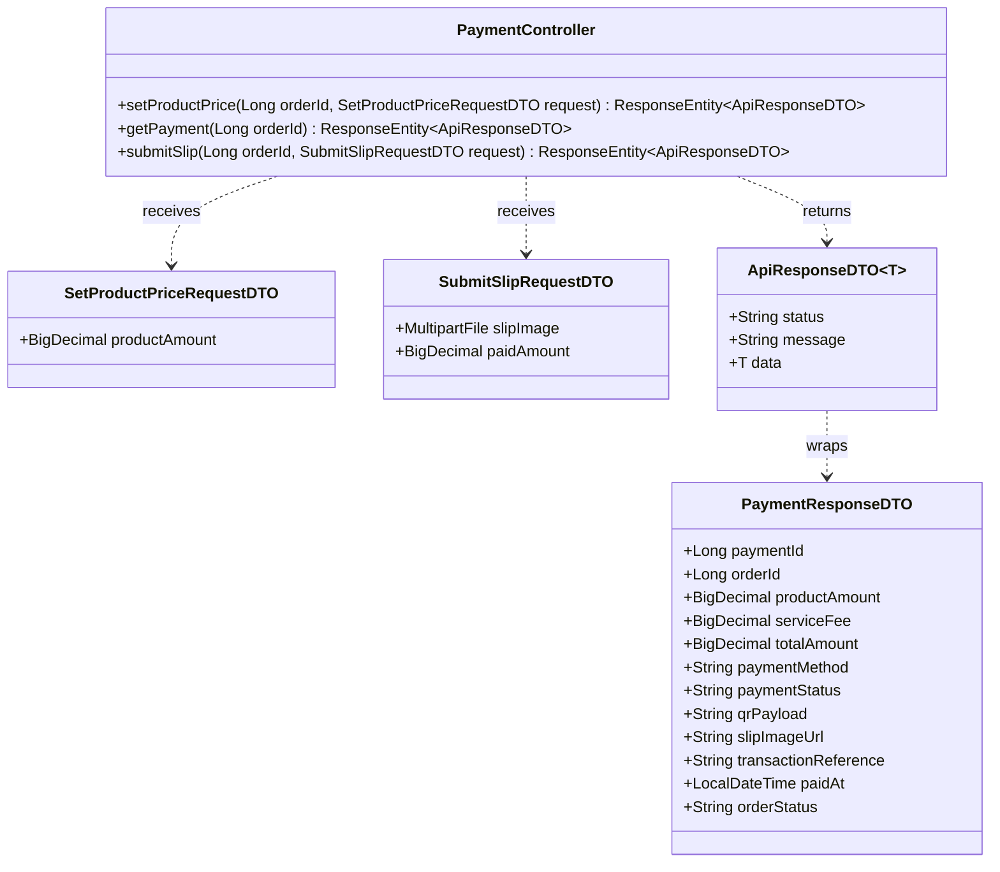
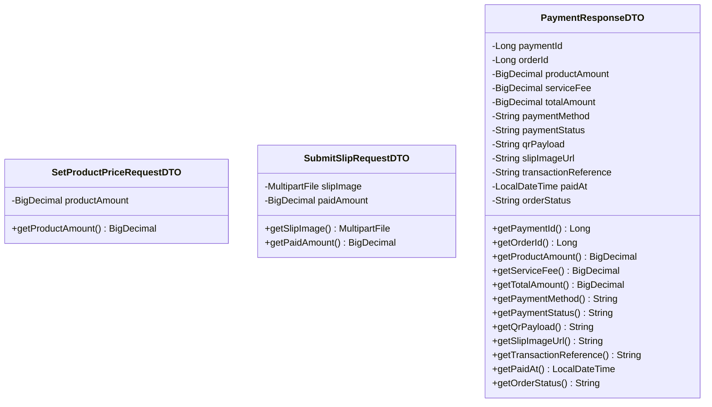
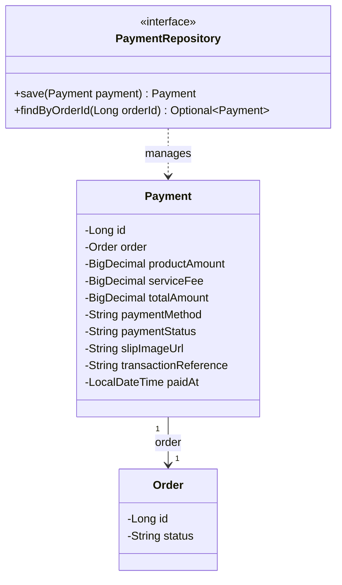
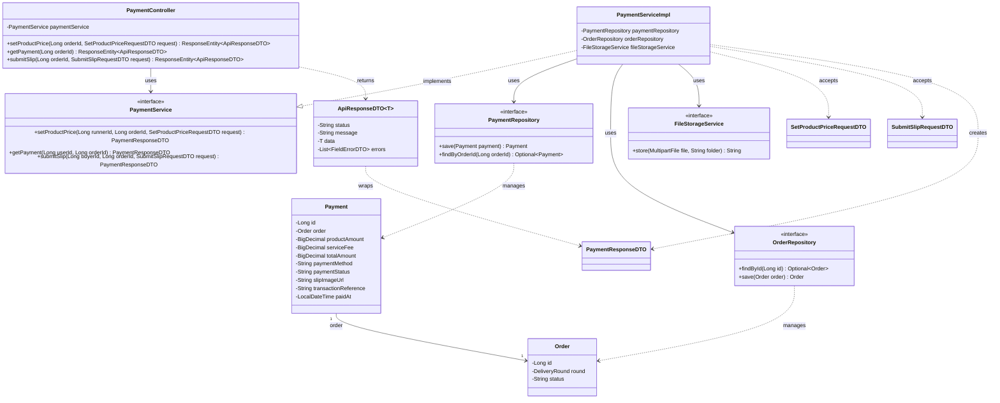

# Task20: US07 - ชำระค่าสินค้าและค่าหิ้วผ่านระบบตัวกลาง (API, API Class Diagram, DTO, DAO)

> ใช้ร่วมกับ [API Conventions](../common/API-CONVENTIONS.md) และ [ERD](../database/ERD.md) (ตาราง `PAYMENTS`, `ORDERS`)
> ต่อจาก Task16 (ออเดอร์สถานะ `PENDING`) และส่งต่อให้ Task24 (ปล่อยเงินเมื่อยืนยันรับสินค้า)

## แนวคิดการชำระเงิน (เพื่อความปลอดภัยและกันการฉ้อโกง)

1. **ผู้รับหิ้วเป็นคนระบุราคาสินค้า** ของออเดอร์ (หลังเห็นรายการที่ผู้ฝากหิ้วสั่ง) ผู้ฝากหิ้วแก้ราคาเองไม่ได้
2. ระบบสร้างรายการชำระเงิน (`Payment` สถานะ `PENDING`) และออก **QR Code ของระบบตัวกลาง** ที่มียอดรวม = ราคาสินค้า + ค่าหิ้ว
3. ผู้ฝากหิ้ว **สแกน QR จ่ายเงินเข้าระบบตัวกลาง (ไม่โอนให้ผู้รับหิ้วโดยตรง)** แล้ว **แนบสลิป** เพื่อยืนยัน
4. เมื่อสลิปและยอดถูกต้อง เงินสถานะ `HELD` (พักไว้ที่ระบบกลาง) และออเดอร์เป็น `PAID` เงินจะถูกโอนให้ผู้รับหิ้วเมื่อผู้ฝากหิ้วยืนยันรับสินค้า (Task24)

ใน Sprint 1 การตรวจสลิปเป็นแบบง่าย: ต้องแนบไฟล์รูปที่ถูกต้อง และยอดที่ผู้ฝากหิ้วระบุต้องตรงกับยอดรวม (ไม่อ่านข้อมูลในรูปด้วย OCR และไม่เชื่อมธนาคารจริง)

## 0. เงื่อนไขจาก User Story ที่ API ต้องรองรับ

| Test case ใน US07 | สิ่งที่ API ต้องทำ | Response |
|---|---|---|
| 1. ผู้ฝากหิ้วชำระค่าสินค้าและค่าหิ้วผ่านระบบตัวกลางได้สำเร็จ | รับสลิป เปลี่ยน `Payment` เป็น `HELD` และออเดอร์เป็น `PAID` | `201 Created` |
| 2. ระบบไม่ยืนยันการชำระเงิน หากชำระไม่สำเร็จหรือยอดเงินไม่ถูกต้อง | ไม่เปลี่ยนสถานะใด ๆ (ออเดอร์ยัง `PENDING`) | `400 Bad Request` |
| So that 1: เงินไม่สูญหายหากไม่ได้รับสินค้า | เงินสถานะ `HELD` อยู่กับระบบกลาง | - |
| So that 2: โอนให้ผู้รับหิ้วเมื่อคำสั่งซื้อเสร็จสมบูรณ์เท่านั้น | ยังไม่โอน ต้องรอ Task24 | - |

---

## 1. API Specification

### Endpoint 1: Set Product Price (ผู้รับหิ้วระบุราคาสินค้าของออเดอร์)
- **URL:** `/api/v1/orders/{orderId}/price`
- **Method:** `PUT`
- **Headers:** `Authorization: Bearer <JWT_TOKEN>` (เจ้าของรอบที่ออเดอร์อยู่เท่านั้น)
- **Content-Type:** `application/json`
- **Request Body:**
```json
{
  "productAmount": 80.00
}
```
**กติกาตรวจข้อมูล**

| Field | กติกา | ตัวอย่าง message |
|---|---|---|
| `productAmount` | ห้ามว่าง และต้อง > 0.00 | `must be greater than 0.00` |

**สิ่งที่ระบบทำ:** ตรวจว่าเป็นเจ้าของรอบและออเดอร์ยัง `PENDING` แล้วสร้าง `Payment` (ถ้ายังไม่มี) หรือแก้ราคาในแถวเดิม โดยตั้ง `service_fee` จากรอบหิ้ว, `total_amount` = `productAmount` + `serviceFee`, `payment_method` = `QR_TRANSFER`, `payment_status` = `PENDING` และสร้างข้อมูล QR สำหรับยอดนี้ แก้ราคาได้จนกว่าผู้ฝากหิ้วจะชำระสำเร็จ

- **Response (200 OK):**
```json
{
  "status": "SUCCESS",
  "message": "Product price set successfully",
  "data": {
    "paymentId": 3001,
    "orderId": 5001,
    "productAmount": 80.00,
    "serviceFee": 20.00,
    "totalAmount": 100.00,
    "paymentMethod": "QR_TRANSFER",
    "paymentStatus": "PENDING",
    "qrPayload": "CARRYHUB-PAY|3001|100.00",
    "slipImageUrl": null,
    "transactionReference": null,
    "paidAt": null,
    "orderStatus": "PENDING"
  }
}
```

| HTTP Status | เงื่อนไข | ตัวอย่าง message |
|---|---|---|
| `400 Bad Request` | ข้อมูลไม่ครบหรือไม่ถูกรูปแบบ | `Validation failed` พร้อม `errors` |
| `401 Unauthorized` | ไม่มี token | `Invalid or missing token` |
| `403 Forbidden` | ไม่ใช่เจ้าของรอบของออเดอร์นี้ | `You are not the owner of this round` |
| `404 Not Found` | ไม่พบออเดอร์ | `Order not found` |
| `409 Conflict` | ออเดอร์ไม่ใช่ `PENDING` (ชำระแล้วหรือปิดแล้ว) | `Order has already been paid` |

### Endpoint 2: Get Order Payment (ดูยอดชำระและ QR)
- **URL:** `/api/v1/orders/{orderId}/payment`
- **Method:** `GET`
- **Headers:** `Authorization: Bearer <JWT_TOKEN>` (ผู้ฝากหิ้วเจ้าของออเดอร์ หรือผู้รับหิ้วเจ้าของรอบ)
- **Response (200 OK):** `data` รูปแบบเดียวกับ Endpoint 1 ผู้ฝากหิ้วใช้ `qrPayload` สร้าง QR ให้สแกน
- **Error:**

| HTTP Status | เงื่อนไข | ตัวอย่าง message |
|---|---|---|
| `401 Unauthorized` | ไม่มี token | `Invalid or missing token` |
| `403 Forbidden` | ไม่ใช่ผู้เกี่ยวข้องกับออเดอร์นี้ | `You are not allowed to view this payment` |
| `404 Not Found` | ไม่พบออเดอร์ หรือผู้รับหิ้วยังไม่ระบุราคา | `Payment not found` |

### Endpoint 3: Submit Payment Slip (ผู้ฝากหิ้วแนบสลิปเพื่อยืนยันการชำระเงิน)
- **URL:** `/api/v1/orders/{orderId}/payment/slip`
- **Method:** `POST`
- **Headers:** `Authorization: Bearer <JWT_TOKEN>` (ผู้ฝากหิ้วเจ้าของออเดอร์เท่านั้น)
- **Content-Type:** `multipart/form-data`
- **Request Parts:**

| Part | ชนิด | บังคับ | กติกา |
|---|---|---|---|
| `slipImage` | ไฟล์รูป | ใช่ | ต้องแนบ, ชนิด JPEG หรือ PNG, ไม่เกิน 5 MB |
| `paidAmount` | ตัวเลข (BigDecimal) | ใช่ | > 0.00 และต้องเท่ากับ `totalAmount` ของรายการชำระ |

**สิ่งที่ระบบทำเมื่อสำเร็จ (ใน transaction เดียว)**
1. ตรวจเจ้าของออเดอร์, ออเดอร์ `PENDING`, `Payment` สถานะ `PENDING` (ผู้รับหิ้วระบุราคาแล้ว)
2. ตรวจไฟล์สลิปและเทียบ `paidAmount` กับ `totalAmount`
3. เก็บไฟล์ บันทึก `slip_image_url`, `transaction_reference`, `paid_at`
4. เปลี่ยน `Payment` เป็น `HELD` และ `Order` เป็น `PAID`

- **Response (201 Created):**
```json
{
  "status": "SUCCESS",
  "message": "Payment confirmed successfully",
  "data": {
    "paymentId": 3001,
    "orderId": 5001,
    "productAmount": 80.00,
    "serviceFee": 20.00,
    "totalAmount": 100.00,
    "paymentMethod": "QR_TRANSFER",
    "paymentStatus": "HELD",
    "qrPayload": "CARRYHUB-PAY|3001|100.00",
    "slipImageUrl": "/uploads/slips/5001-1761373800.jpg",
    "transactionReference": "TXN-20261025-000123",
    "paidAt": "2026-10-25T13:30:00",
    "orderStatus": "PAID"
  }
}
```

| HTTP Status | เงื่อนไข | ตัวอย่าง message |
|---|---|---|
| `400 Bad Request` | ไม่แนบสลิป / ไม่ใช่ JPEG หรือ PNG / เกิน 5 MB / `paidAmount` ไม่เท่ายอดรวม (ไม่เปลี่ยนสถานะ ตาม Test case 2) | `Validation failed` พร้อม `errors` |
| `401 Unauthorized` | ไม่มี token | `Invalid or missing token` |
| `403 Forbidden` | ไม่ใช่เจ้าของออเดอร์ | `You are not the owner of this order` |
| `404 Not Found` | ไม่พบออเดอร์ | `Order not found` |
| `409 Conflict` | ผู้รับหิ้วยังไม่ระบุราคา | `Product price has not been set yet` |
| `409 Conflict` | ออเดอร์ชำระแล้วหรือปิดแล้ว | `Order has already been paid` |

ตัวอย่าง `400`:
```json
{
  "status": "ERROR",
  "message": "Validation failed",
  "errors": [
    { "field": "slipImage", "message": "must not be empty" },
    { "field": "paidAmount", "message": "must equal the total amount (100.00)" }
  ]
}
```
ข้อความอื่นของ `slipImage`: `only JPEG or PNG images are allowed`, `file size must not exceed 5 MB`

---

## 2. API Class Diagram


---

## 3. DTO Class Specification & Diagram

1. **`SetProductPriceRequestDTO`** (JSON)
   - `productAmount`: BigDecimal (Not Null, > 0.00)
2. **`SubmitSlipRequestDTO`** (`multipart/form-data` ผูกด้วย `@ModelAttribute`)
   - `slipImage`: MultipartFile (Not Null, ไม่ว่าง, `image/jpeg` หรือ `image/png`, ไม่เกิน 5 MB)
   - `paidAmount`: BigDecimal (Not Null, > 0.00)
3. **`PaymentResponseDTO`**
   - `paymentId`, `orderId`: Long
   - `productAmount`, `serviceFee`, `totalAmount`: BigDecimal
   - `paymentMethod`: String (`QR_TRANSFER`)
   - `paymentStatus`: String (`PENDING` หรือ `HELD`)
   - `qrPayload`: String (ข้อมูลสำหรับสร้าง QR ของระบบตัวกลาง)
   - `slipImageUrl`: String (ว่างก่อนแนบสลิป)
   - `transactionReference`: String (ว่างก่อนชำระ)
   - `paidAt`: LocalDateTime (ว่างก่อนชำระ)
   - `orderStatus`: String

ขนาดไฟล์ 5 MB ตั้งที่ `spring.servlet.multipart.max-file-size` และ `max-request-size`



---

## 4. DAO / Repository Specification & Diagram

### Entity `Payment` (ตาราง `payments`)

| Field | Column | หมายเหตุ |
|---|---|---|
| `id` | `id` | PK |
| `order` (`Order`) | `order_id` | FK → `ORDERS.id`, UNIQUE (`@OneToOne`) |
| `productAmount` | `product_amount` | NOT NULL ราคาที่ผู้รับหิ้วระบุ |
| `serviceFee` | `service_fee` | NOT NULL คัดลอกจากรอบหิ้ว |
| `totalAmount` | `total_amount` | NOT NULL |
| `paymentMethod` | `payment_method` | NOT NULL (`QR_TRANSFER`) |
| `paymentStatus` | `payment_status` | NOT NULL (`PENDING`, `HELD`, `FAILED`, `RELEASED`) |
| `slipImageUrl` | `slip_image_url` | **column ใหม่** ว่างได้จนกว่าจะแนบสลิป |
| `transactionReference` | `transaction_reference` | ว่างได้ก่อนชำระ |
| `paidAt` | `paid_at` | ว่างได้ก่อนชำระ |

> `slip_image_url` ยังไม่มีใน ERD ต้องเพิ่มที่ตาราง `PAYMENTS` เพื่อเก็บสลิปที่ผู้ฝากหิ้วแนบ (ใช้ตรวจสอบย้อนหลังกรณีมีข้อพิพาท) ส่วน `FAILED` เก็บไว้ใน enum ตาม ERD เดิม แต่ Sprint 1 ยังไม่ใช้ เพราะสลิปที่ไม่ผ่านจะตอบ `400` และไม่เปลี่ยนแถว

### Repository
- **Interface:** `PaymentRepository` (extends `JpaRepository<Payment, Long>`)
- **Methods:**
  - `Payment save(Payment payment)` - สร้าง/แก้ราคา (Endpoint 1), บันทึกสลิป (Endpoint 3), เปลี่ยนเป็น `RELEASED` (Task24)
  - `Optional<Payment> findByOrderId(Long orderId)` - ดึงรายการชำระของออเดอร์ (ทุก endpoint และ Task24)
- **ใช้ร่วมกับ task อื่น:** `OrderRepository.findById/save` (Task16) ตรวจเจ้าของและเปลี่ยนเป็น `PAID`, `DeliveryRoundRepository` (Task08) ดึง `serviceFee` และตรวจเจ้าของรอบผ่าน `order.round`



---

## 5. Extended API Class Diagram (Full Layered Architecture)

Controller เรียก Service, Service ใช้ `PaymentRepository`, `OrderRepository` (Task16) และ `FileStorageService` (เก็บไฟล์รูป ใช้ร่วมกับ Task24)



## Sequence Diagrams

```mermaid
sequenceDiagram
    autonumber
    actor User as User (RUNNER / BUYER)
    participant Ctrl as PaymentController<br/>(/api/v1/orders/{orderId})
    participant Svc as PaymentServiceImpl
    participant OrderRepo as OrderRepository
    participant PayRepo as PaymentRepository
    participant FileSvc as FileStorageService
    participant DB as PostgreSQL Database (PAYMENTS & ORDERS)

    %% ==========================================
    %% 1. Endpoint 1: PUT /api/v1/orders/{orderId}/price (Set Product Price)
    %% ==========================================
    rect rgb(240, 255, 240)
    note over User, DB: 1. Endpoint 1: Set Product Price (PUT /api/v1/orders/{orderId}/price)
    User->>Ctrl: PUT /api/v1/orders/{orderId}/price (SetProductPriceRequestDTO)
    activate Ctrl
    note right of User: Header: Bearer <JWT_TOKEN> (ผู้รับหิ้วเจ้าของรอบเท่านั้น)<br/>Body: productAmount (> 0.00)

    alt Missing/Invalid Token
        Ctrl-->>User: 401 Unauthorized (Invalid or missing token)
    else Validation Failed (productAmount null or <= 0.00)
        Ctrl-->>User: 400 Bad Request (ApiResponseDTO with FieldErrorDTO)
    else Authorization & Validation Passed
        Ctrl->>Svc: setProductPrice(runnerId, orderId, requestDTO)
        activate Svc

        Svc->>OrderRepo: findById(orderId)
        activate OrderRepo
        OrderRepo->>DB: SELECT * FROM ORDERS WHERE id = orderId
        activate DB
        DB-->>OrderRepo: Order Entity / null
        deactivate DB
        OrderRepo-->>Svc: Optional<Order>
        deactivate OrderRepo

        alt Order Not Found
            Svc-->>Ctrl: throw ResourceNotFoundException
            Ctrl-->>User: 404 Not Found (Order not found)
        else User is NOT the runner of this order's delivery round
            Svc-->>Ctrl: throw AccessDeniedException
            Ctrl-->>User: 403 Forbidden (You are not the owner of this round)
        else Order status is NOT 'PENDING'
            Svc-->>Ctrl: throw IllegalStateException
            Ctrl-->>User: 409 Conflict (Order has already been paid)
        else Order is PENDING & Valid
            Svc->>PayRepo: findByOrderId(orderId)
            activate PayRepo
            PayRepo->>DB: SELECT * FROM PAYMENTS WHERE order_id = orderId
            activate DB
            DB-->>PayRepo: Payment Entity / null
            deactivate DB
            PayRepo-->>Svc: Optional<Payment>
            deactivate PayRepo

            Svc->>Svc: Read serviceFee from order.round.serviceFee<br/>Calculate totalAmount = productAmount + serviceFee<br/>Generate qrPayload = "CARRYHUB-PAY|{paymentId}|{totalAmount}"
            
            Svc->>PayRepo: save(payment)
            activate PayRepo
            PayRepo->>DB: INSERT / UPDATE PAYMENTS (order_id, product_amount, service_fee, total_amount, payment_method='QR_TRANSFER', payment_status='PENDING', qr_payload) VALUES (...)
            activate DB
            DB-->>PayRepo: Saved Payment
            deactivate DB
            PayRepo-->>Svc: Payment Entity
            deactivate PayRepo

            Svc-->>Ctrl: PaymentResponseDTO
            deactivate Svc
            Ctrl-->>User: 200 OK<br/>ApiResponseDTO(status="SUCCESS", message="Product price set successfully", data=PaymentResponseDTO)
            deactivate Ctrl
        end
    end
    end

    %% ==========================================
    %% 2. Endpoint 2: GET /api/v1/orders/{orderId}/payment (Get Order Payment)
    %% ==========================================
    rect rgb(240, 248, 255)
    note over User, DB: 2. Endpoint 2: Get Order Payment (GET /api/v1/orders/{orderId}/payment)
    User->>Ctrl: GET /api/v1/orders/{orderId}/payment
    activate Ctrl
    note right of User: Header: Bearer <JWT_TOKEN> (ผู้ฝากซื้อ หรือ ผู้รับหิ้วเจ้าของรอบ)

    alt Missing/Invalid Token
        Ctrl-->>User: 401 Unauthorized
    else Authorized Token Passed
        Ctrl->>Svc: getPayment(userId, orderId)
        activate Svc

        Svc->>OrderRepo: findById(orderId)
        activate OrderRepo
        OrderRepo->>DB: SELECT * FROM ORDERS WHERE id = orderId
        activate DB
        DB-->>OrderRepo: Order Entity / null
        deactivate DB
        OrderRepo-->>Svc: Optional<Order>
        deactivate OrderRepo

        alt Order Not Found
            Svc-->>Ctrl: throw ResourceNotFoundException
            Ctrl-->>User: 404 Not Found (Order not found)
        else User is NEITHER Buyer NOR Runner of this order
            Svc-->>Ctrl: throw AccessDeniedException
            Ctrl-->>User: 403 Forbidden (You are not allowed to view this payment)
        else User Authorized
            Svc->>PayRepo: findByOrderId(orderId)
            activate PayRepo
            PayRepo->>DB: SELECT * FROM PAYMENTS WHERE order_id = orderId
            activate DB
            DB-->>PayRepo: Payment Entity / null
            deactivate DB
            PayRepo-->>Svc: Optional<Payment>
            deactivate PayRepo

            alt Payment Not Set Yet
                Svc-->>Ctrl: throw ResourceNotFoundException
                Ctrl-->>User: 404 Not Found (Payment not found)
            else Payment Found
                Svc-->>Ctrl: PaymentResponseDTO
                deactivate Svc
                Ctrl-->>User: 200 OK<br/>ApiResponseDTO(status="SUCCESS", data=PaymentResponseDTO)
                deactivate Ctrl
            end
        end
    end
    end

    %% ==========================================
    %% 3. Endpoint 3: POST /api/v1/orders/{orderId}/payment/slip (Submit Payment Slip)
    %% ==========================================
    rect rgb(255, 240, 245)
    note over User, DB: 3. Endpoint 3: Submit Payment Slip (POST /api/v1/orders/{orderId}/payment/slip)
    User->>Ctrl: POST /api/v1/orders/{orderId}/payment/slip (SubmitSlipRequestDTO)
    activate Ctrl
    note right of User: Header: Bearer <JWT_TOKEN> (ผู้ฝากซื้อเจ้าของออเดอร์เท่านั้น)<br/>Content-Type: multipart/form-data<br/>Parts: slipImage (file <= 5MB, JPEG/PNG), paidAmount

    alt Missing/Invalid Token
        Ctrl-->>User: 401 Unauthorized
    else Validation Failed (File empty / > 5MB / Not JPEG or PNG / paidAmount != totalAmount)
        Ctrl-->>User: 400 Bad Request (ApiResponseDTO with FieldErrorDTO)
    else Authorization & Validation Passed
        Ctrl->>Svc: submitSlip(buyerId, orderId, requestDTO)
        activate Svc

        Svc->>OrderRepo: findById(orderId)
        activate OrderRepo
        OrderRepo->>DB: SELECT * FROM ORDERS WHERE id = orderId
        activate DB
        DB-->>OrderRepo: Order Entity / null
        deactivate DB
        OrderRepo-->>Svc: Optional<Order>
        deactivate OrderRepo

        alt Order Not Found
            Svc-->>Ctrl: throw ResourceNotFoundException
            Ctrl-->>User: 404 Not Found (Order not found)
        else User is NOT the buyer of this order
            Svc-->>Ctrl: throw AccessDeniedException
            Ctrl-->>User: 403 Forbidden (You are not the owner of this order)
        else Order status is NOT 'PENDING'
            Svc-->>Ctrl: throw IllegalStateException
            Ctrl-->>User: 409 Conflict (Order has already been paid)
        else Order is Valid
            Svc->>PayRepo: findByOrderId(orderId)
            activate PayRepo
            PayRepo->>DB: SELECT * FROM PAYMENTS WHERE order_id = orderId
            activate DB
            DB-->>PayRepo: Payment Entity / null
            deactivate DB
            PayRepo-->>Svc: Optional<Payment>
            deactivate PayRepo

            alt Payment Price Not Set Yet
                Svc-->>Ctrl: throw IllegalStateException
                Ctrl-->>User: 409 Conflict (Product price has not been set yet)
            else Payment Entity Valid
                %% Step 1: Save Slip Image File
                Svc->>FileSvc: store(slipImage, "slips")
                activate FileSvc
                FileSvc-->>Svc: slipImageUrl (e.g. "/uploads/slips/5001-1761373800.jpg")
                deactivate FileSvc

                %% Step 2: Update Payment & Order Status in Single Transaction
                Svc->>Svc: Generate transactionReference (e.g. "TXN-20261025-000123")<br/>Set paymentStatus = 'HELD', paidAt = NOW()<br/>Set orderStatus = 'PAID'

                Svc->>PayRepo: save(payment)
                activate PayRepo
                PayRepo->>DB: UPDATE PAYMENTS SET payment_status = 'HELD', slip_image_url = ?, transaction_reference = ?, paid_at = NOW() WHERE id = ?
                activate DB
                DB-->>PayRepo: Updated Payment
                deactivate DB
                PayRepo-->>Svc: Payment Entity
                deactivate PayRepo

                Svc->>OrderRepo: save(order)
                activate OrderRepo
                OrderRepo->>DB: UPDATE ORDERS SET status = 'PAID' WHERE id = ?
                activate DB
                DB-->>OrderRepo: Updated Order
                deactivate DB
                OrderRepo-->>Svc: Order Entity
                deactivate OrderRepo

                Svc-->>Ctrl: PaymentResponseDTO
                deactivate Svc
                Ctrl-->>User: 201 Created<br/>ApiResponseDTO(status="SUCCESS", message="Payment confirmed successfully", data=PaymentResponseDTO)
                deactivate Ctrl
            end
        end
    end
    end