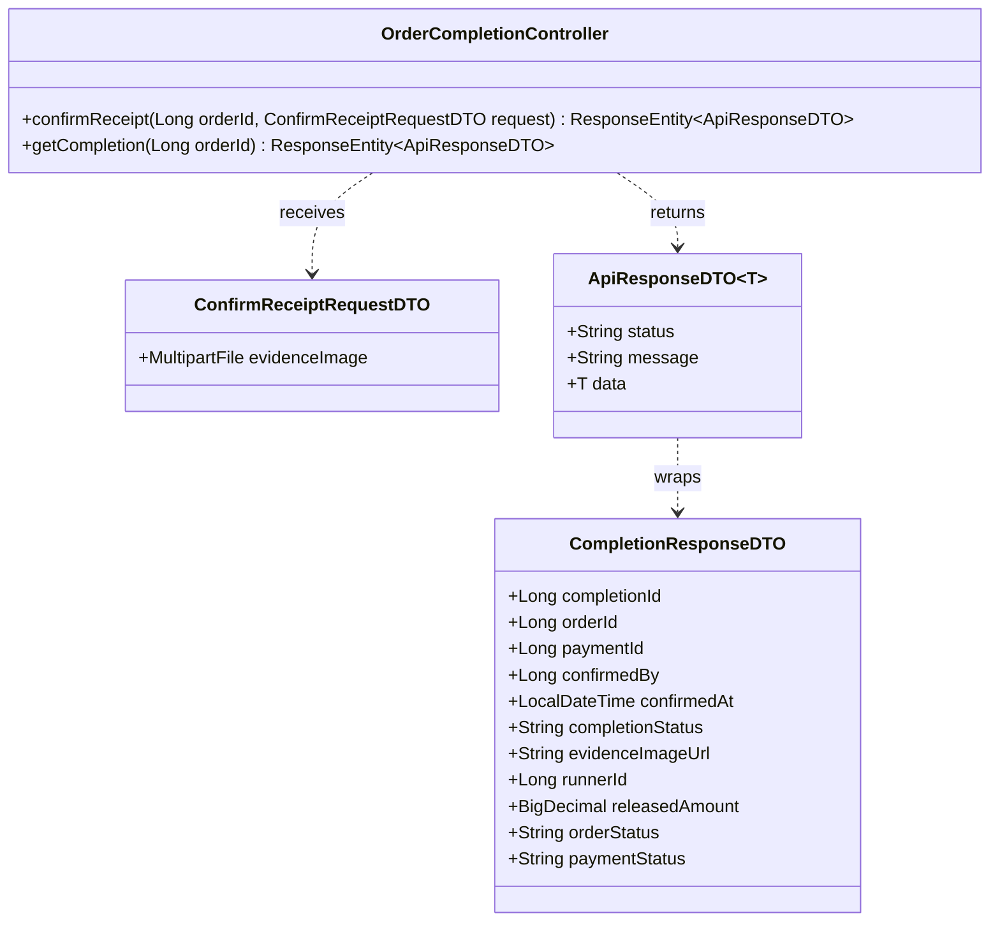
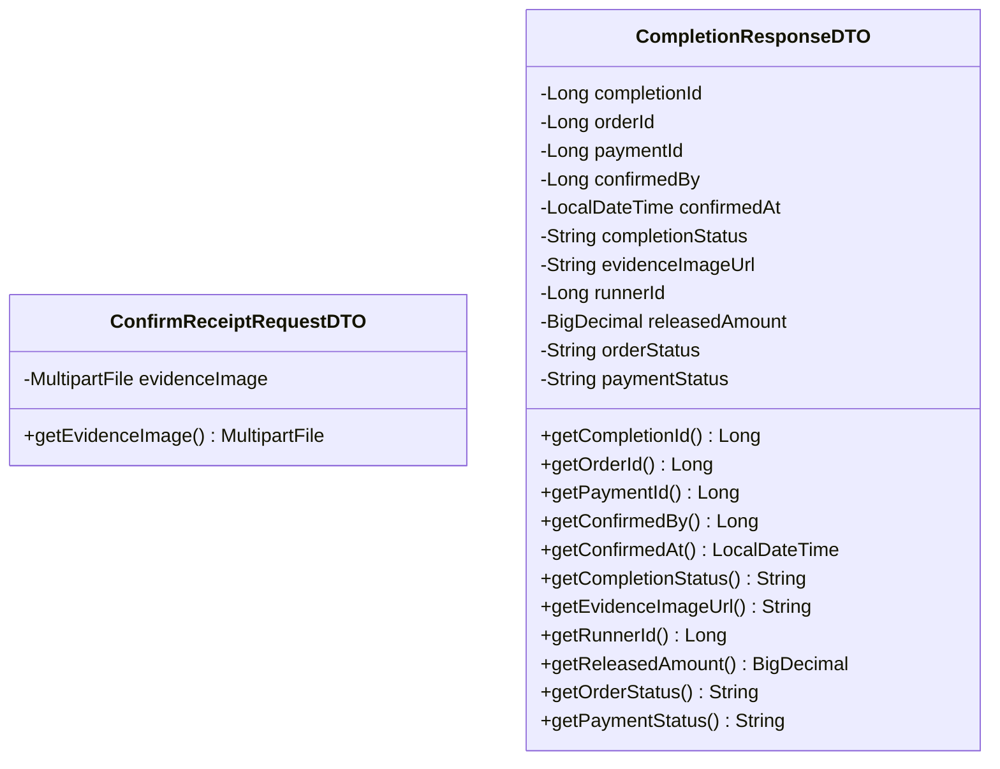
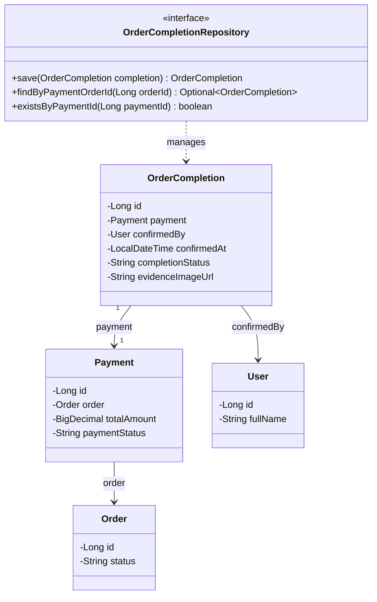
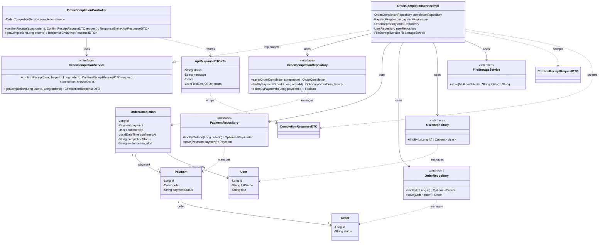

# Task24: US08 - ยืนยันการได้รับสินค้าและปิดออเดอร์ (API, API Class Diagram, DTO, DAO)

> ใช้ร่วมกับ [API Conventions](../common/API-CONVENTIONS.md) (รูปแบบ response, JWT, enum) และ [ERD](../database/ERD.md) (ตาราง `ORDER_COMPLETIONS`, `PAYMENTS`, `ORDERS`)
> ต่อจาก Task16 (ออเดอร์) และ Task20 (ชำระเงิน) ออเดอร์ต้องอยู่ในสถานะ `PAID` และมีการชำระเงินสถานะ `HELD` จึงจะยืนยันรับสินค้าได้

## 0. เงื่อนไขจาก User Story ที่ API ต้องรองรับ

| Test case ใน US08 | สิ่งที่ API ต้องทำ | Response |
|---|---|---|
| 1. ผู้ฝากหิ้วถ่ายรูปและส่งรูปเพื่อยืนยันว่าได้รับสินค้าเรียบร้อยแล้ว | บันทึกการยืนยันพร้อมรูป ปิดออเดอร์ และปล่อยเงินให้ผู้รับหิ้ว | `201 Created` |
| 2. ไม่มีรูปภาพหรือหลักฐานที่แน่ชัด ระบบไม่อนุญาตให้ปิดออเดอร์ | ไม่บันทึกและไม่เปลี่ยนสถานะใด ๆ | `400 Bad Request` |
| So that: โอนเงินค่าสินค้าพร้อมค่าหิ้วให้ผู้รับหิ้ว และปิดออเดอร์สมบูรณ์ไม่มีข้อพิพาทค้าง | `Payment` เปลี่ยนเป็น `RELEASED`, `Order` เปลี่ยนเป็น `COMPLETED` | อยู่ใน Endpoint 1 |

---

## 1. API Specification

### Endpoint 1: Confirm Receipt and Close Order (ยืนยันรับสินค้าและปิดออเดอร์)
- **URL:** `/api/v1/orders/{orderId}/completion`
- **Method:** `POST`
- **Headers:** `Authorization: Bearer <JWT_TOKEN>` (`BUYER` เจ้าของออเดอร์เท่านั้น)
- **Content-Type:** `multipart/form-data`
- **Request Parts:**

| Part | ชนิด | บังคับ | กติกา |
|---|---|---|---|
| `evidenceImage` | ไฟล์รูป | ใช่ | ต้องแนบไฟล์, ชนิด JPEG หรือ PNG, ขนาดไม่เกิน 5 MB |

*(หมายเหตุ: `confirmedBy` ไม่ต้องส่ง ระบบอ่านจาก JWT)*

**สิ่งที่ระบบทำเมื่อสำเร็จ (ใน transaction เดียว ถ้าขั้นใดล้มเหลวให้ rollback ทั้งหมด)**
1. ตรวจว่าผู้ใช้เป็นเจ้าของออเดอร์ และออเดอร์อยู่ในสถานะ `PAID`
2. ตรวจไฟล์รูป (ต้องมี ชนิด และขนาดถูกต้อง) แล้วเก็บไฟล์
3. บันทึก `OrderCompletion` (`completion_status = COMPLETED`, `confirmed_by` = ผู้ใช้จาก JWT, `confirmed_at` = เวลาปัจจุบัน, `evidence_image_url` = ที่อยู่ไฟล์)
4. เปลี่ยน `Payment.paymentStatus` จาก `HELD` เป็น `RELEASED` (เงินค่าสินค้าพร้อมค่าหิ้วไปที่ผู้รับหิ้ว)
5. เปลี่ยน `Order.status` จาก `PAID` เป็น `COMPLETED`

- **Response (201 Created):**
```json
{
  "status": "SUCCESS",
  "message": "Order completed successfully",
  "data": {
    "completionId": 701,
    "orderId": 5001,
    "paymentId": 3001,
    "confirmedBy": 2,
    "confirmedAt": "2026-10-25T15:10:00",
    "completionStatus": "COMPLETED",
    "evidenceImageUrl": "/uploads/completions/5001-1761376200.jpg",
    "runnerId": 1,
    "releasedAmount": 100.00,
    "orderStatus": "COMPLETED",
    "paymentStatus": "RELEASED"
  }
}
```

**Error Responses**

| HTTP Status | เงื่อนไข | ตัวอย่าง message |
|---|---|---|
| `400 Bad Request` | ไม่แนบรูป / ไม่ใช่ JPEG หรือ PNG / ขนาดเกิน 5 MB (ไม่บันทึกและไม่ปิดออเดอร์) | `Validation failed` พร้อม `errors` ระบุ field `evidenceImage` |
| `401 Unauthorized` | ไม่ส่ง token หรือ token ไม่ถูกต้อง | `Invalid or missing token` |
| `403 Forbidden` | ไม่ใช่ `BUYER` หรือไม่ใช่เจ้าของออเดอร์นี้ | `You are not the owner of this order` |
| `404 Not Found` | ไม่พบออเดอร์ตาม `orderId` | `Order not found` |
| `409 Conflict` | ออเดอร์ยังไม่ได้ชำระเงิน (สถานะ `PENDING`) | `Order has not been paid` |
| `409 Conflict` | ออเดอร์ถูกปิดไปแล้ว (สถานะ `COMPLETED`) | `Order is already completed` |

ตัวอย่าง `400`:
```json
{
  "status": "ERROR",
  "message": "Validation failed",
  "errors": [
    { "field": "evidenceImage", "message": "must not be empty" }
  ]
}
```
ข้อความอื่นของ field `evidenceImage`: `only JPEG or PNG images are allowed`, `file size must not exceed 5 MB`

### Endpoint 2: Get Order Completion (ดูผลการยืนยันรับสินค้า)
- **URL:** `/api/v1/orders/{orderId}/completion`
- **Method:** `GET`
- **Headers:** `Authorization: Bearer <JWT_TOKEN>` (ผู้ฝากหิ้วเจ้าของออเดอร์ หรือผู้รับหิ้วเจ้าของรอบที่ออเดอร์อยู่)
- **Response (200 OK):** `data` รูปแบบเดียวกับ `data` ใน Endpoint 1
- **Error:**

| HTTP Status | เงื่อนไข | ตัวอย่าง message |
|---|---|---|
| `401 Unauthorized` | ไม่มี token | `Invalid or missing token` |
| `403 Forbidden` | ไม่ใช่ผู้เกี่ยวข้องกับออเดอร์นี้ | `You are not allowed to view this order` |
| `404 Not Found` | ไม่พบออเดอร์ หรือออเดอร์ยังไม่ได้ยืนยันรับสินค้า | `Order completion not found` |

---

## 2. API Class Diagram


---

## 3. DTO Class Specification & Diagram

`ApiResponseDTO<T>` และ `FieldErrorDTO` ใช้ร่วมกันทุก task ดูที่ [API Conventions](../common/API-CONVENTIONS.md)

### DTO Specifications
1. **`ConfirmReceiptRequestDTO`** (รับแบบ `multipart/form-data` ผูกด้วย `@ModelAttribute`)
   - `evidenceImage`: MultipartFile (Not Null, ไม่เป็นไฟล์ว่าง, ชนิด `image/jpeg` หรือ `image/png`, ขนาดไม่เกิน 5 MB)
2. **`CompletionResponseDTO`**
   - `completionId`: Long
   - `orderId`: Long
   - `paymentId`: Long
   - `confirmedBy`: Long (ผู้ฝากหิ้วที่กดยืนยัน)
   - `confirmedAt`: LocalDateTime
   - `completionStatus`: String (`COMPLETED`)
   - `evidenceImageUrl`: String
   - `runnerId`: Long (ผู้รับหิ้วที่ได้รับเงิน ดึงจากรอบของออเดอร์)
   - `releasedAmount`: BigDecimal (เท่ากับ `PAYMENTS.total_amount`)
   - `orderStatus`: String (`COMPLETED`)
   - `paymentStatus`: String (`RELEASED`)

ขนาดไฟล์ 5 MB ต้องตั้งค่าที่ `spring.servlet.multipart.max-file-size` และ `spring.servlet.multipart.max-request-size` ใน `application.properties` ด้วย

### DTO Class Diagram


---

## 4. DAO / Repository Specification & Diagram

### Entity ที่เกี่ยวข้อง

**`OrderCompletion`** (ตาราง `order_completions`)

| Field | Column | หมายเหตุ |
|---|---|---|
| `id` | `id` | PK |
| `payment` (`Payment`) | `payment_id` | FK → `PAYMENTS.id`, UNIQUE (`@OneToOne`) หนึ่งการชำระเงินปิดได้ครั้งเดียว |
| `confirmedBy` (`User`) | `confirmed_by` | FK → `USERS.id` (`@ManyToOne`) |
| `confirmedAt` | `confirmed_at` | NOT NULL, DEFAULT CURRENT_TIMESTAMP |
| `completionStatus` | `completion_status` | NOT NULL (`COMPLETED`) |
| `evidenceImageUrl` | `evidence_image_url` | **column ใหม่** NOT NULL เก็บที่อยู่รูปหลักฐานตาม Test case 1 และ 2 |

> `evidence_image_url` ยังไม่มีใน ERD ต้องเพิ่มที่ตาราง `ORDER_COMPLETIONS` ใน [docs/database/ERD.md](../database/ERD.md) เพราะ US08 บังคับแนบรูปหลักฐาน

### Repository
- **Interface:** `OrderCompletionRepository` (extends `JpaRepository<OrderCompletion, Long>`)
- **Methods:**
  - `OrderCompletion save(OrderCompletion completion)` - บันทึกการยืนยันรับสินค้า (Endpoint 1)
  - `Optional<OrderCompletion> findByPaymentOrderId(Long orderId)` - ดูผลการยืนยันของออเดอร์ (Endpoint 2) ค้นผ่าน `payment.order.id`
  - `boolean existsByPaymentId(Long paymentId)` - กันการยืนยันซ้ำ
- **ใช้ร่วมกับ task อื่น (อยู่ใน transaction เดียวกัน):**
  - `OrderRepository.findById` / `save` (Task16) ตรวจเจ้าของ และเปลี่ยนสถานะออเดอร์เป็น `COMPLETED`
  - `PaymentRepository.findByOrderId` / `save` (Task20) ดึงการชำระเงินของออเดอร์ และเปลี่ยนสถานะเป็น `RELEASED`
  - `UserRepository.findById` (Task04) ดึงผู้ฝากหิ้วจาก JWT



---

## 5. Extended API Class Diagram (Full Layered Architecture)

Controller เรียก Service, Service ทำงานข้าม 3 ตารางใน transaction เดียว (`OrderCompletion`, `Payment`, `Order`) และใช้ `FileStorageService` ร่วมกับ Task20


