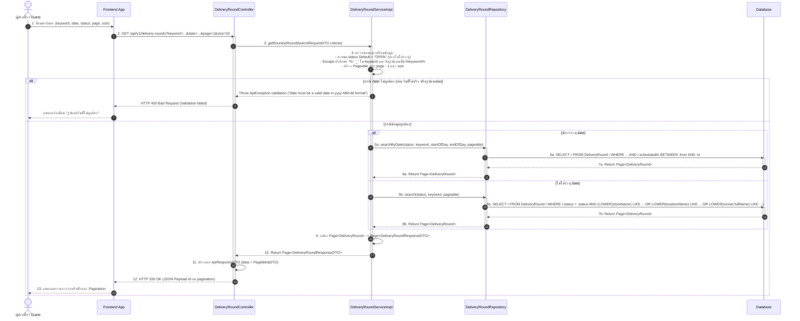

# Task 28: US02 - Sequence Diagram และ UI Prototype สำหรับระบบค้นหารอบรับหิ้ว

## 1. Sequence Diagram

### 1.1 Search Delivery Rounds (GET /api/v1/delivery-rounds)


### 1.2 Get Delivery Round Detail (GET /api/v1/delivery-rounds/{roundId})
```mermaid
sequenceDiagram
    autonumber
    actor Guest as ผู้ฝากหิ้ว / Guest
    participant FE as Frontend App
    participant Controller as DeliveryRoundController
    participant SVC as DeliveryRoundServiceImpl
    participant Repo as DeliveryRoundRepository
    participant DB as Database

    Guest->>FE: 1. กดเลือกดูรายละเอียดรอบรับหิ้ว (roundId)
    FE->>Controller: 2. GET /api/v1/delivery-rounds/{roundId}
    activate Controller
    
    Controller->>SVC: 3. getRound(roundId)
    activate SVC
    
    SVC->>Repo: 4. findById(roundId)
    activate Repo
    Repo->>DB: 5. SELECT * FROM delivery_rounds WHERE id = roundId
    activate DB
    DB-->>Repo: 6. Return Optional<DeliveryRound>
    deactivate DB
    Repo-->>SVC: 7. Return Optional<DeliveryRound>
    deactivate Repo
    
    alt ไม่พบข้อมูลรอบรับหิ้ว (Optional.isEmpty)
        SVC-->>Controller: Throw ApiException.notFound ("Delivery round not found")
        Controller-->>FE: HTTP 404 Not Found
        FE-->>Guest: แสดงแจ้งเตือน "ไม่พบรอบรับหิ้ว"
    else พบข้อมูลรอบรับหิ้ว
        SVC->>SVC: 8. แปลง Entity -> DeliveryRoundResponseDTO
        SVC-->>Controller: 9. Return DeliveryRoundResponseDTO
        deactivate SVC
        Controller-->>FE: 10. HTTP 200 OK (JSON Data)
        deactivate Controller
        FE-->>Guest: 11. แสดงรายละเอียดรอบรับหิ้ว (ร้านค้า, สถานที่, เวลา scheduledAt, ค่าหิ้ว serviceFee)
    end