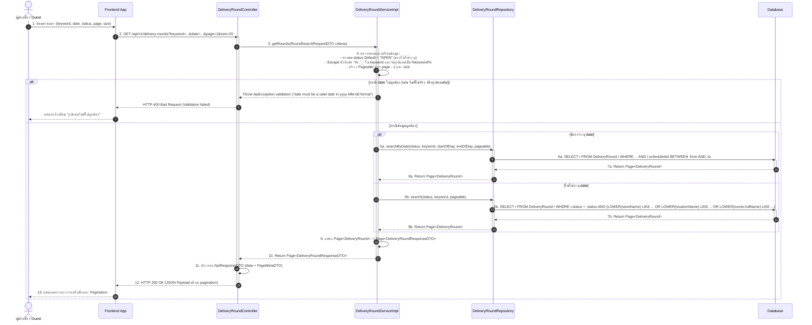
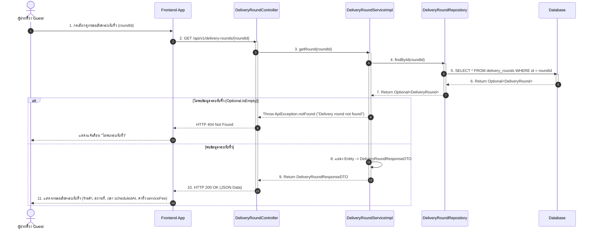

# Task 28: US02 - Sequence Diagram และ UI Prototype สำหรับระบบค้นหารอบรับหิ้ว

## 1. Sequence Diagram

### 1.1 Search Delivery Rounds (GET /api/v1/delivery-rounds)

### 1.2 Get Delivery Round Detail (GET /api/v1/delivery-rounds/{roundId})

## Test Cases (US02)

| Test Case ID | หัวข้อการทดสอบ (Test Scenario) | เงื่อนไข / Input Data | ผลลัพธ์ที่คาดหวัง (Expected Output) | HTTP Status |
| :--- | :--- | :--- | :--- | :---: |
| **TC-US02-01** | ค้นหารอบรับหิ้วด้วย `keyword` | `GET /api/v1/delivery-rounds?keyword=ชานม` | คืนค่ารายการรอบรับหิ้วที่มีชื่อร้าน, สถานที่ หรือชื่อผู้รับหิ้วตรงกับคำว่า "ชานม" | `200 OK` |
| **TC-US02-02** | ค้นหาโดยไม่ส่งค่า `status` | `GET /api/v1/delivery-rounds?keyword=SC1` | ระบบจะกรองและคืนค่าเฉพาะรอบรับหิ้วที่มีสถานะเป็น `OPEN` เท่านั้น | `200 OK` |
| **TC-US02-03** | ค้นหารอบรับหิ้วโดยระบุ `date` และ `keyword` | `GET /api/v1/delivery-rounds?keyword=SC1&date=2026-11-12` | คืนค่ารอบที่มีสถานะ `OPEN` ในวันที่ 2026-11-12 ที่ตรงกับคำค้นหา | `200 OK` |
| **TC-US02-04** | ทดสอบการแบ่งหน้า (Pagination) | `GET /api/v1/delivery-rounds?page=2&size=10` | คืนค่าข้อมูลรอบรับหิ้วหน้า 2 จำนวน 10 รายการ พร้อมวัตถุ `pagination` (`page: 2, size: 10`) | `200 OK` |
| **TC-US02-05** | ค้นหาด้วย `keyword` ที่มีอักขระพิเศษ `%` หรือ `_` | `GET /api/v1/delivery-rounds?keyword=100%` | มอง `%` เป็นตัวอักษรปกติ ไม่ใช้เป็น Wildcard และคืนค่าเฉพาะข้อมูลที่มีอักขระ `%` | `200 OK` |
| **TC-US02-06** | ค้นหาแล้วไม่พบข้อมูลรอบรับหิ้ว | `GET /api/v1/delivery-rounds?keyword=ร้านที่ไม่มีอยู่จริง` | คืนค่า `data: []` และ `totalItems: 0` ในส่วน pagination | `200 OK` |
| **TC-US02-07** | Validation Error: รูปแบบวันที่ไม่ถูกต้อง (`date`) | `GET /api/v1/delivery-rounds?date=2026-02-30` | คืนค่า Error Message `"date: must be a valid date in yyyy-MM-dd format"` | `400 Bad Request` |
| **TC-US02-08** | Validation Error: ค่า `page` หรือ `size` ไม่อยู่ในเกณฑ์ | `GET /api/v1/delivery-rounds?page=0&size=150` | คืนค่า Validation Error สำหรับ `page` ต้อง >= 1 และ `size` อยู่ระหว่าง 1 ถึง 100 | `400 Bad Request` |
| **TC-US02-09** | ดูรายละเอียดรอบรับหิ้วด้วย ID ที่มีอยู่จริง | `GET /api/v1/delivery-rounds/101` | คืนค่าข้อมูลรอบรับหิ้ว ID 101 ครบถ้วน | `200 OK` |
| **TC-US02-10** | ดูรายละเอียดรอบรับหิ้วด้วย ID ที่ไม่มีในระบบ | `GET /api/v1/delivery-rounds/9999` | คืนค่า Error Message `"Delivery round not found"` | `404 Not Found` |