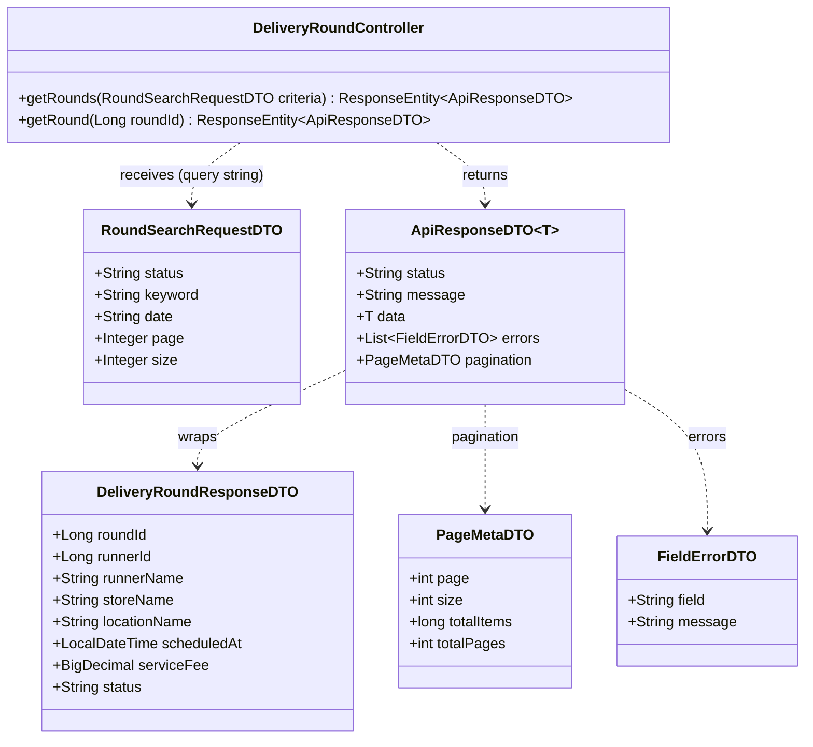
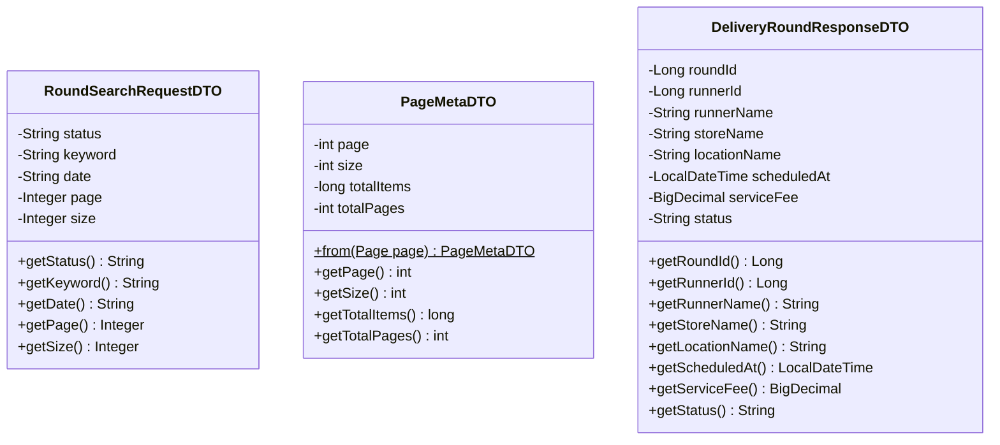
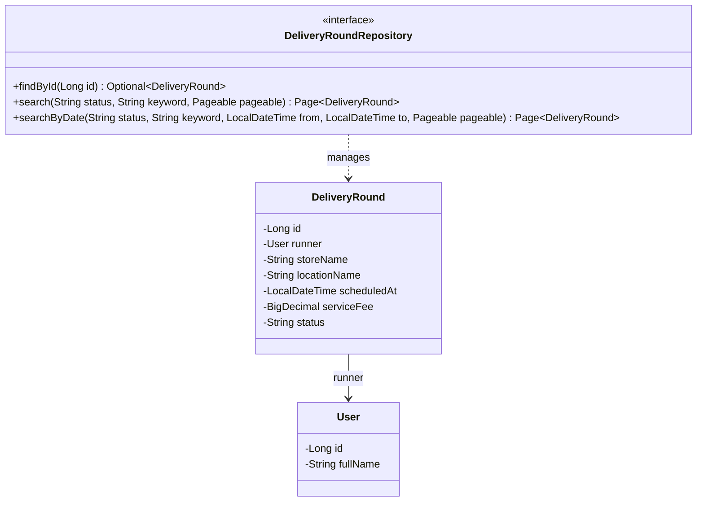
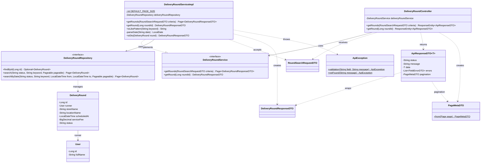

# Task29: US02 - ค้นหาและดูรอบรับหิ้วที่เปิดอยู่ (API Spec, API Class Diagram, DTO, DAO)

> ใช้ร่วมกับ [API Conventions](../common/API-CONVENTIONS.md) (รูปแบบ response, error) และต่อยอดจาก [Task08 เปิดรอบรับหิ้ว](../task-08/README.md) (ตาราง `delivery_rounds`, `DeliveryRoundRepository`)
> โค้ดที่ทำตามเอกสารนี้อยู่ใน Task31 [Backend]

## 0. เงื่อนไขจาก User Story ที่ API ต้องรองรับ

| เงื่อนไขใน US02 | สิ่งที่ API ต้องทำ | Endpoint |
|---|---|---|
| Test case 1: ผู้ฝากหิ้วค้นหาและดูรายละเอียดรอบรับหิ้วที่กำลังเปิดอยู่ได้ | ค้นหารอบจากคำค้น (ชื่อร้าน สถานที่ ชื่อผู้รับหิ้ว) และวันที่ แล้วดูรายละเอียดรอบที่เลือก | Endpoint 1 และ 2 |
| Test case 2: ระบบไม่แสดงรอบรับหิ้วที่ปิดไปแล้วหรือไม่เปิดรับฝากหิ้ว | ผลค้นหามีเฉพาะรอบสถานะ `OPEN` เสมอเมื่อไม่ได้ระบุ `status` | Endpoint 1 |
| So that 1: เลือกรอบที่ตรงกับร้านหรือสถานที่ที่ต้องการได้ | `keyword` ค้นได้ทั้งชื่อร้านและสถานที่ | Endpoint 1 |
| So that 2: ทราบวัน เวลา และค่าหิ้วก่อนเข้าร่วมรอบ | ผลลัพธ์มี `scheduledAt` และ `serviceFee` ทุกรายการ | Endpoint 1 และ 2 |
| การ์ด Task30 [Frontend]: หน้าจอค้นหารอบมี Pagination | แบ่งผลค้นหาเป็นหน้าด้วย `page` และ `size` และบอกจำนวนทั้งหมด | Endpoint 1 |

### ทำไมใช้ `/api/v1/delivery-rounds` ไม่ใช่ `/api/v1/rounds` ตามการ์ด

ระบบมี endpoint รายการรอบอยู่แล้วตั้งแต่ Task08 คือ `GET /api/v1/delivery-rounds` (ได้เฉพาะรอบ `OPEN` อยู่แล้ว) และหน้าเว็บ `rounds.html` เรียก endpoint นี้อยู่ US02 จึง**เพิ่ม query parameter ให้ endpoint เดิม** แทนการสร้าง `/rounds` ใหม่ เพื่อไม่ให้มี API ซ้ำกัน 2 ตัว `data` ยังเป็น array ของรอบเหมือนเดิม หน้าเว็บเดิมจึงอ่านได้ทันที ส่วนข้อมูลการแบ่งหน้าแยกไว้ใน field ใหม่ `pagination`

### ขอบเขต
- ค้นหาได้ทั้ง Guest และผู้ที่ login แล้ว (ไม่ต้องใช้ token) ตามกติกา Guest ใน API Conventions
- ผลค้นหาแบ่งเป็นหน้า หน้าละ 20 รอบถ้าไม่ระบุ `size`

---

## 1. API Specification

### Endpoint 1: Search Delivery Rounds (ค้นหารอบรับหิ้ว)
- **URL:** `/api/v1/delivery-rounds`
- **Method:** `GET`
- **Headers:** ไม่ต้องใช้ token (Guest ดูได้)
- **Query Parameters:** ไม่บังคับทุกตัว

| Parameter | Type | ความหมาย | ถ้าไม่ส่ง |
|---|---|---|---|
| `keyword` | string | คำค้นจากชื่อร้าน (`storeName`) สถานที่ (`locationName`) หรือชื่อผู้รับหิ้ว (`runnerName`) แบบมีคำนี้อยู่ส่วนใดก็ได้ ไม่สนตัวพิมพ์เล็กใหญ่ | ไม่กรองตามคำค้น |
| `date` | string `yyyy-MM-dd` | วันที่ของ `scheduledAt` (ตั้งแต่ 00:00 ของวันนั้นถึงก่อน 00:00 ของวันถัดไป) | ไม่กรองตามวันที่ |
| `status` | string | สถานะรอบ `OPEN`, `CLOSED`, `COMPLETED`, `CANCELLED` (มีตั้งแต่ Task08) | ได้เฉพาะ `OPEN` |
| `page` | integer ≥ 1 | หน้าที่ต้องการ เริ่มนับที่ 1 | `1` |
| `size` | integer 1 ถึง 100 | จำนวนรอบต่อหน้า | `20` |

- **กติกาของ `keyword`:**
  - ตัดช่องว่างหน้าหลังก่อนค้น ถ้าเหลือเป็นค่าว่าง ถือว่าไม่ได้ส่งมา
  - ตัวอักษร `%` และ `_` ที่ผู้ใช้พิมพ์ ถือเป็นตัวอักษรธรรมดา ไม่ใช่ wildcard
- **การเรียงลำดับ:** `scheduledAt` จากใกล้ที่สุดไปไกลที่สุด (เวลาเท่ากันเรียงตาม `roundId`) เพื่อให้แต่ละหน้าไม่ซ้ำกัน
- **ตัวอย่าง:**
  - `GET /api/v1/delivery-rounds?keyword=ชานม`
  - `GET /api/v1/delivery-rounds?keyword=sc1&date=2026-11-12`
  - `GET /api/v1/delivery-rounds?keyword=ชานม&page=2&size=10`
- **Response (200 OK):** `data` คือรอบของหน้านั้น และ `pagination` บอกหน้าปัจจุบันกับจำนวนทั้งหมด
  - ไม่พบรอบที่ตรงเงื่อนไข ได้ `data: []` และ `totalItems: 0` (ยังเป็น 200)
  - ขอหน้าที่เกินจำนวนหน้าที่มี ได้ `data: []` และ `pagination` บอกจำนวนจริง (ยังเป็น 200)
```json
{
  "status": "SUCCESS",
  "data": [
    {
      "roundId": 101,
      "runnerId": 1,
      "runnerName": "Naphat Thongkao",
      "storeName": "ร้านชานม ตึก SC",
      "locationName": "อาคารเรียนรวมสังคมศาสตร์ (SC1) มธ.รังสิต",
      "scheduledAt": "2026-11-12T14:00:00",
      "serviceFee": 20.00,
      "status": "OPEN"
    }
  ],
  "pagination": {
    "page": 1,
    "size": 20,
    "totalItems": 1,
    "totalPages": 1
  }
}
```

| Field ใน `pagination` | ความหมาย |
|---|---|
| `page` | หน้าปัจจุบัน (เริ่มที่ 1) |
| `size` | จำนวนรอบต่อหน้าที่ใช้ |
| `totalItems` | จำนวนรอบทั้งหมดที่ตรงเงื่อนไข (ทุกหน้ารวมกัน) |
| `totalPages` | จำนวนหน้าทั้งหมด |

- **Error Responses:**

| Status | เมื่อไหร่ | `errors` |
|---|---|---|
| `400 Bad Request` | `date` ไม่ใช่รูปแบบ `yyyy-MM-dd` หรือเป็นวันที่ไม่มีจริง เช่น `2026-02-30` | `date`: `must be a valid date in yyyy-MM-dd format` |
| `400 Bad Request` | `keyword` ยาวเกิน 100 ตัวอักษร | `keyword`: `must be at most 100 characters` |
| `400 Bad Request` | `status` ไม่อยู่ในค่าที่กำหนด | `status`: `must be one of OPEN, CLOSED, COMPLETED, CANCELLED` |
| `400 Bad Request` | `page` น้อยกว่า 1 | `page`: `must be greater than or equal to 1` |
| `400 Bad Request` | `size` น้อยกว่า 1 หรือมากกว่า 100 | `size`: `must be between 1 and 100` |
| `400 Bad Request` | `page` หรือ `size` ไม่ใช่ตัวเลข | `page` หรือ `size`: `has an invalid format` |

ตัวอย่าง error:
```json
{
  "status": "ERROR",
  "message": "Validation failed",
  "errors": [
    { "field": "date", "message": "must be a valid date in yyyy-MM-dd format" }
  ]
}
```

### Endpoint 2: Get Delivery Round Detail (รายละเอียดรอบรับหิ้ว)
ใช้ของเดิมจาก Task08 Endpoint 4 ไม่มีการเปลี่ยนแปลง
- **URL:** `/api/v1/delivery-rounds/{roundId}`
- **Method:** `GET`
- **Headers:** ไม่ต้องใช้ token
- **Response (200 OK):** `data` เป็นรอบเดียว รูปแบบเดียวกับรายการใน Endpoint 1
- **Error:** `404` (`Delivery round not found`) เมื่อไม่พบรอบ

---

## 2. API Class Diagram



> `DeliveryRoundController` มีเมธอดอื่นจาก Task08 (createRound, getMyRounds, updateStatus) ที่ไม่เกี่ยวกับ US02 จึงไม่ได้แสดงในแผนภาพนี้

---

## 3. DTO Class Specification & Diagram

### DTO Specifications

**`RoundSearchRequestDTO` (ใหม่):** รับค่าจาก query string ของ Endpoint 1 ผ่าน `@ModelAttribute` และตรวจด้วย `@Valid`

| Field | Type | Validation | หมายเหตุ |
|---|---|---|---|
| `status` | String | `@Pattern(OPEN\|CLOSED\|COMPLETED\|CANCELLED)` | ไม่ส่ง = `OPEN` |
| `keyword` | String | `@Size(max = 100)` | ค้นแบบมีคำนี้อยู่ ไม่สนตัวพิมพ์เล็กใหญ่ |
| `date` | String | `@Pattern(\d{4}-\d{2}-\d{2})` และ Service ตรวจซ้ำว่าเป็นวันที่มีจริง | แปลงเป็นช่วงเวลา 00:00 ถึงก่อน 00:00 วันถัดไป |
| `page` | Integer | `@Min(1)` | ไม่ส่ง = 1 |
| `size` | Integer | `@Min(1)`, `@Max(100)` | ไม่ส่ง = 20 |

**`PageMetaDTO` (ใหม่):** ข้อมูลการแบ่งหน้าที่ส่งใน field `pagination` ของ `ApiResponseDTO` สร้างจาก `Page` ของ Spring ด้วย `PageMetaDTO.from(page)` (แปลงเลขหน้าจากเริ่ม 0 เป็นเริ่ม 1)

| Field | Type | หมายเหตุ |
|---|---|---|
| `page` | int | หน้าปัจจุบัน เริ่มที่ 1 |
| `size` | int | จำนวนรอบต่อหน้า |
| `totalItems` | long | จำนวนรอบทั้งหมดที่ตรงเงื่อนไข |
| `totalPages` | int | จำนวนหน้าทั้งหมด |

**`ApiResponseDTO<T>` (แก้จาก Sprint 1):** เพิ่ม field `pagination` (ส่งเฉพาะ endpoint ที่แบ่งหน้า endpoint อื่นไม่มี field นี้) และเมธอด `success(T data, PageMetaDTO pagination)`

**`DeliveryRoundResponseDTO` (ใช้ของเดิมจาก Task08):** ข้อมูลรอบหนึ่งรอบ มี `runnerName` ให้หน้าเว็บแสดงชื่อผู้รับหิ้ว

### DTO Class Diagram



---

## 4. DAO / Repository Specification & Diagram

### Entity ที่ใช้ (ของเดิมจาก Task08 ไม่มีตารางหรือ column ใหม่)

| Entity / Field | Column | ใช้ใน US02 |
|---|---|---|
| `DeliveryRound.storeName` | `delivery_rounds.store_name` | ค้นด้วย `keyword` |
| `DeliveryRound.locationName` | `delivery_rounds.location_name` | ค้นด้วย `keyword` |
| `DeliveryRound.runner.fullName` | `users.full_name` (ผ่าน `runner_id`) | ค้นด้วย `keyword` |
| `DeliveryRound.scheduledAt` | `delivery_rounds.scheduled_at` | กรองด้วย `date` และใช้เรียงลำดับ |
| `DeliveryRound.status` | `delivery_rounds.status` | ได้เฉพาะ `OPEN` เมื่อไม่ส่ง `status` (Test case 2) |

### Repository
- **Interface:** `DeliveryRoundRepository` (extends `JpaRepository<DeliveryRound, Long>`)
- **เมธอดใหม่ (US02):** คืนค่าเป็น `Page` ตาม `Pageable` ที่ Service สร้างจาก `page` และ `size` และมี count query แยกสำหรับนับ `totalItems`
  - `Page<DeliveryRound> search(String status, String keyword, Pageable pageable)` ค้นตามสถานะและคำค้น เรียง `scheduledAt` จากน้อยไปมาก
  - `Page<DeliveryRound> searchByDate(String status, String keyword, LocalDateTime from, LocalDateTime to, Pageable pageable)` เหมือน `search` แต่จำกัด `from <= scheduledAt < to`
- **คำค้นที่ส่งเข้า Repository:** Service แปลงเป็นตัวพิมพ์เล็กและครอบด้วย `%` แล้ว (เช่น `%ชานม%`) และ escape ตัว `%` `_` ของผู้ใช้ด้วย `!` ถ้าไม่มีคำค้นจะส่ง `%` ซึ่งตรงกับทุกรอบ
- **JPQL ของ `search`:**
```sql
SELECT r FROM DeliveryRound r
WHERE r.status = :status
  AND (LOWER(r.storeName) LIKE :keyword ESCAPE '!'
       OR LOWER(r.locationName) LIKE :keyword ESCAPE '!'
       OR LOWER(r.runner.fullName) LIKE :keyword ESCAPE '!')
ORDER BY r.scheduledAt ASC, r.id ASC
-- count query: SELECT COUNT(r) ... (เงื่อนไข WHERE เดียวกัน ไม่มี ORDER BY)
```
- **เมธอดเดิมจาก Task08 ที่ยังใช้:** `findById(Long id)` (Endpoint 2), `findByStatusOrderByScheduledAtAsc`, `findByRunnerIdOrderByScheduledAtDesc` (ไม่ได้ลบ เพราะ Unit Test ของ DAO ใช้อยู่)



---

## 5. Extended API Class Diagram (Full Layered Architecture)

Controller รับเงื่อนไขค้นหาเป็น `RoundSearchRequestDTO` ส่งให้ Service ซึ่งแปลงคำค้น วันที่ และหน้า แล้วเลือกเรียก `search` หรือ `searchByDate` ของ Repository ได้ `Page` กลับมา Controller แยกเป็น `data` (รายการ) กับ `pagination` (`PageMetaDTO`)



### ขั้นตอนใน Service (`getRounds`)
1. `status` ไม่ส่ง → ใช้ `OPEN` (Test case 2)
2. แปลง `keyword` เป็น pattern เช่น `%ชานม%` ถ้าไม่มีคำค้นใช้ `%`
3. สร้าง `Pageable` จาก `page - 1` (Spring เริ่มนับที่ 0) และ `size` (ไม่ส่ง = 20)
4. ไม่มี `date` → เรียก `search(status, keyword, pageable)`
5. มี `date` → แปลงเป็น `LocalDate` (วันที่ไม่มีจริงโยน `ApiException.validation` → 400) แล้วเรียก `searchByDate(status, keyword, date 00:00, วันถัดไป 00:00, pageable)`
6. แปลง `DeliveryRound` ทุกตัวในหน้านั้นเป็น `DeliveryRoundResponseDTO` คืนเป็น `Page`
7. Controller ส่ง `page.getContent()` เป็น `data` และ `PageMetaDTO.from(page)` เป็น `pagination`
