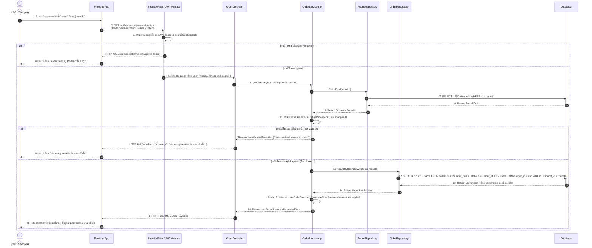

# Task 33: US04 - Sequence Diagram และ UI แสดงรายการฝากซื้อในรอบ

## 1. Sequence Diagram

### 1.1 View Round Orders (GET /api/v1/rounds/{roundId}/orders)

## 2. Test Cases 

| Test Case ID | หัวข้อการทดสอบ (Test Scenario) | เงื่อนไข / Input Data | ผลลัพธ์ที่คาดหวัง (Expected Output) | HTTP Status |
| :--- | :--- | :--- | :--- | :---: |
| **TC-US04-01** | ดูรายการฝากซื้อในรอบของตนเองสำเร็จ (มีข้อมูลสั่งซื้อ) | `GET /api/v1/rounds/101/orders` + Token เจ้าของรอบ | คืนค่า List รายการสั่งซื้อทั้งหมดพร้อมรายละเอียดสินค้าและข้อมูลผู้ฝาก | `200 OK` |
| **TC-US04-02** | ดูรายการฝากซื้อในรอบของตนเอง แต่ยังไม่มีใครฝากซื้อ (Empty List) | `GET /api/v1/rounds/102/orders` + Token เจ้าของรอบ | คืนค่า `data: []` (อาร์เรย์ว่าง) ไม่เกิด Error | `200 OK` |
| **TC-US04-03** | ป้องกันผู้รับหิ้วคนอื่นแอบดูรายการฝากซื้อในรอบ | `GET /api/v1/rounds/101/orders` + Token ผู้รับหิ้วท่านอื่น | ปฏิเสธการเข้าถึง และคืนค่า Error `"ไม่สามารถดูรายการฝากซื้อของรอบอื่นได้"` | `403 Forbidden` |
| **TC-US04-04** | ป้องกันผู้ฝากหิ้ว (Buyer/Role อื่น) เรียกดู API ผู้รับหิ้ว | `GET /api/v1/rounds/101/orders` + Token ของผู้ฝากหิ้ว | ปฏิเสธการเข้าถึง เนื่องจากสิทธิ์ไม่ถึง (Access Denied) | `403 Forbidden` |
| **TC-US04-05** | ผู้ใช้งานไม่ได้ยืนยันตัวตน / Token หมดอายุ | `GET /api/v1/rounds/101/orders` (ไม่ส่ง Header Authorization) | คืนค่า Error Unauthorized | `401 Unauthorized` |
| **TC-US04-06** | ระบุ ID รอบรับหิ้วที่ไม่พบในระบบ | `GET /api/v1/rounds/9999/orders` + Token เจ้าของรอบ | คืนค่า Error Message `"Round not found"` | `404 Not Found` |
| **TC-US04-07** | Validation Error: รูปแบบ `roundId` ไม่ถูกต้อง | `GET /api/v1/rounds/abc/orders` + Token เจ้าของรอบ | คืนค่า Validation Error สำหรับ Parameter `roundId` ต้องเป็นตัวเลข | `400 Bad Request` |