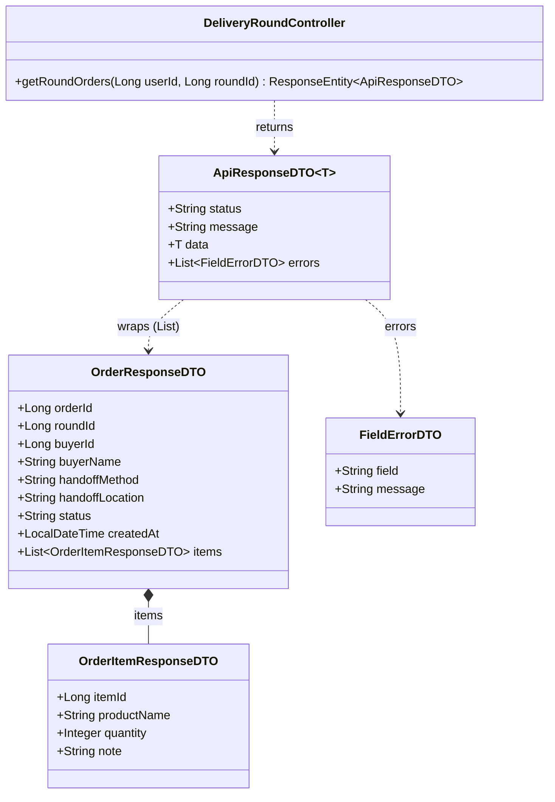
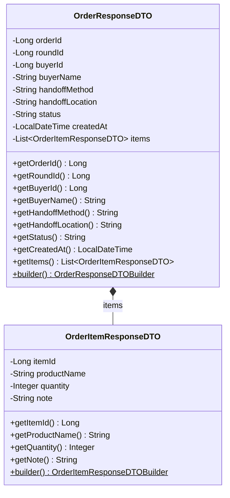
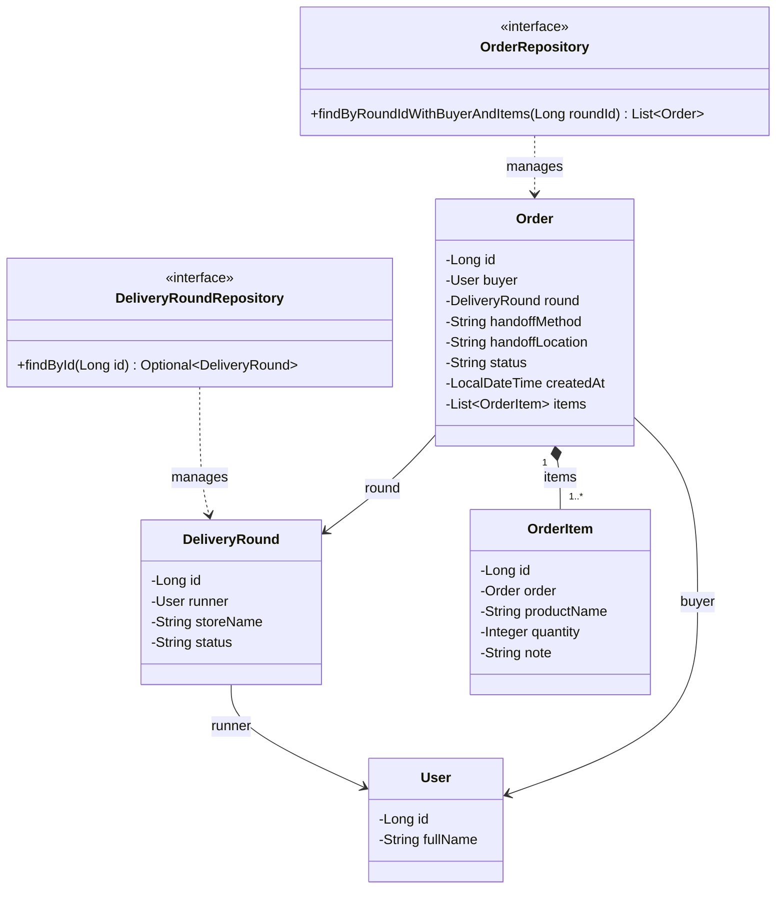
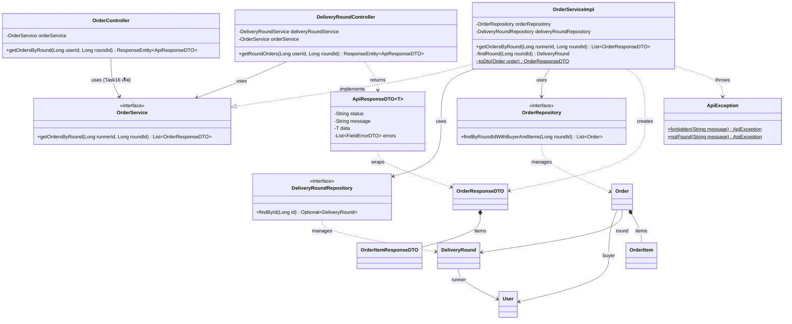

# Task34: US04 - ดูรายการฝากซื้อทั้งหมดในรอบ (API Spec, API Class Diagram, DTO, DAO)

> ใช้ร่วมกับ [API Conventions](../common/API-CONVENTIONS.md) (รูปแบบ response, error) และต่อยอดจาก [Task08 เปิดรอบรับหิ้ว](../task-08/README.md) (ตาราง `delivery_rounds`) กับ [Task16 ฝากซื้อสินค้า](../task-16/README.md) (ตาราง `orders`, `order_items`)
> โค้ดที่ทำตามเอกสารนี้อยู่ใน Task36 [Backend] ส่วน Sequence Diagram อยู่ใน Task33 [Design]

## 0. เงื่อนไขจาก User Story ที่ API ต้องรองรับ

| เงื่อนไขใน US04 | สิ่งที่ API ต้องทำ |
|---|---|
| I want to: ผู้รับหิ้วดูรายการฝากซื้อทั้งหมดในรอบที่เปิดอยู่ | คืนออเดอร์ทุกรายการของรอบที่ระบุ ทุกสถานะ |
| So that 1: รวบรวมรายการสินค้าจากผู้ฝากหิ้วหลายคนได้ | แต่ละออเดอร์มีชื่อผู้ฝากหิ้ว (`buyerName`) และรายการสินค้า (`items`) ครบในครั้งเดียว |
| So that 2: ตรวจสอบรายละเอียดแต่ละรายการก่อนเดินทางไปซื้อ | ทุกรายการสินค้ามีชื่อสินค้า จำนวน และหมายเหตุ ทุกออเดอร์มีวิธีและจุดส่งมอบ |
| Task33 TC-US04-01: เจ้าของรอบดูรายการฝากซื้อในรอบตัวเองได้ | `200` พร้อม array ของออเดอร์ |
| Task33 TC-US04-02: รอบที่ยังไม่มีใครฝากซื้อ | `200` และ `data: []` ไม่ใช่ error |
| Task33 TC-US04-03 และ 04: ผู้รับหิ้วคนอื่นหรือผู้ฝากหิ้วเรียกดู | `403` เพราะไม่ใช่เจ้าของรอบ |
| Task33 TC-US04-05: ไม่ส่ง token หรือ token หมดอายุ | `401` |

### ขอบเขต
- **ใช้ได้เฉพาะเจ้าของรอบ** ต้องมี token และ `userId` ใน token ต้องเป็นผู้รับหิ้วของรอบนั้น
- **endpoint เดิม `GET /api/v1/orders?roundId=` (Task16 Endpoint 3) ยังใช้ได้เหมือนเดิม** ทั้งสอง endpoint เรียก Service ตัวเดียวกันจึงได้ผลลัพธ์เหมือนกันทุกอย่าง หน้าเว็บที่เรียกของเดิมอยู่ใช้ต่อได้โดยไม่ต้องแก้
- **ไม่แบ่งหน้า (ไม่มี `pagination`):** ผู้รับหิ้วต้องเห็นรายการครบทุกออเดอร์ก่อนไปซื้อ จำนวนออเดอร์ในรอบเดียวไม่มาก และ Task33 ออกแบบให้ได้รายการทั้งหมดในครั้งเดียว
- **ดึงข้อมูลใน query เดียว:** ออเดอร์ ผู้ฝากหิ้ว และรายการสินค้าดึงมาพร้อมกันด้วย `JOIN FETCH` ตาม Task33 ขั้นที่ 11 และ 12 ออเดอร์ในรอบเยอะขึ้นก็ยังใช้ 2 query เท่าเดิม (หารอบ 1 ครั้ง และดึงออเดอร์ 1 ครั้ง)

---

## 1. API Specification

### Endpoint: Get Orders of a Delivery Round (รายการฝากซื้อทั้งหมดในรอบ)
- **URL:** `/api/v1/delivery-rounds/{roundId}/orders`
- **Method:** `GET`
- **Headers:** `Authorization: Bearer <JWT_TOKEN>` (เจ้าของรอบนั้นเท่านั้น)
- **Path Parameter:**

| Parameter | Type | ความหมาย |
|---|---|---|
| `roundId` | Long | รหัสรอบรับหิ้ว |

- **ผลลัพธ์:** ออเดอร์ทุกสถานะในรอบนั้น พร้อมผู้ฝากหิ้วและรายการสินค้า
- **การเรียงลำดับ:** `createdAt` จากเก่าไปใหม่ (ฝากก่อนอยู่ก่อน) ถ้าเวลาเท่ากันเรียงตาม `orderId`
- **ตัวอย่าง:** `GET /api/v1/delivery-rounds/101/orders`
- **Response (200 OK):** `data` เป็น array ของออเดอร์ รูปแบบเดียวกับ Task16
  - รอบที่ยังไม่มีออเดอร์ ได้ `data: []` (ยังเป็น 200)
```json
{
  "status": "SUCCESS",
  "data": [
    {
      "orderId": 501,
      "roundId": 101,
      "buyerId": 7,
      "buyerName": "Somchai Jaidee",
      "handoffMethod": "MEETUP",
      "handoffLocation": "หน้าตึก SC1",
      "status": "PENDING",
      "createdAt": "2026-11-12T10:15:00",
      "items": [
        { "itemId": 901, "productName": "ลาเต้เย็น", "quantity": 2, "note": "หวานน้อย" }
      ]
    },
    {
      "orderId": 502,
      "roundId": 101,
      "buyerId": 8,
      "buyerName": "Malee Rakdee",
      "handoffMethod": "DELIVERY",
      "handoffLocation": "หอพัก A ห้อง 305",
      "status": "PAID",
      "createdAt": "2026-11-12T10:40:00",
      "items": [
        { "itemId": 902, "productName": "ชานมไข่มุก", "quantity": 1, "note": null },
        { "itemId": 903, "productName": "ขนมปังเนยสด", "quantity": 2, "note": "ไม่ปิ้ง" }
      ]
    }
  ]
}
```

- **Error Responses:**

| Status | เมื่อไหร่ | `message` |
|---|---|---|
| `400 Bad Request` | `roundId` ไม่ใช่ตัวเลข เช่น `/delivery-rounds/abc/orders` | `Validation failed` |
| `401 Unauthorized` | ไม่ส่ง token หรือ token ไม่ถูกต้อง/หมดอายุ | `Invalid or missing token` |
| `403 Forbidden` | ผู้ใช้ไม่ใช่เจ้าของรอบนี้ (ผู้รับหิ้วคนอื่น หรือผู้ฝากหิ้วในรอบนั้น) | `You are not the owner of this delivery round` |
| `404 Not Found` | ไม่พบรอบ | `Delivery round not found` |

ตัวอย่าง error:
```json
{
  "status": "ERROR",
  "message": "You are not the owner of this delivery round"
}
```

---

## 2. API Class Diagram



> `userId` มาจาก JWT (`@RequestAttribute`) ส่วน `roundId` มาจาก path (`@PathVariable`) `DeliveryRoundController` มีเมธอดอื่นจาก Task08 และ Task31 ที่ไม่เกี่ยวกับ US04 จึงไม่ได้แสดงในแผนภาพนี้

---

## 3. DTO Class Specification & Diagram

### DTO Specifications

US04 **ไม่มี DTO ใหม่** ใช้ DTO ของ Task16 ซึ่งมีข้อมูลที่ผู้รับหิ้วต้องใช้ครบแล้ว (ชื่อผู้ฝาก รายการสินค้า จุดส่งมอบ สถานะ) และเป็นรูปแบบเดียวกับ `GET /orders?roundId=` ที่หน้าเว็บใช้อยู่ หน้าเว็บจึงอ่านได้ทั้งสอง endpoint

**`OrderResponseDTO` (ของเดิมจาก Task16):** ออเดอร์หนึ่งรายการในรอบ

| Field | Type | หมายเหตุ |
|---|---|---|
| `orderId` | Long | รหัสออเดอร์ |
| `roundId` | Long | รหัสรอบ (เท่ากับ `roundId` ใน path ทุกรายการ) |
| `buyerId` | Long | รหัสผู้ฝากหิ้ว |
| `buyerName` | String | ชื่อผู้ฝากหิ้ว ใช้แยกรายการตามผู้ฝาก |
| `handoffMethod` | String | `MEETUP` หรือ `DELIVERY` |
| `handoffLocation` | String | จุดนัดรับหรือที่อยู่ส่ง |
| `status` | String | สถานะออเดอร์ เช่น `PENDING`, `PAID`, `COMPLETED` |
| `createdAt` | LocalDateTime | เวลาที่ฝากซื้อ ใช้เรียงลำดับ |
| `items` | List&lt;OrderItemResponseDTO&gt; | รายการสินค้าในออเดอร์ มีอย่างน้อย 1 รายการ |

**`OrderItemResponseDTO` (ของเดิมจาก Task16):** สินค้าหนึ่งรายการในออเดอร์

| Field | Type | หมายเหตุ |
|---|---|---|
| `itemId` | Long | รหัสรายการสินค้า |
| `productName` | String | ชื่อสินค้า |
| `quantity` | Integer | จำนวน |
| `note` | String | หมายเหตุถึงผู้รับหิ้ว ไม่มีได้ (`null`) |

**`ApiResponseDTO<T>` (ของเดิม):** endpoint นี้ส่งผ่าน `success(T data)` จึงไม่มี field `pagination`

### DTO Class Diagram



---

## 4. DAO / Repository Specification & Diagram

### Entity ที่ใช้ (ของเดิมจาก Task08 และ Task16 ไม่มีตารางหรือ column ใหม่)

| Entity / Field | Column | ใช้ใน US04 |
|---|---|---|
| `DeliveryRound.id` | `delivery_rounds.id` | หารอบจาก `roundId` (ไม่พบ → 404) |
| `DeliveryRound.runner` | `delivery_rounds.runner_id` | ตรวจว่าผู้เรียกเป็นเจ้าของรอบ (ไม่ใช่ → 403) |
| `Order.round` | `orders.round_id` | กรองเฉพาะออเดอร์ของรอบนี้ |
| `Order.buyer` | `orders.buyer_id` → `users.full_name` | ชื่อผู้ฝากหิ้ว (`buyerName`) |
| `Order.handoffMethod`, `handoffLocation`, `status` | `orders.handoff_method`, `handoff_location`, `status` | ส่งกลับใน response |
| `Order.createdAt` | `orders.created_at` | เรียงลำดับ |
| `Order.items` | `order_items.order_id` | รายการสินค้า (`product_name`, `quantity`, `note`) |

### Repository
- **`DeliveryRoundRepository`** (ของเดิม): ใช้ `findById(Long id)` หารอบ
- **`OrderRepository`** (extends `JpaRepository<Order, Long>`)
  - **เมธอดใหม่ (US04):** `List<Order> findByRoundIdWithBuyerAndItems(Long roundId)` ดึงออเดอร์ของรอบพร้อมผู้ฝากหิ้วและรายการสินค้าใน query เดียว
  - **ใช้แทน** `findByRoundIdOrderByCreatedAtAsc` ใน Service (เมธอดเดิมยังอยู่ ไม่ได้ลบ) เดิมดึงผู้ฝากหิ้วและรายการสินค้าทีหลังทีละออเดอร์ ออเดอร์ยิ่งเยอะยิ่งต้องคุยกับฐานข้อมูลหลายรอบ
- **JPQL ของ `findByRoundIdWithBuyerAndItems`:**
```sql
SELECT o FROM Order o
JOIN FETCH o.buyer
LEFT JOIN FETCH o.items
WHERE o.round.id = :roundId
ORDER BY o.createdAt ASC, o.id ASC
```
  - `JOIN FETCH o.buyer` ทุกออเดอร์มีผู้ฝากหิ้วเสมอ (`buyer_id` NOT NULL)
  - `LEFT JOIN FETCH o.items` ดึงรายการสินค้ามาพร้อมกัน
  - ออเดอร์ที่มีสินค้าหลายรายการได้ออกมาแค่ครั้งเดียว (Hibernate รวมแถวที่ซ้ำจากการ join `items` ให้เอง)



---

## 5. Extended API Class Diagram (Full Layered Architecture)

Controller รับ `userId` จาก JWT และ `roundId` จาก path ส่งให้ `OrderService` ตัวเดียวกับที่ `GET /orders?roundId=` (Task16) ใช้ Service หารอบและตรวจเจ้าของรอบก่อน แล้วจึงดึงออเดอร์ทั้งหมดพร้อมผู้ฝากและสินค้า แปลงเป็น `OrderResponseDTO`



### ขั้นตอนใน Service (`getOrdersByRound`)
1. `deliveryRoundRepository.findById(roundId)` ไม่พบรอบ → โยน `ApiException.notFound("Delivery round not found")` (404)
2. เทียบ `round.runner.id` กับ `userId` จาก token ไม่ตรง → โยน `ApiException.forbidden("You are not the owner of this delivery round")` (403)
3. `orderRepository.findByRoundIdWithBuyerAndItems(roundId)` ได้ออเดอร์ทั้งหมดพร้อมผู้ฝากและสินค้า เรียงเก่าไปใหม่
4. แปลง `Order` แต่ละตัวเป็น `OrderResponseDTO` (สินค้าแต่ละรายการเป็น `OrderItemResponseDTO`)
5. Controller ส่งกลับเป็น `ApiResponseDTO.success(list)` ไม่มีออเดอร์ได้ `data: []`

> ถ้าไม่มี token ไม่ถึง Service เลย Controller ตอบ `401` ทันที (ไม่มี `userId` จาก `JwtAuthFilter`)
