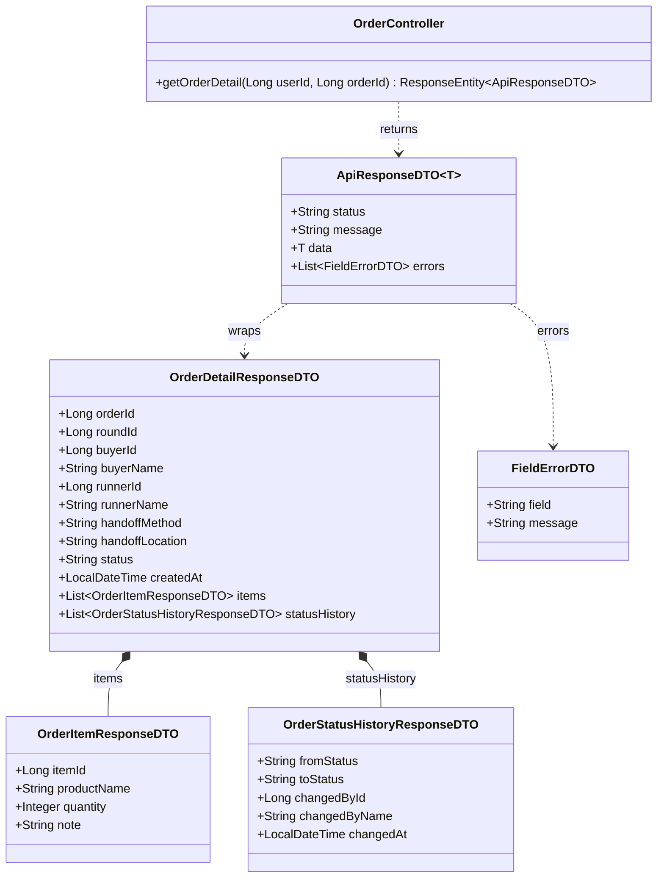
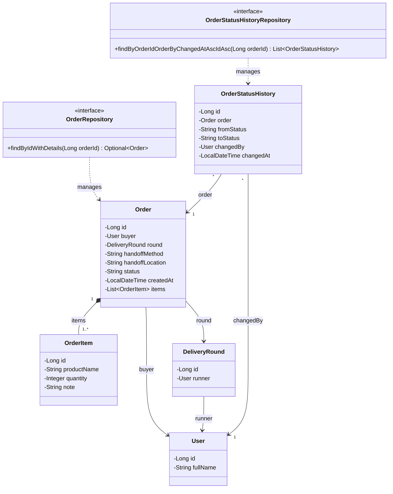
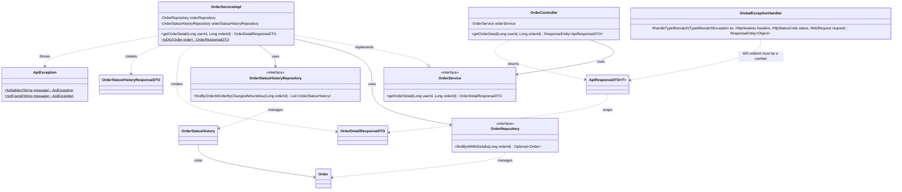

# Task39: US05 - ดูรายละเอียดและสถานะรายการฝากซื้อ (API Spec, API Class Diagram, DTO, DAO)

> ใช้ร่วมกับ [API Conventions](../common/API-CONVENTIONS.md) (รูปแบบ response, error) และต่อยอดจาก [Task16 ฝากซื้อสินค้า](../task-16/README.md) (`GET /orders/{orderId}` เดิม) กับ [Task44 อัปเดตสถานะออเดอร์](../task-44/README.md) (สถานะและตาราง `order_status_history`)
> โค้ดที่ทำตามเอกสารนี้อยู่ใน Task41 [Backend] ส่วน Sequence Diagram และหน้าจออยู่ใน Task38 [Design]

## 0. เงื่อนไขจาก User Story ที่ API ต้องรองรับ

| เงื่อนไขใน US05 | สิ่งที่ API ต้องทำ |
|---|---|
| I want to: ผู้ฝากหิ้วดูรายละเอียดและสถานะของรายการฝากซื้อของตนเอง | คืนรายละเอียดออเดอร์ รายการสินค้า จุดนัดรับ และสถานะปัจจุบัน |
| So that 1: ตรวจสอบว่ารายการฝากซื้ออยู่ในขั้นตอนไหน | `status` เป็นสถานะล่าสุดเสมอ |
| So that 2: ติดตามความคืบหน้าของการซื้อและจัดส่ง | `statusHistory` ประวัติการเปลี่ยนสถานะทุกครั้ง เรียงตามเวลา พร้อมชื่อผู้รับหิ้ว |
| Test case 1: ดูรายละเอียดสินค้า จุดนัดรับ และสถานะของตนเองได้ | `200` พร้อม `items`, `handoffMethod`, `handoffLocation`, `status` |
| Test case 2: สถานะตรงกับที่ผู้รับหิ้วอัปเดตล่าสุด | `status` อ่านจากออเดอร์ตอนเรียก และ `statusHistory` แถวสุดท้ายตรงกับ `status` |
| Task42: ผู้ใช้อื่นที่ไม่เกี่ยวข้องเข้าถึงข้อมูลออเดอร์ไม่ได้ | `403` สำหรับทุกคนที่ไม่ใช่ผู้ฝากหิ้วของออเดอร์หรือผู้รับหิ้วของรอบ |

### ขอบเขต
- **ใช้ endpoint เดิม** `GET /api/v1/orders/{orderId}` (Task16) และส่งข้อมูลเพิ่ม field เดิมยังอยู่ครบทุกตัว หน้าเว็บที่เรียกอยู่ใช้ต่อได้
- **ใครดูได้:** ผู้ฝากหิ้วของออเดอร์ และผู้รับหิ้วของรอบที่ออเดอร์อยู่ ผู้รับหิ้วต้องใช้หน้ารายละเอียดเดียวกันนี้เพื่อระบุราคา (Task20) และเปลี่ยนสถานะ (Task46)
- **ประวัติสถานะ** มาจากตาราง `order_status_history` (Task44) ซึ่งบันทึกตั้งแต่สร้างออเดอร์ ออเดอร์ที่สร้างก่อนมีตารางนี้ได้ `statusHistory: []`
- **id ที่ไม่ใช่ตัวเลข** ได้ `400` พร้อม `errors` บอกชื่อ parameter ใช้กับทุก endpoint ที่รับ id (เพิ่มใน [API Conventions](../common/API-CONVENTIONS.md))

---

## 1. API Specification

### Endpoint: Get Order Detail (รายละเอียดออเดอร์และประวัติสถานะ)
- **URL:** `/api/v1/orders/{orderId}`
- **Method:** `GET`
- **Headers:** `Authorization: Bearer <JWT_TOKEN>` (ผู้ฝากหิ้วของออเดอร์ หรือผู้รับหิ้วของรอบ)
- **Path Parameter:**

| Parameter | Type | ความหมาย |
|---|---|---|
| `orderId` | Long | รหัสออเดอร์ |

- **Response (200 OK):**
```json
{
  "status": "SUCCESS",
  "data": {
    "orderId": 501,
    "roundId": 101,
    "buyerId": 7,
    "buyerName": "Somchai Jaidee",
    "runnerId": 3,
    "runnerName": "Malee Rakdee",
    "handoffMethod": "MEETUP",
    "handoffLocation": "หน้าตึก SC1",
    "status": "PURCHASING",
    "createdAt": "2026-11-14T10:15:00",
    "items": [
      { "itemId": 901, "productName": "ลาเต้เย็น", "quantity": 2, "note": "หวานน้อย" }
    ],
    "statusHistory": [
      { "fromStatus": null, "toStatus": "PENDING", "changedById": 7, "changedByName": "Somchai Jaidee", "changedAt": "2026-11-14T10:15:00" },
      { "fromStatus": "PENDING", "toStatus": "PAID", "changedById": 7, "changedByName": "Somchai Jaidee", "changedAt": "2026-11-14T10:30:12" },
      { "fromStatus": "PAID", "toStatus": "ACCEPTED", "changedById": 3, "changedByName": "Malee Rakdee", "changedAt": "2026-11-14T11:02:40" },
      { "fromStatus": "ACCEPTED", "toStatus": "PURCHASING", "changedById": 3, "changedByName": "Malee Rakdee", "changedAt": "2026-11-14T11:20:05" }
    ]
  }
}
```

| Field | ความหมาย |
|---|---|
| `orderId`, `roundId`, `buyerId`, `buyerName`, `handoffMethod`, `handoffLocation`, `status`, `createdAt`, `items` | เหมือน Task16 เดิมทุกตัว |
| `runnerId`, `runnerName` | **ใหม่** ผู้รับหิ้วของรอบที่ออเดอร์อยู่ |
| `statusHistory` | **ใหม่** ประวัติสถานะเรียงเก่าไปใหม่ แถวแรกของออเดอร์ใหม่คือ `null` → `PENDING` |

- **Error Responses:**

| Status | เมื่อไหร่ | `message` |
|---|---|---|
| `400 Bad Request` | `orderId` ไม่ใช่ตัวเลข เช่น `/orders/abc` | `Validation failed` และ `errors: [{ "field": "orderId", "message": "must be a number" }]` |
| `401 Unauthorized` | ไม่ส่ง token หรือ token ไม่ถูกต้อง/หมดอายุ | `Invalid or missing token` |
| `403 Forbidden` | ผู้ใช้ไม่ใช่ผู้ฝากหิ้วของออเดอร์ และไม่ใช่ผู้รับหิ้วของรอบ | `You are not allowed to view this order` |
| `404 Not Found` | ไม่พบออเดอร์ | `Order not found` |

---

## 2. API Class Diagram



> `userId` มาจาก JWT (`@RequestAttribute`) และ `orderId` มาจาก path (`@PathVariable`) เมธอดอื่นของ `OrderController` จาก Task16 และ Task46 ไม่ได้แสดงในแผนภาพนี้

---

## 3. DTO Class Specification & Diagram

### DTO Specifications

**`OrderDetailResponseDTO`** (ใหม่): ผลของ `GET /orders/{orderId}` แยกจาก `OrderResponseDTO` เพราะ `OrderResponseDTO` ใช้ในรายการออเดอร์ (`/orders/my`, `/delivery-rounds/{roundId}/orders`) ซึ่งไม่ต้องมีประวัติสถานะของทุกออเดอร์

| Field | Type | หมายเหตุ |
|---|---|---|
| `orderId` | Long | รหัสออเดอร์ |
| `roundId` | Long | รหัสรอบ |
| `buyerId` | Long | ผู้ฝากหิ้ว |
| `buyerName` | String | ชื่อผู้ฝากหิ้ว |
| `runnerId` | Long | ผู้รับหิ้วของรอบ |
| `runnerName` | String | ชื่อผู้รับหิ้ว |
| `handoffMethod` | String | `MEETUP` หรือ `DELIVERY` |
| `handoffLocation` | String | จุดนัดรับหรือที่อยู่ส่ง |
| `status` | String | สถานะล่าสุด (ดู [Task44](../task-44/README.md)) |
| `createdAt` | LocalDateTime | เวลาที่ฝากซื้อ |
| `items` | List&lt;OrderItemResponseDTO&gt; | รายการสินค้า (DTO เดิมของ Task16) |
| `statusHistory` | List&lt;OrderStatusHistoryResponseDTO&gt; | ประวัติสถานะ เรียงเก่าไปใหม่ |

**`OrderStatusHistoryResponseDTO`** (ใหม่): การเปลี่ยนสถานะหนึ่งครั้ง

| Field | Type | หมายเหตุ |
|---|---|---|
| `fromStatus` | String | สถานะเดิม (`null` ตอนสร้างออเดอร์) |
| `toStatus` | String | สถานะใหม่ |
| `changedById` | Long | ผู้ที่ทำให้สถานะเปลี่ยน |
| `changedByName` | String | ชื่อผู้ที่ทำให้สถานะเปลี่ยน |
| `changedAt` | LocalDateTime | เวลาที่เปลี่ยน |

### DTO Class Diagram

```mermaid
classDiagram
    class OrderDetailResponseDTO {
        -Long orderId
        -Long roundId
        -Long buyerId
        -String buyerName
        -Long runnerId
        -String runnerName
        -String handoffMethod
        -String handoffLocation
        -String status
        -LocalDateTime createdAt
        -List~OrderItemResponseDTO~ items
        -List~OrderStatusHistoryResponseDTO~ statusHistory
        +getRunnerName() String
        +getStatusHistory() List~OrderStatusHistoryResponseDTO~
        +builder()$ OrderDetailResponseDTOBuilder
    }
    class OrderItemResponseDTO {
        -Long itemId
        -String productName
        -Integer quantity
        -String note
    }
    class OrderStatusHistoryResponseDTO {
        -String fromStatus
        -String toStatus
        -Long changedById
        -String changedByName
        -LocalDateTime changedAt
        +getFromStatus() String
        +getToStatus() String
        +getChangedAt() LocalDateTime
        +builder()$ OrderStatusHistoryResponseDTOBuilder
    }

    OrderDetailResponseDTO *-- OrderItemResponseDTO : items
    OrderDetailResponseDTO *-- OrderStatusHistoryResponseDTO : statusHistory
```



> getter ของทุก field สร้างด้วย Lombok `@Getter` แผนภาพแสดงเฉพาะตัวที่เพิ่มใหม่

---

## 4. DAO / Repository Specification & Diagram

### Entity ที่ใช้ (ของเดิม ไม่มีตารางหรือ column ใหม่)

| Entity / Field | Column | ใช้ใน US05 |
|---|---|---|
| `Order` | ตาราง `orders` | ข้อมูลออเดอร์และสถานะล่าสุด |
| `Order.buyer` | `orders.buyer_id` → `users` | ผู้ฝากหิ้ว และตรวจสิทธิ์ |
| `Order.round` → `DeliveryRound.runner` | `orders.round_id` → `delivery_rounds.runner_id` → `users` | ผู้รับหิ้ว และตรวจสิทธิ์ |
| `Order.items` | ตาราง `order_items` | รายการสินค้า |
| `OrderStatusHistory` | ตาราง `order_status_history` (Task44) | ประวัติสถานะ |
| `OrderStatusHistory.changedBy` | `order_status_history.changed_by` → `users` | ชื่อผู้เปลี่ยนสถานะ |

### Repository
- **`OrderRepository`**
  - **เมธอดใหม่:** `Optional<Order> findByIdWithDetails(Long orderId)` ดึงออเดอร์พร้อมผู้ฝากหิ้ว รอบ ผู้รับหิ้ว และรายการสินค้า ใน query เดียว
```sql
SELECT o FROM Order o
JOIN FETCH o.buyer
JOIN FETCH o.round r
JOIN FETCH r.runner
LEFT JOIN FETCH o.items
WHERE o.id = :orderId
```
- **`OrderStatusHistoryRepository`** (มีจาก Task44)
  - `List<OrderStatusHistory> findByOrderIdOrderByChangedAtAscIdAsc(Long orderId)` ประวัติของออเดอร์ เรียงเก่าไปใหม่ เพิ่ม `@EntityGraph(attributePaths = "changedBy")` ให้ดึงผู้เปลี่ยนสถานะมาใน query เดียวกัน
- รวมแล้วหนึ่งครั้งที่เรียก API ใช้ **2 query** ไม่ว่าออเดอร์จะมีสินค้าหรือประวัติกี่แถว



---

## 5. Extended API Class Diagram (Full Layered Architecture)



### ขั้นตอนใน Service (`getOrderDetail`)
1. `orderRepository.findByIdWithDetails(orderId)` ไม่พบ → `ApiException.notFound("Order not found")` (404)
2. ตรวจสิทธิ์: `userId` ต้องเป็น `order.buyer.id` หรือ `order.round.runner.id` ไม่ใช่ทั้งสอง → `ApiException.forbidden("You are not allowed to view this order")` (403)
3. `orderStatusHistoryRepository.findByOrderIdOrderByChangedAtAscIdAsc(orderId)` ได้ประวัติเรียงเก่าไปใหม่ แปลงแต่ละแถวเป็น `OrderStatusHistoryResponseDTO`
4. รวมข้อมูลออเดอร์ รายการสินค้า ผู้รับหิ้ว และประวัติ เป็น `OrderDetailResponseDTO`
5. Controller ส่งกลับเป็น `ApiResponseDTO.success(data)`

> ไม่มี token → `401` ก่อนถึง Controller ส่วน `orderId` ที่ไม่ใช่ตัวเลข → `GlobalExceptionHandler.handleTypeMismatch` ตอบ `400` ก่อนถึง Service
