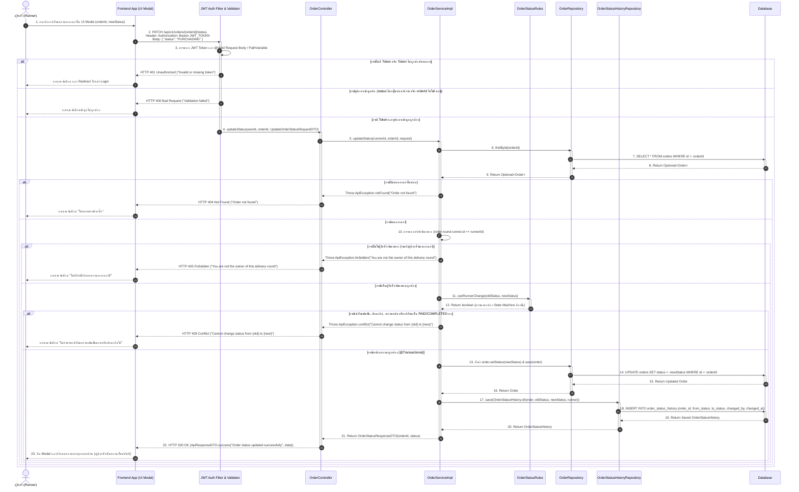

# Task 43: US06 - Sequence Diagram (State Transition) และ UI เปลี่ยนสถานะ

## 1. Sequence Diagram

### 1.1 Update Order Status & State Transition (PATCH /api/v1/orders/{orderId}/status)

## 2. Test Cases (US06)

| Test Case ID | หัวข้อการทดสอบ (Test Scenario) | เงื่อนไข / Input Data | ผลลัพธ์ที่คาดหวัง (Expected Output) | HTTP Status |
| :--- | :--- | :--- | :--- | :---: |
| **TC-US06-01** | ผู้รับหิ้วรับออเดอร์หลังชำระเงินสำเร็จ (`PAID` → `ACCEPTED`) | `PATCH /api/v1/orders/501/status` + Token เจ้าของรอบ + `{ "status": "ACCEPTED" }` | อัปเดตสถานะเป็น `ACCEPTED` บันทึกประวัติลง `order_status_history` และคืน `"Order status updated successfully"` | `200 OK` |
| **TC-US06-02** | ผู้รับหิ้วอัปเดตสถานะตามลำดับจนถึงส่งมอบ (`ACCEPTED` → `PURCHASING` → `READY_FOR_DELIVERY` → `DELIVERING`) | `PATCH /api/v1/orders/501/status` + Token เจ้าของรอบ (อัปเดตทีละขั้น) | บันทึกสถานะล่าสุดสำเร็จทุกขั้น และผู้ฝากหิ้วเห็นสถานะล่าสุดตรงกันเมื่อเรียก `GET /api/v1/orders/501` | `200 OK` |
| **TC-US06-03** | ผู้รับหิ้วยกเลิกออเดอร์ที่ยังไม่ชำระเงิน (`PENDING` → `CANCELLED`) | `PATCH /api/v1/orders/502/status` + Token เจ้าของรอบ + `{ "status": "CANCELLED" }` | อัปเดตสถานะเป็น `CANCELLED` และบันทึกประวัติ `PENDING -> CANCELLED` สำเร็จ | `200 OK` |
| **TC-US06-04** | ป้องกันการอัปเดตสถานะข้ามขั้นตอน (`PAID` → `DELIVERING`) | `PATCH /api/v1/orders/501/status` (สถานะเดิม `PAID`) + `{ "status": "DELIVERING" }` | ปฏิเสธการเปลี่ยนสถานะ คืนค่า `"Cannot change status from PAID to DELIVERING"` | `409 Conflict` |
| **TC-US06-05** | ป้องกันการย้อนกลับสถานะ หรือเปลี่ยนเป็นสถานะเดิมซ้ำ | `PATCH /api/v1/orders/501/status` (สถานะเดิม `PURCHASING`) + `{ "status": "ACCEPTED" }` | ปฏิเสธการเปลี่ยนสถานะ คืนค่า `"Cannot change status from PURCHASING to ACCEPTED"` | `409 Conflict` |
| **TC-US06-06** | ป้องกันผู้รับหิ้วเปลี่ยนเป็น `PAID`/`COMPLETED` เอง หรือแก้ไขออเดอร์ที่จบแล้ว | `PATCH /api/v1/orders/501/status` + `{ "status": "COMPLETED" }` (หรือแก้จาก `COMPLETED`/`CANCELLED`) | ปฏิเสธการเปลี่ยนสถานะเนื่องจากสงวนสิทธิ์ให้ผู้ฝากหิ้ว หรือออเดอร์ปิดงานแล้ว | `409 Conflict` |
| **TC-US06-07** | ป้องกันผู้รับหิ้วคนอื่น หรือผู้ฝากหิ้วแอบเปลี่ยนสถานะออเดอร์ | `PATCH /api/v1/orders/501/status` + Token ผู้รับหิ้วรอบอื่น (หรือผู้ฝากหิ้ว) + `{ "status": "ACCEPTED" }` | ปฏิเสธการเข้าถึง คืนค่า `"You are not the owner of this delivery round"` | `403 Forbidden` |
| **TC-US06-08** | ระบุ ID รายการฝากซื้อ (`orderId`) ที่ไม่พบในระบบ | `PATCH /api/v1/orders/9999/status` + Token เจ้าของรอบ + `{ "status": "ACCEPTED" }` | คืนค่า Error `"Order not found"` | `404 Not Found` |
| **TC-US06-09** | ผู้ใช้งานไม่ได้ยืนยันตัวตน / Token หมดอายุ | `PATCH /api/v1/orders/501/status` (ไม่ส่ง Header Authorization) | คืนค่า Error `"Invalid or missing token"` | `401 Unauthorized` |
| **TC-US06-10** | Validation Error: ส่งค่า `status` ผิด/ค่าว่าง หรือ `orderId` ไม่ใช่ตัวเลข | `PATCH /api/v1/orders/501/status` + `{ "status": "IN_PROGRESS" }` (หรือ `orderId = abc`) | คืนค่า `"Validation failed"` พร้อมรายละเอียด field error | `400 Bad Request` |