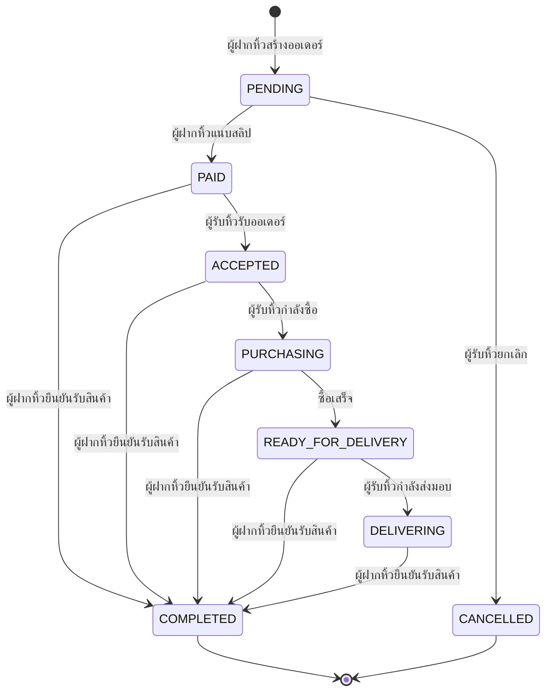
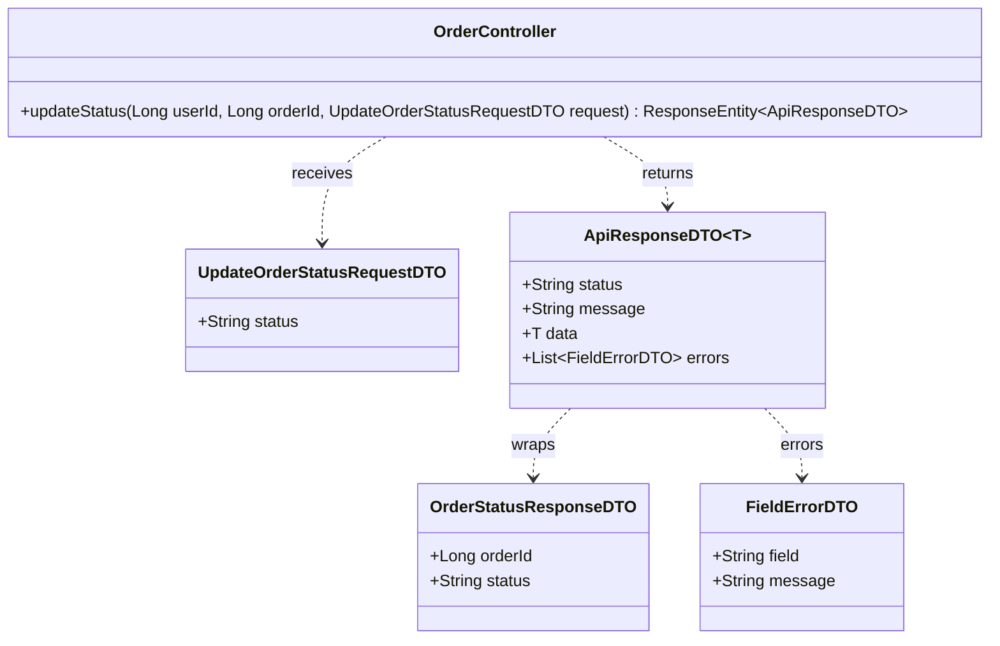
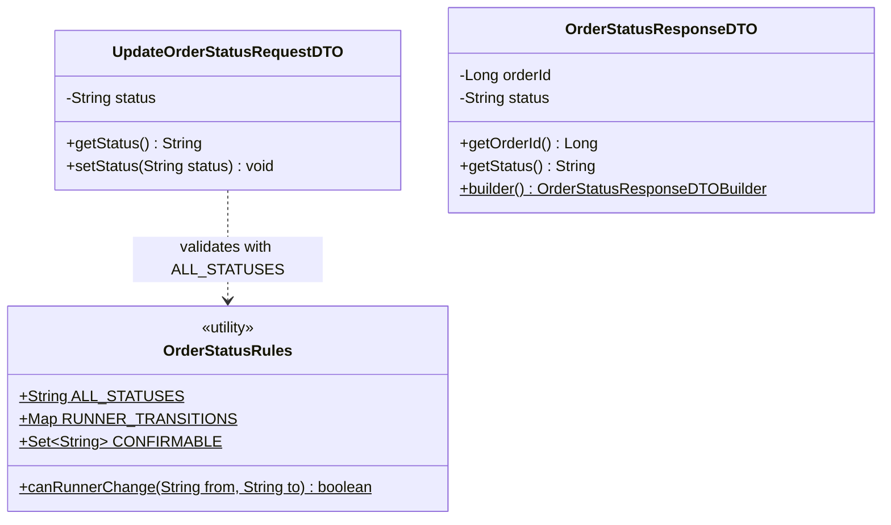
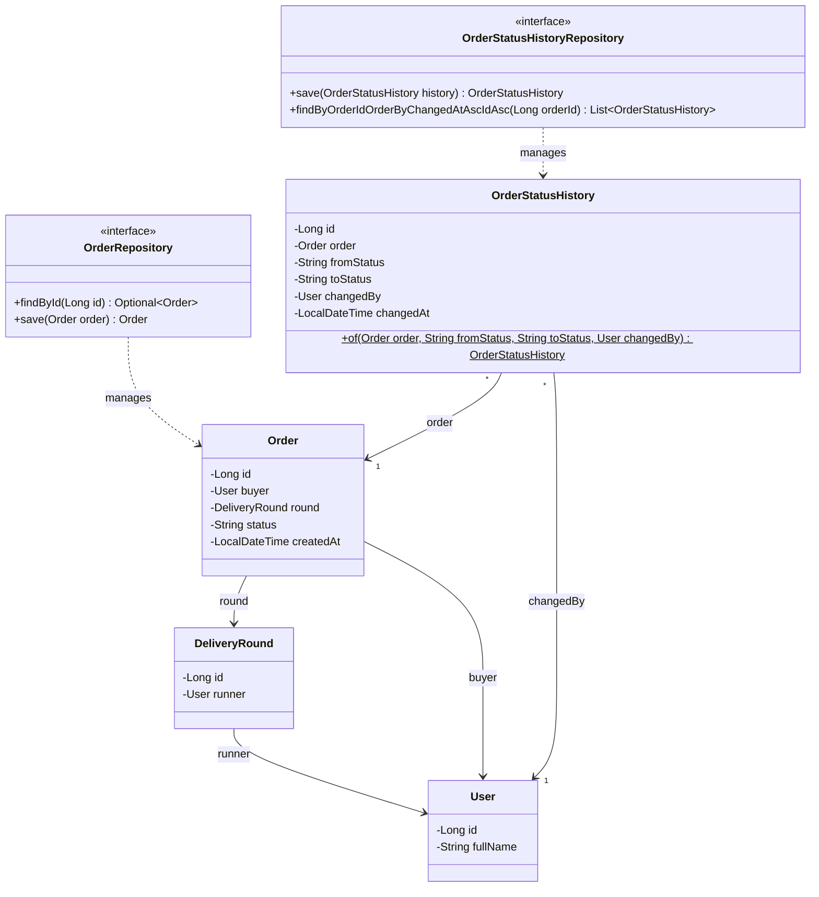

# Task44: US06 - อัปเดตสถานะรายการฝากซื้อ (API Spec, API Class Diagram, State Machine, DAO)

> ใช้ร่วมกับ [API Conventions](../common/API-CONVENTIONS.md) (รูปแบบ response, error) และต่อยอดจาก [Task16 ฝากซื้อสินค้า](../task-16/README.md) (ตาราง `orders`), [Task20 ชำระเงิน](../task-20/README.md) และ [Task24 ยืนยันรับสินค้า](../task-24/README.md)
> โค้ดที่ทำตามเอกสารนี้อยู่ใน Task46 [Backend] ส่วน Sequence Diagram และหน้าจออยู่ใน Task43 [Design]

## 0. เงื่อนไขจาก User Story ที่ API ต้องรองรับ

| เงื่อนไขใน US06 | สิ่งที่ API ต้องทำ |
|---|---|
| I want to: ผู้รับหิ้วกดเปลี่ยนสถานะคำสั่งซื้อในแต่ละขั้นตอนได้ | ผู้รับหิ้วเจ้าของรอบส่งสถานะใหม่ของออเดอร์ได้ ทีละขั้น |
| So that 1: ผู้ฝากหิ้วทราบความคืบหน้าของสินค้า | สถานะใหม่บันทึกลงออเดอร์ทันที ผู้ฝากหิ้วเห็นผ่าน `GET /orders/{orderId}` และ `GET /orders/my` |
| So that 2: ลดการทักถามซ้ำซ้อน | ทุกการเปลี่ยนสถานะมีประวัติว่าเปลี่ยนจากอะไรเป็นอะไร ใครเปลี่ยน และเมื่อไหร่ |
| Test case 1: อัปเดตสถานะได้ และระบบบันทึกสถานะล่าสุด | `200` พร้อมสถานะใหม่ และบันทึกลงตาราง `orders` กับ `order_status_history` |
| Test case 2: ผู้ฝากหิ้วเห็นสถานะที่อัปเดตล่าสุด | `GET` ของออเดอร์คืนสถานะล่าสุดเสมอ |
| Task47: ปฏิเสธการข้ามขั้นตอนสถานะ | ข้ามขั้น ย้อนกลับ หรือเปลี่ยนจากสถานะที่จบแล้ว ได้ `409` |

### ขอบเขต
- **ผู้รับหิ้วเจ้าของรอบเท่านั้น** ที่เปลี่ยนสถานะผ่าน API นี้ได้ ผู้ฝากหิ้วหรือคนอื่นได้ `403`
- **เปลี่ยนได้ทีละขั้นตามลำดับ** ห้ามข้ามและห้ามย้อนกลับ (ดูหัวข้อ 1.1)
- **ยกเลิกได้เฉพาะออเดอร์ที่ยังไม่จ่ายเงิน** (`PENDING` → `CANCELLED`) เพราะออเดอร์ที่จ่ายแล้วมีเงินพักอยู่ในระบบตัวกลาง ยกเลิกหลังจ่ายจึงไม่อยู่ใน US06
- **`PAID` และ `COMPLETED` ไม่ได้เปลี่ยนผ่าน API นี้** `PAID` เกิดตอนผู้ฝากหิ้วแนบสลิป (Task20) และ `COMPLETED` เกิดตอนผู้ฝากหิ้วยืนยันรับสินค้า (Task24)
- **ผลต่อ API เดิม**
  - ยืนยันรับสินค้า (Task24) ทำได้ทุกขั้นหลังจ่ายเงิน (`PAID`, `ACCEPTED`, `PURCHASING`, `READY_FOR_DELIVERY`, `DELIVERING`) จากเดิมที่ทำได้เฉพาะ `PAID`
  - ระบุราคา แนบสลิป และยืนยันรับสินค้า ของออเดอร์ที่ถูกยกเลิก ได้ `409 Order has been cancelled`
  - สร้างออเดอร์ จ่ายเงิน และยืนยันรับสินค้า บันทึกประวัติลง `order_status_history` ด้วย ประวัติของทุกออเดอร์จึงครบตั้งแต่สร้างจนเสร็จ

---

## 1. API Specification

### 1.1 สถานะออเดอร์ (State Machine)

| สถานะ | ความหมาย | เกิดจาก |
|---|---|---|
| `PENDING` | สร้างออเดอร์แล้ว รอชำระเงิน | ผู้ฝากหิ้วสร้างออเดอร์ (Task16) |
| `PAID` | ชำระเงินแล้ว เงินพักในระบบตัวกลาง | ผู้ฝากหิ้วแนบสลิป (Task20) |
| `ACCEPTED` | ผู้รับหิ้วรับออเดอร์แล้ว | **ผู้รับหิ้ว** (API นี้) |
| `PURCHASING` | ผู้รับหิ้วกำลังซื้อสินค้า | **ผู้รับหิ้ว** (API นี้) |
| `READY_FOR_DELIVERY` | ซื้อสินค้าเสร็จแล้ว รอส่งมอบ | **ผู้รับหิ้ว** (API นี้) |
| `DELIVERING` | ผู้รับหิ้วกำลังส่งมอบสินค้า | **ผู้รับหิ้ว** (API นี้) |
| `COMPLETED` | ผู้ฝากหิ้วได้รับสินค้าแล้ว ปิดออเดอร์ | ผู้ฝากหิ้วยืนยันรับสินค้า (Task24) |
| `CANCELLED` | ยกเลิกออเดอร์ก่อนชำระเงิน | **ผู้รับหิ้ว** (API นี้) |



**สิ่งที่ผู้รับหิ้วเปลี่ยนได้ผ่าน API นี้ (ทีละขั้น):**

| สถานะปัจจุบัน | เปลี่ยนเป็นได้ |
|---|---|
| `PENDING` | `CANCELLED` |
| `PAID` | `ACCEPTED` |
| `ACCEPTED` | `PURCHASING` |
| `PURCHASING` | `READY_FOR_DELIVERY` |
| `READY_FOR_DELIVERY` | `DELIVERING` |
| `DELIVERING`, `COMPLETED`, `CANCELLED` | เปลี่ยนไม่ได้ |

นอกเหนือจากตารางนี้ทั้งหมดได้ `409` เช่น ข้ามขั้น (`PAID` → `DELIVERING`), ย้อนกลับ (`PURCHASING` → `ACCEPTED`), เปลี่ยนเป็นสถานะเดิม หรือขอเปลี่ยนเป็น `PAID` / `COMPLETED` เอง

### 1.2 Endpoint: Update Order Status (เปลี่ยนสถานะออเดอร์)
- **URL:** `/api/v1/orders/{orderId}/status`
- **Method:** `PATCH`
- **Headers:**
  - `Authorization: Bearer <JWT_TOKEN>` (ผู้รับหิ้วเจ้าของรอบที่ออเดอร์อยู่)
  - `Content-Type: application/json`
- **Path Parameter:**

| Parameter | Type | ความหมาย |
|---|---|---|
| `orderId` | Long | รหัสออเดอร์ |

- **Request Body:**
```json
{
  "status": "PURCHASING"
}
```

| Field | Type | Required | Validation |
|---|---|---|---|
| `status` | String | ใช่ | ต้องเป็นหนึ่งใน `PENDING`, `PAID`, `ACCEPTED`, `PURCHASING`, `READY_FOR_DELIVERY`, `DELIVERING`, `COMPLETED`, `CANCELLED` (ตัวพิมพ์ใหญ่) |

- **Response (200 OK):**
```json
{
  "status": "SUCCESS",
  "message": "Order status updated successfully",
  "data": {
    "orderId": 501,
    "status": "PURCHASING"
  }
}
```

- **Error Responses:**

| Status | เมื่อไหร่ | `message` |
|---|---|---|
| `400 Bad Request` | ไม่ส่ง `status`, ส่งค่าว่าง หรือส่งค่าที่ไม่มีในระบบ เช่น `IN_PROGRESS` | `Validation failed` (พร้อม `errors` ระบุ field `status`) |
| `400 Bad Request` | `orderId` ไม่ใช่ตัวเลข | `Validation failed` |
| `401 Unauthorized` | ไม่ส่ง token หรือ token ไม่ถูกต้อง/หมดอายุ | `Invalid or missing token` |
| `403 Forbidden` | ผู้ใช้ไม่ใช่เจ้าของรอบของออเดอร์นี้ (รวมถึงผู้ฝากหิ้วของออเดอร์) | `You are not the owner of this delivery round` |
| `404 Not Found` | ไม่พบออเดอร์ | `Order not found` |
| `409 Conflict` | เปลี่ยนจากสถานะปัจจุบันไปสถานะที่ขอไม่ได้ (ดูตารางในหัวข้อ 1.1) | `Cannot change status from PAID to DELIVERING` |

ตัวอย่าง error:
```json
{
  "status": "ERROR",
  "message": "Validation failed",
  "errors": [
    { "field": "status", "message": "must be one of PENDING, PAID, ACCEPTED, PURCHASING, READY_FOR_DELIVERY, DELIVERING, COMPLETED, CANCELLED" }
  ]
}
```

### 1.3 ผลต่อ Endpoint เดิม

| Endpoint เดิม | เปลี่ยนอะไร |
|---|---|
| `POST /api/v1/orders` (Task16) | บันทึกประวัติ `null` → `PENDING` |
| `PUT /api/v1/orders/{orderId}/price` (Task20) | ออเดอร์ `CANCELLED` ได้ `409 Order has been cancelled` |
| `POST /api/v1/orders/{orderId}/payment/slip` (Task20) | ออเดอร์ `CANCELLED` ได้ `409 Order has been cancelled` และบันทึกประวัติ `PENDING` → `PAID` |
| `POST /api/v1/orders/{orderId}/completion` (Task24) | ยืนยันได้เมื่อสถานะเป็น `PAID`, `ACCEPTED`, `PURCHASING`, `READY_FOR_DELIVERY` หรือ `DELIVERING`<br>ออเดอร์ `CANCELLED` ได้ `409 Order has been cancelled`<br>ยังไม่จ่าย (`PENDING`) ได้ `409 Order has not been paid` เหมือนเดิม<br>บันทึกประวัติ (สถานะเดิม) → `COMPLETED` |

---

## 2. API Class Diagram



> `userId` มาจาก JWT (`@RequestAttribute`) `orderId` มาจาก path (`@PathVariable`) และ body ตรวจด้วย `@Valid` ส่วนเมธอดอื่นของ `OrderController` จาก Task16 ไม่ได้แสดงในแผนภาพนี้

---

## 3. DTO Class Specification & Diagram

### DTO Specifications

**`UpdateOrderStatusRequestDTO`** (ใหม่): body ของ `PATCH /orders/{orderId}/status` รูปแบบเดียวกับ `UpdateRoundStatusRequestDTO` ของรอบรับหิ้ว

| Field | Type | Validation |
|---|---|---|
| `status` | String | `@NotBlank`, `@Pattern` ต้องเป็นสถานะที่มีในระบบ (`OrderStatusRules.ALL_STATUSES`) |

**`OrderStatusResponseDTO`** (ใหม่): ผลลัพธ์หลังเปลี่ยนสถานะ

| Field | Type | หมายเหตุ |
|---|---|---|
| `orderId` | Long | รหัสออเดอร์ |
| `status` | String | สถานะใหม่ |

### DTO Class Diagram



> `OrderStatusRules` (package `common`) เก็บกติกาสถานะไว้ที่เดียว `RUNNER_TRANSITIONS` คือตารางในหัวข้อ 1.1 และ `CONFIRMABLE` คือสถานะที่ผู้ฝากหิ้วยืนยันรับสินค้าได้ ใช้ร่วมกันทั้ง `OrderServiceImpl` และ `OrderCompletionServiceImpl`

---

## 4. DAO / Repository Specification & Diagram

### ตารางใหม่ `order_status_history` (Entity `OrderStatusHistory`)

หนึ่งแถวต่อการเปลี่ยนสถานะหนึ่งครั้ง

| Entity Field | Column | Type | เงื่อนไข | ความหมาย |
|---|---|---|---|---|
| `id` | `id` | BIGINT | PK, auto increment | รหัสประวัติ |
| `order` | `order_id` | BIGINT | FK → `orders.id`, NOT NULL | ออเดอร์ที่เปลี่ยนสถานะ |
| `fromStatus` | `from_status` | VARCHAR(20) | NULL ได้ | สถานะเดิม (`null` ตอนสร้างออเดอร์) |
| `toStatus` | `to_status` | VARCHAR(20) | NOT NULL | สถานะใหม่ |
| `changedBy` | `changed_by` | BIGINT | FK → `users.id`, NOT NULL | ผู้ที่ทำให้สถานะเปลี่ยน |
| `changedAt` | `changed_at` | TIMESTAMP | NOT NULL | เวลาที่เปลี่ยน (ระบบใส่ให้ตอนบันทึก) |

ความสัมพันธ์: `orders` 1 ── * `order_status_history` และ `users` 1 ── * `order_status_history`

**ใครเป็น `changedBy` ในแต่ละจุด:**

| จุดที่บันทึก | `fromStatus` → `toStatus` | `changedBy` |
|---|---|---|
| สร้างออเดอร์ (Task16) | `null` → `PENDING` | ผู้ฝากหิ้ว |
| แนบสลิป (Task20) | `PENDING` → `PAID` | ผู้ฝากหิ้ว |
| เปลี่ยนสถานะ (Task46) | ตามตารางในหัวข้อ 1.1 | ผู้รับหิ้ว |
| ยืนยันรับสินค้า (Task24) | สถานะเดิม → `COMPLETED` | ผู้ฝากหิ้ว |

### ตาราง `orders` (ของเดิม)
ไม่มี column ใหม่ `orders.status` (VARCHAR 20) มีค่าเพิ่มเป็น `ACCEPTED`, `PURCHASING`, `READY_FOR_DELIVERY`, `DELIVERING`, `CANCELLED` (ยาวสุด 18 ตัวอักษร ใช้ column เดิมได้)

### Repository
- **`OrderRepository`** (ของเดิม): `findById` หาออเดอร์ และ `save` บันทึกสถานะใหม่
- **`OrderStatusHistoryRepository`** (ใหม่, extends `JpaRepository<OrderStatusHistory, Long>`)
  - `save(OrderStatusHistory)` บันทึกประวัติหนึ่งแถว
  - `findByOrderIdOrderByChangedAtAscIdAsc(Long orderId)` ประวัติของออเดอร์ เรียงเก่าไปใหม่ (เวลาเท่ากันเรียงตาม `id`)

### DAO Class Diagram



---

## 5. Extended API Class Diagram (Full Layered Architecture)

```mermaid
classDiagram
    class OrderController {
        -OrderService orderService
        +updateStatus(Long userId, Long orderId, UpdateOrderStatusRequestDTO request) ResponseEntity~ApiResponseDTO~
    }
    class OrderService {
        <<interface>>
        +updateStatus(Long runnerId, Long orderId, UpdateOrderStatusRequestDTO request) OrderStatusResponseDTO
    }
    class OrderServiceImpl {
        -OrderRepository orderRepository
        -OrderStatusHistoryRepository orderStatusHistoryRepository
        +createOrder(Long buyerId, CreateOrderRequestDTO request) OrderResponseDTO
        +updateStatus(Long runnerId, Long orderId, UpdateOrderStatusRequestDTO request) OrderStatusResponseDTO
    }
    class PaymentServiceImpl {
        -OrderStatusHistoryRepository orderStatusHistoryRepository
        +submitSlip(Long buyerId, Long orderId, SubmitSlipRequestDTO request) PaymentResponseDTO
    }
    class OrderCompletionServiceImpl {
        -OrderStatusHistoryRepository orderStatusHistoryRepository
        +confirmReceipt(Long buyerId, Long orderId, ConfirmReceiptRequestDTO request) CompletionResponseDTO
    }
    class OrderStatusRules {
        <<utility>>
        +canRunnerChange(String from, String to)$ boolean
        +Set~String~ CONFIRMABLE$
    }
    class OrderRepository {
        <<interface>>
    }
    class OrderStatusHistoryRepository {
        <<interface>>
    }
    class Order
    class OrderStatusHistory
    class UpdateOrderStatusRequestDTO
    class OrderStatusResponseDTO
    class ApiResponseDTO~T~
    class ApiException {
        +forbidden(String message)$ ApiException
        +notFound(String message)$ ApiException
        +conflict(String message)$ ApiException
    }

    OrderController --> OrderService : uses
    OrderController ..> UpdateOrderStatusRequestDTO : receives
    OrderController ..> ApiResponseDTO : returns
    OrderServiceImpl ..|> OrderService : implements
    OrderServiceImpl --> OrderRepository : uses
    OrderServiceImpl --> OrderStatusHistoryRepository : uses
    OrderServiceImpl ..> OrderStatusRules : checks transition
    OrderServiceImpl ..> OrderStatusResponseDTO : creates
    OrderServiceImpl ..> ApiException : throws
    PaymentServiceImpl --> OrderStatusHistoryRepository : records PENDING to PAID
    OrderCompletionServiceImpl --> OrderStatusHistoryRepository : records to COMPLETED
    OrderCompletionServiceImpl ..> OrderStatusRules : checks CONFIRMABLE
    OrderRepository ..> Order : manages
    OrderStatusHistoryRepository ..> OrderStatusHistory : manages
    OrderStatusHistory --> Order : order
    ApiResponseDTO ..> OrderStatusResponseDTO : wraps
```



### ขั้นตอนใน Service (`updateStatus`)
1. `orderRepository.findById(orderId)` ไม่พบ → `ApiException.notFound("Order not found")` (404)
2. เทียบ `order.round.runner.id` กับ `userId` จาก token ไม่ตรง → `ApiException.forbidden("You are not the owner of this delivery round")` (403)
3. `OrderStatusRules.canRunnerChange(สถานะเดิม, สถานะใหม่)` ไม่ได้ → `ApiException.conflict("Cannot change status from <เดิม> to <ใหม่>")` (409)
4. ตั้ง `order.status` เป็นสถานะใหม่ แล้ว `orderRepository.save(order)`
5. `orderStatusHistoryRepository.save(OrderStatusHistory.of(order, เดิม, ใหม่, ผู้รับหิ้ว))`
6. คืน `OrderStatusResponseDTO(orderId, status)` Controller ห่อด้วย `ApiResponseDTO.success("Order status updated successfully", data)`

> ขั้นที่ 4 และ 5 อยู่ใน transaction เดียวกัน ถ้าบันทึกประวัติไม่สำเร็จ สถานะออเดอร์ก็ไม่เปลี่ยน ส่วน body ที่ผิดรูปแบบ (400) และไม่มี token (401) ถูกตอบกลับก่อนถึง Service
