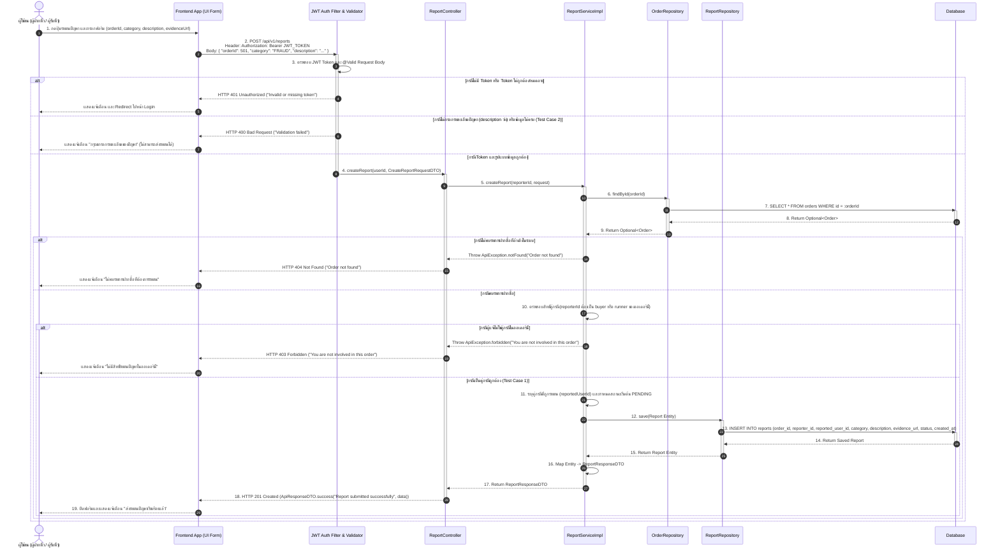

# Task 48: US09 - Sequence Diagram และ UI ฟอร์มรายงานปัญหา

## 1. Sequence Diagram

### 1.1 Submit Issue / Suspicious Behavior Report (POST /api/v1/reports)

---

## 2. Test Cases (US09)

| Test Case ID | หัวข้อการทดสอบ (Test Scenario) | เงื่อนไข / Input Data | ผลลัพธ์ที่คาดหวัง (Expected Output) | HTTP Status |
| :--- | :--- | :--- | :--- | :---: |
| **TC-US09-01** | ผู้ฝากหิ้วส่งรายงานปัญหาหรือพฤติกรรมน่าสงสัยของคู่กรณีพร้อมรายละเอียดสำเร็จ (Test Case 1) | `POST /api/v1/reports` + Token ผู้ฝากหิ้ว + `{ "orderId": 501, "category": "NOT_DELIVERED", "description": "ผู้รับหิ้วไม่นำสินค้ามาส่งตามเวลานัด" }` | บันทึกข้อมูลลงตาราง `reports` สถานะ `PENDING` และคืนข้อความ `"Report submitted successfully"` | `201 Created` |
| **TC-US09-02** | ผู้รับหิ้วส่งรายงานปัญหาหรือพฤติกรรมน่าสงสัยของคู่กรณีพร้อมรายละเอียดสำเร็จ (Test Case 1) | `POST /api/v1/reports` + Token ผู้รับหิ้ว + `{ "orderId": 501, "category": "SUSPICIOUS_BEHAVIOR", "description": "ผู้ฝากหิ้วให้ข้อมูลจุดนัดรับเท็จและติดต่อไม่ได้" }` | บันทึกข้อมูลลงตาราง `reports` สถานะ `PENDING` และคืนข้อความ `"Report submitted successfully"` | `201 Created` |
| **TC-US09-03** | ระบบไม่สามารถส่งรายงานได้ หากผู้ใช้ไม่กรอกรายละเอียดของปัญหา (Test Case 2) | `POST /api/v1/reports` + Token ผู้ใช้งาน + `{ "orderId": 501, "category": "FRAUD", "description": "" }` (หรือเป็น `null`) | ปฏิเสธการส่งรายงาน และคืนค่า `"Validation failed"` พร้อมแจ้งเตือนฟิลด์ `description` ห้ามว่าง | `400 Bad Request` |
| **TC-US09-04** | Validation Error: ไม่ระบุประเภทปัญหา (`category`) หรือไม่ระบุ `orderId` | `POST /api/v1/reports` + Token ผู้ใช้งาน + `{ "description": "พบปัญหาการใช้งาน" }` | ปฏิเสธการส่งรายงาน และคืนค่า `"Validation failed"` พร้อมรายละเอียด field error | `400 Bad Request` |
| **TC-US09-05** | ป้องกันบุคคลภายนอกที่ไม่ได้เป็นคู่กรณีในออเดอร์นั้นส่งรายงาน | `POST /api/v1/reports` + Token ผู้ใช้งานอื่นที่ไม่ใช่ทั้งผู้ฝากและผู้รับหิ้วของออเดอร์ 501 | ปฏิเสธการเข้าถึง คืนค่า Error `"You are not involved in this order"` | `403 Forbidden` |
| **TC-US09-06** | ระบุรหัสออเดอร์ (`orderId`) ที่ไม่มีอยู่จริงในระบบ | `POST /api/v1/reports` + Token ผู้ใช้งาน + `{ "orderId": 9999, "category": "FRAUD", "description": "แจ้งปัญหาออเดอร์" }` | คืนค่า Error `"Order not found"` | `404 Not Found` |
| **TC-US09-07** | ผู้ใช้งานไม่ได้ยืนยันตัวตน / ไม่ส่ง Token หรือ Token หมดอายุ | `POST /api/v1/reports` (ไม่ส่ง Header Authorization) | คืนค่า Error `"Invalid or missing token"` | `401 Unauthorized` |