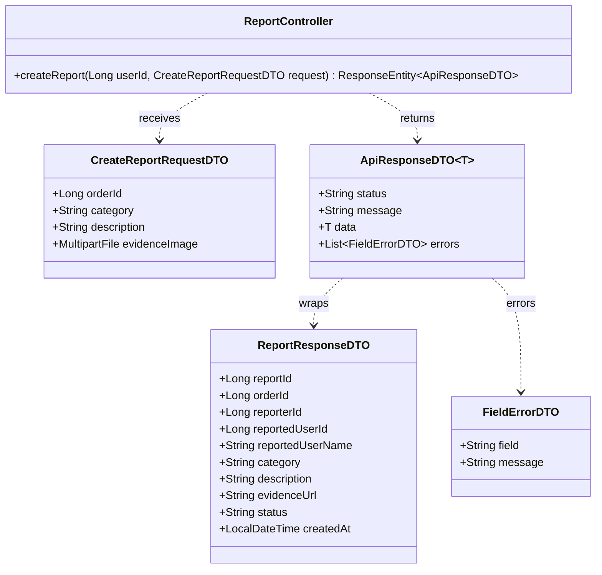
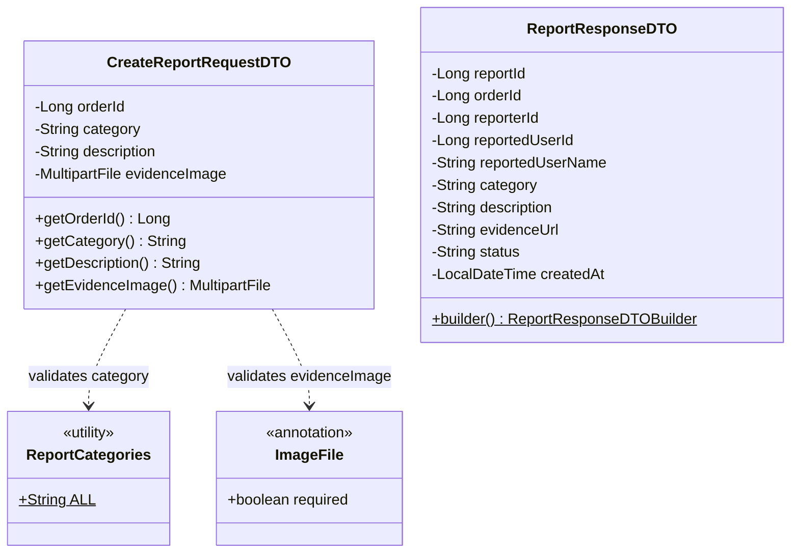
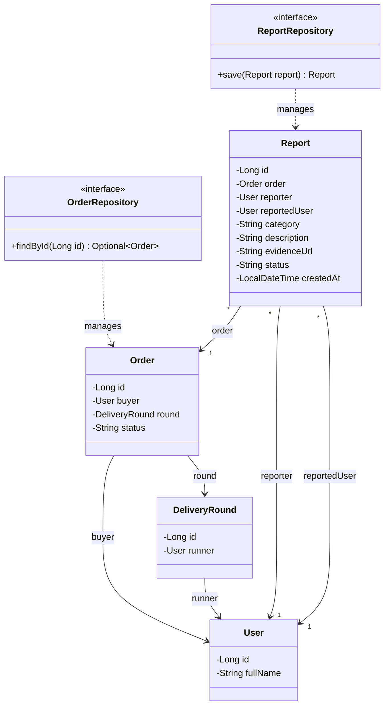
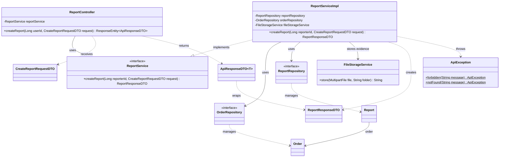

# Task49: US09 - รายงานปัญหาหรือพฤติกรรมที่น่าสงสัย (API Spec, API Class Diagram, DTO, DAO)

> ใช้ร่วมกับ [API Conventions](../common/API-CONVENTIONS.md) (รูปแบบ response, error) และต่อยอดจาก [Task16 ฝากซื้อสินค้า](../task-16/README.md) (ตาราง `orders`) กับ [Task24 ยืนยันรับสินค้า](../task-24/README.md) (การอัปโหลดรูปแบบ multipart)
> โค้ดที่ทำตามเอกสารนี้อยู่ใน Task51 [Backend] ส่วน Sequence Diagram และหน้าจออยู่ใน Task48 [Design] กับ Task50 [Frontend]

## 0. เงื่อนไขจาก User Story ที่ API ต้องรองรับ

| เงื่อนไขใน US09 | สิ่งที่ API ต้องทำ |
|---|---|
| I want to: ผู้ใช้ (ทั้งผู้ฝากหิ้วและผู้รับหิ้ว) ส่งรายงานปัญหา ข้อพิพาท หรือพฤติกรรมทุจริตของคู่กรณีได้ | ผู้ฝากหิ้วหรือผู้รับหิ้วของออเดอร์ส่งรายงานได้ ระบบระบุคู่กรณีที่ถูกรายงานให้เอง |
| So that: ผู้ดูแลระบบเข้ามาตรวจสอบหลักฐานและไกล่เกลี่ยได้ | บันทึกประเภทปัญหา รายละเอียด รูปหลักฐาน และสถานะ `PENDING` ลงตาราง `reports` |
| Test case 1: ส่งรายงานพร้อมรายละเอียดได้ | `201` และ `"Report submitted successfully"` |
| Test case 2: ไม่กรอกรายละเอียดของปัญหา ส่งไม่ได้ | `400` พร้อม `errors` ที่ field `description` และไม่บันทึกอะไร |

### ขอบเขต
- **ผู้รายงานต้องเป็นคู่กรณีในออเดอร์** คือผู้ฝากหิ้วของออเดอร์ หรือผู้รับหิ้วของรอบที่ออเดอร์อยู่ คนอื่นได้ `403`
- **ผู้ถูกรายงานคืออีกฝ่ายเสมอ** ผู้ฝากหิ้วรายงานผู้รับหิ้ว และผู้รับหิ้วรายงานผู้ฝากหิ้ว ไม่ต้องส่งมาใน request
- **รูปหลักฐานไม่บังคับ** ถ้าแนบต้องเป็น JPEG หรือ PNG ไม่เกิน 5 MB (กติกาเดียวกับสลิปและรูปยืนยันรับสินค้า)
- **รายงานได้ทุกสถานะของออเดอร์** เพราะปัญหาเกิดได้ทุกขั้น เช่น ก่อนจ่ายเงิน ระหว่างส่ง หรือหลังยกเลิก
- **รายงานใหม่มีสถานะ `PENDING`** (รอผู้ดูแลระบบตรวจสอบ)

---

## 1. API Specification

### Endpoint: Submit Report (ส่งรายงานปัญหา)
- **URL:** `/api/v1/reports`
- **Method:** `POST`
- **Headers:**
  - `Authorization: Bearer <JWT_TOKEN>`
  - `Content-Type: multipart/form-data`
- **Request (multipart/form-data):**

| Field | Type | Required | Validation |
|---|---|---|---|
| `orderId` | Long | ใช่ | ต้องเป็นตัวเลข |
| `category` | String | ใช่ | หนึ่งใน `PRODUCT_MISMATCH`, `DELIVERY_ISSUE`, `PAYMENT_ISSUE`, `SUSPICIOUS_BEHAVIOR`, `OTHER` |
| `description` | String | ใช่ | ห้ามว่างหรือมีแต่ช่องว่าง ไม่เกิน 1000 ตัวอักษร |
| `evidenceImage` | File | ไม่ | JPEG หรือ PNG ไม่เกิน 5 MB |

**ประเภทปัญหา (`category`)** ตรงกับตัวเลือกในฟอร์มรายงานปัญหา (Task50)

| ค่า | ในฟอร์ม |
|---|---|
| `PRODUCT_MISMATCH` | สินค้าไม่ตรงตามที่สั่ง |
| `DELIVERY_ISSUE` | ปัญหาการส่งมอบสินค้า |
| `PAYMENT_ISSUE` | ปัญหาการชำระเงิน |
| `SUSPICIOUS_BEHAVIOR` | ปัญหาเกี่ยวกับผู้ใช้งาน (พฤติกรรมน่าสงสัย ทุจริต) |
| `OTHER` | อื่น ๆ |

- **Response (201 Created):**
```json
{
  "status": "SUCCESS",
  "message": "Report submitted successfully",
  "data": {
    "reportId": 12,
    "orderId": 501,
    "reporterId": 7,
    "reportedUserId": 3,
    "reportedUserName": "Malee Rakdee",
    "category": "DELIVERY_ISSUE",
    "description": "ผู้รับหิ้วไม่นำสินค้ามาส่งตามเวลานัด",
    "evidenceUrl": "/uploads/reports/7f1c2a9e-0b6d-4d0e-9a41-3c2f5e8b1d20.png",
    "status": "PENDING",
    "createdAt": "2026-11-14T18:15:00"
  }
}
```
ไม่แนบรูปได้ `evidenceUrl: null`

- **Error Responses:**

| Status | เมื่อไหร่ | `message` |
|---|---|---|
| `400 Bad Request` | ไม่ส่งหรือส่งค่าผิดของ `orderId`, `category`, `description` หรือแนบไฟล์ที่ไม่ใช่ JPEG/PNG หรือใหญ่เกิน 5 MB | `Validation failed` (พร้อม `errors` ระบุ field) |
| `401 Unauthorized` | ไม่ส่ง token หรือ token ไม่ถูกต้อง/หมดอายุ | `Invalid or missing token` |
| `403 Forbidden` | ผู้ใช้ไม่ใช่ผู้ฝากหิ้วของออเดอร์และไม่ใช่ผู้รับหิ้วของรอบ | `You are not involved in this order` |
| `404 Not Found` | ไม่พบออเดอร์ | `Order not found` |

ตัวอย่าง error (ไม่กรอกรายละเอียด):
```json
{
  "status": "ERROR",
  "message": "Validation failed",
  "errors": [
    { "field": "description", "message": "must not be blank" }
  ]
}
```

---

## 2. API Class Diagram



> `userId` มาจาก JWT (`@RequestAttribute`) ส่วน request ผูกจาก multipart/form-data ด้วย `@Valid @ModelAttribute`

---

## 3. DTO Class Specification & Diagram

### DTO Specifications

**`CreateReportRequestDTO`** (ใหม่)

| Field | Type | Validation |
|---|---|---|
| `orderId` | Long | `@NotNull` |
| `category` | String | `@NotBlank`, `@Pattern` (`ReportCategories.ALL`) |
| `description` | String | `@NotBlank`, `@Size(max = 1000)` |
| `evidenceImage` | MultipartFile | `@ImageFile(required = false)` ไม่แนบก็ได้ ถ้าแนบต้องเป็น JPEG/PNG ไม่เกิน 5 MB |

> `@ImageFile` เดิมบังคับให้แนบไฟล์เสมอ (สลิป Task20, รูปยืนยันรับสินค้า Task24) เพิ่ม `required` ที่มีค่าเริ่มต้นเป็น `true` ของเดิมจึงทำงานเหมือนเดิมทุกอย่าง

**`ReportResponseDTO`** (ใหม่)

| Field | Type | หมายเหตุ |
|---|---|---|
| `reportId` | Long | รหัสรายงาน |
| `orderId` | Long | ออเดอร์ที่รายงาน |
| `reporterId` | Long | ผู้รายงาน |
| `reportedUserId` | Long | ผู้ถูกรายงาน (อีกฝ่ายในออเดอร์) |
| `reportedUserName` | String | ชื่อผู้ถูกรายงาน |
| `category` | String | ประเภทปัญหา |
| `description` | String | รายละเอียด |
| `evidenceUrl` | String | path รูปหลักฐาน หรือ `null` |
| `status` | String | `PENDING` |
| `createdAt` | LocalDateTime | เวลาที่รายงาน |

### DTO Class Diagram



---

## 4. DAO / Repository Specification & Diagram

### ตารางใหม่ `reports` (Entity `Report`)

หนึ่งแถวต่อรายงานหนึ่งครั้ง

| Entity Field | Column | Type | เงื่อนไข | ความหมาย |
|---|---|---|---|---|
| `id` | `id` | BIGINT | PK, auto increment | รหัสรายงาน |
| `order` | `order_id` | BIGINT | FK → `orders.id`, NOT NULL | ออเดอร์ที่รายงาน |
| `reporter` | `reporter_id` | BIGINT | FK → `users.id`, NOT NULL | ผู้รายงาน |
| `reportedUser` | `reported_user_id` | BIGINT | FK → `users.id`, NOT NULL | ผู้ถูกรายงาน |
| `category` | `category` | VARCHAR(30) | NOT NULL | ประเภทปัญหา |
| `description` | `description` | VARCHAR(1000) | NOT NULL | รายละเอียด |
| `evidenceUrl` | `evidence_url` | VARCHAR(500) | NULL ได้ | path รูปหลักฐาน |
| `status` | `status` | VARCHAR(20) | NOT NULL | `PENDING` ตอนสร้าง |
| `createdAt` | `created_at` | TIMESTAMP | NOT NULL | เวลาที่รายงาน (ระบบใส่ให้) |

ความสัมพันธ์: `orders` 1 ── * `reports`, `users` 1 ── * `reports` (ในฐานะผู้รายงาน) และ `users` 1 ── * `reports` (ในฐานะผู้ถูกรายงาน)

รูปหลักฐานเก็บเป็นไฟล์ในโฟลเดอร์ `uploads/reports/` ผ่าน `FileStorageService` (ตัวเดียวกับสลิปและรูปยืนยันรับสินค้า)

### Repository
- **`OrderRepository`** (ของเดิม): `findById` หาออเดอร์ พร้อมผู้ฝากหิ้วและรอบ (ผู้รับหิ้ว)
- **`ReportRepository`** (ใหม่, extends `JpaRepository<Report, Long>`): `save(Report)` บันทึกรายงาน

### DAO Class Diagram



---

## 5. Extended API Class Diagram (Full Layered Architecture)



### ขั้นตอนใน Service (`createReport`)
1. `orderRepository.findById(orderId)` ไม่พบ → `ApiException.notFound("Order not found")` (404)
2. หาคู่กรณี: ถ้า `userId` เป็นผู้ฝากหิ้ว ผู้ถูกรายงานคือผู้รับหิ้วของรอบ ถ้าเป็นผู้รับหิ้ว ผู้ถูกรายงานคือผู้ฝากหิ้ว ไม่ใช่ทั้งสอง → `ApiException.forbidden("You are not involved in this order")` (403)
3. ถ้าแนบรูป `fileStorageService.store(evidenceImage, "reports")` ได้ path ไปใส่ `evidenceUrl`
4. สร้าง `Report` สถานะ `PENDING` แล้ว `reportRepository.save(report)`
5. คืน `ReportResponseDTO` Controller ห่อด้วย `ApiResponseDTO.success("Report submitted successfully", data)` สถานะ `201`

> ข้อมูลไม่ครบหรือผิดรูปแบบ (`400`) และไม่มี token (`401`) ถูกตอบกลับก่อนถึง Service จึงไม่มีการบันทึกรายงานหรือไฟล์
