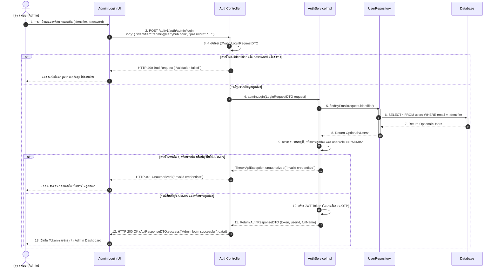
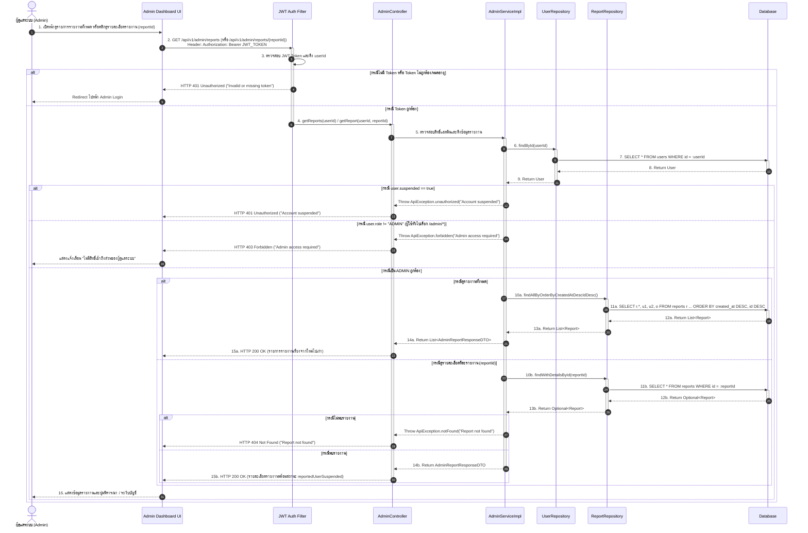
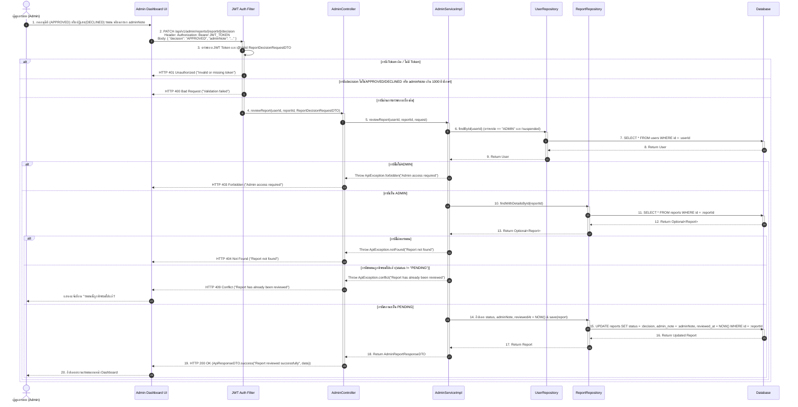
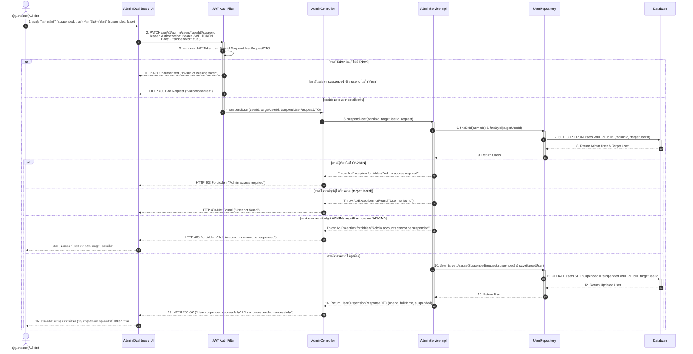

# Task 53: US10 - Sequence Diagram และ Admin UI สำหรับการระงับบัญชี

## 1. Sequence Diagram

### 1.1 Admin Login (POST /api/v1/auth/admin/login)

### 1.2 Get All Reports & Report Detail (GET /api/v1/admin/reports และ GET /api/v1/admin/reports/{reportId})

### 1.3 Review Report Decision (PATCH /api/v1/admin/reports/{reportId}/decision)

### 1.4 Suspend / Unsuspend User Account (PATCH /api/v1/admin/users/{userId}/suspend)

