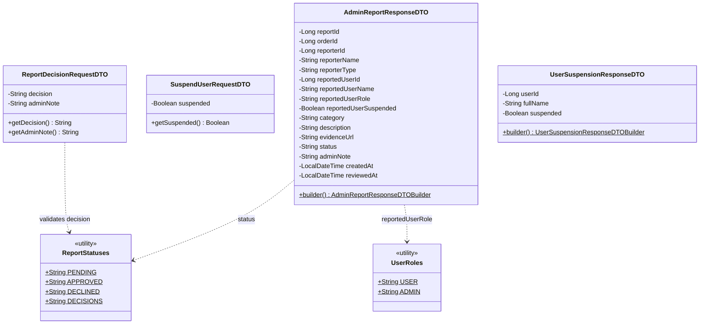
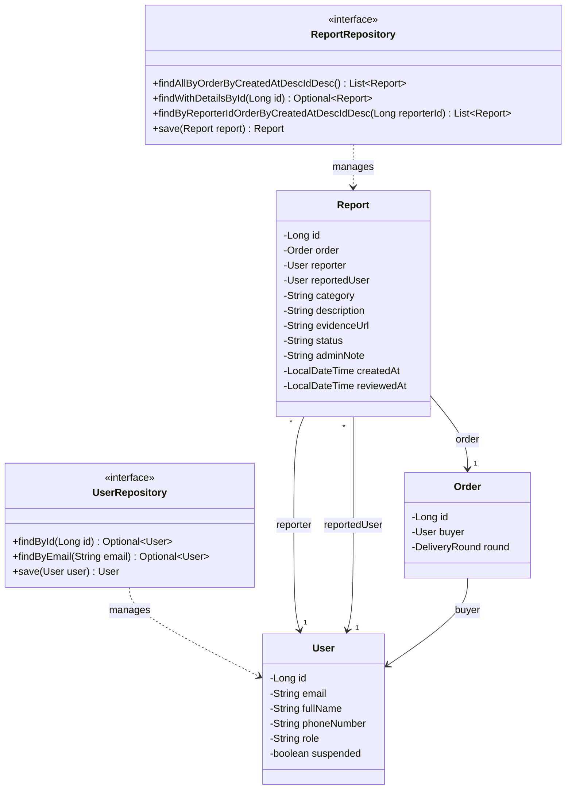

# Task54: US10 - ตรวจสอบและระงับบัญชีที่มีพฤติกรรมน่าสงสัย (API Spec, API Class Diagram, DTO, DAO)

> ใช้ร่วมกับ [API Conventions](../common/API-CONVENTIONS.md) (รูปแบบ response, error) และต่อยอดจาก [Task49 รายงานปัญหา](../task-49/README.md) (ตาราง `reports`) กับ [Task04 ลงทะเบียนและเข้าสู่ระบบ](../task-04/README.md) (ตาราง `users`, JWT)
> โค้ดที่ทำตามเอกสารนี้อยู่ใน Task56 [Backend] ส่วน Sequence Diagram และหน้าจออยู่ใน Task53 [Design] กับ Task55 [Frontend]

## 0. เงื่อนไขจาก User Story ที่ API ต้องรองรับ

| เงื่อนไขใน US10 | สิ่งที่ API ต้องทำ |
|---|---|
| As a: ผู้ดูแลระบบ (Admin) | มีบัญชีแอดมิน (`role = ADMIN`) เข้าสู่ระบบด้วยอีเมลและรหัสผ่าน และใช้ endpoint กลุ่ม `/admin/*` ได้คนเดียว |
| I want to: ตรวจสอบประวัติการรายงาน | แอดมินดูรายงานทั้งหมด ดูรายละเอียดทีละรายงาน และพิจารณาว่าอนุมัติหรือปฏิเสธ |
| I want to: ระงับการใช้งานบัญชีผู้ใช้ที่ทำผิดกฎ | แอดมินระงับบัญชีได้ และคืนสิทธิ์ได้ถ้าระงับผิด |
| So that: ป้องกันการฉ้อโกงหรือความเสียหายซ้ำ | บัญชีที่ถูกระงับเข้าสู่ระบบไม่ได้ และใช้ token เดิมต่อไม่ได้ทันที |
| ผู้ใช้ทั่วไปต้องเข้าถึงส่วนของแอดมินไม่ได้ | ผู้ใช้ `role = USER` เรียก `/admin/*` ได้ `403` |

### ขอบเขต
- **แอดมินมีบัญชีเดียว** ระบบสร้างให้ตอนเริ่มแอปจากค่า `APP_ADMIN_EMAIL` และ `APP_ADMIN_PASSWORD` (ไม่มีหน้าสมัครแอดมิน) ถ้าไม่ตั้งสองค่านี้ ระบบจะไม่มีบัญชีแอดมิน
- **แอดมินเข้าสู่ระบบที่ `POST /auth/admin/login`** ด้วยอีเมลและรหัสผ่าน ได้ JWT ทันทีโดยไม่ผ่าน OTP เพราะบัญชีแอดมินไม่มีเบอร์โทร ส่วนแอดมินที่ใช้ `POST /auth/login` ของผู้ใช้ทั่วไปได้ `403`
- **ตรวจสิทธิ์แอดมินจากฐานข้อมูล** JWT ยังมีแค่ `userId` เหมือนเดิม ระบบอ่าน `role` ของผู้ใช้คนนั้นจากตาราง `users` ทุกครั้ง
- **พิจารณารายงานได้ครั้งเดียว** จาก `PENDING` เป็น `APPROVED` หรือ `DECLINED` รายงานที่พิจารณาแล้วได้ `409`
- **ระงับหรือคืนสิทธิ์ด้วย endpoint เดียว** ส่ง `suspended: true` เพื่อระงับ หรือ `false` เพื่อคืนสิทธิ์ ระงับบัญชีแอดมินไม่ได้ (`403`)
- **บัญชีที่ถูกระงับ** เข้าสู่ระบบได้ `403 Account suspended` และทุก request ที่แนบ token เดิมได้ `401 Account suspended`
- **ผู้ใช้ดูประวัติรายงานของตัวเองได้** ที่ `GET /reports/my` (เห็นสถานะว่าแอดมินพิจารณาแล้วหรือยัง)

---

## 1. API Specification

### Endpoint 1: Admin Login (แอดมินเข้าสู่ระบบ)
- **URL:** `/api/v1/auth/admin/login`
- **Method:** `POST`
- **Headers:** `Content-Type: application/json` (ไม่ต้องมี token)
- **Request Body:** ใช้ `LoginRequestDTO` ตัวเดียวกับ Task04

```json
{
  "identifier": "admin@carryhub.com",
  "password": "AdminPassword123"
}
```

| Field | Type | Required | Validation |
|---|---|---|---|
| `identifier` | String | ใช่ | อีเมลของบัญชีแอดมิน ห้ามว่าง |
| `password` | String | ใช่ | ห้ามว่าง |

- **Response (200 OK):** `AuthResponseDTO` รูปแบบเดียวกับ `POST /auth/otp/verify`

```json
{
  "status": "SUCCESS",
  "message": "Admin login successful",
  "data": {
    "token": "eyJhbGciOiJIUzI1NiJ9...",
    "tokenType": "Bearer",
    "userId": 1,
    "fullName": "CarryHub Admin"
  }
}
```

| Status | เมื่อไหร่ | `message` |
|---|---|---|
| `400 Bad Request` | ไม่ส่ง `identifier` หรือ `password` | `Validation failed` (พร้อม `errors`) |
| `401 Unauthorized` | ไม่พบอีเมล, รหัสผ่านผิด หรือบัญชีนี้ไม่ใช่แอดมิน | `Invalid credentials` |

---

### Endpoint 2: Get All Reports (แอดมินดูรายงานทั้งหมด)
- **URL:** `/api/v1/admin/reports`
- **Method:** `GET`
- **Headers:** `Authorization: Bearer <JWT_TOKEN>` (ของแอดมิน)
- **Response (200 OK):** รายการ `AdminReportResponseDTO` เรียงจากใหม่ไปเก่า ไม่มีรายงานได้ `data: []`

```json
{
  "status": "SUCCESS",
  "data": [
    {
      "reportId": 12,
      "orderId": 501,
      "reporterId": 7,
      "reporterName": "Somchai Jaidee",
      "reporterType": "BUYER",
      "reportedUserId": 3,
      "reportedUserName": "Malee Rakdee",
      "reportedUserRole": "USER",
      "reportedUserSuspended": false,
      "category": "DELIVERY_ISSUE",
      "description": "ผู้รับหิ้วไม่นำสินค้ามาส่งตามเวลานัด",
      "evidenceUrl": "/uploads/reports/7f1c2a9e-0b6d-4d0e-9a41-3c2f5e8b1d20.png",
      "status": "PENDING",
      "adminNote": null,
      "createdAt": "2026-11-14T18:15:00",
      "reviewedAt": null
    }
  ]
}
```

- `reporterType`: `BUYER` = ผู้ฝากหิ้วเป็นคนรายงาน, `RUNNER` = ผู้รับหิ้วเป็นคนรายงาน
- `reportedUserSuspended`: สถานะปัจจุบันของบัญชีผู้ถูกรายงาน ใช้ตัดสินว่าหน้าจอแสดงปุ่ม "ระงับบัญชี" หรือ "คืนสิทธิ์บัญชี"

---

### Endpoint 3: Get Report Detail (แอดมินดูรายละเอียดรายงาน)
- **URL:** `/api/v1/admin/reports/{reportId}`
- **Method:** `GET`
- **Headers:** `Authorization: Bearer <JWT_TOKEN>` (ของแอดมิน)
- **Response (200 OK):** `data` เป็น `AdminReportResponseDTO` หนึ่งรายการ รูปแบบเดียวกับ Endpoint 2

---

### Endpoint 4: Review Report (แอดมินอนุมัติหรือปฏิเสธรายงาน)
- **URL:** `/api/v1/admin/reports/{reportId}/decision`
- **Method:** `PATCH`
- **Headers:** `Authorization: Bearer <JWT_TOKEN>` (ของแอดมิน), `Content-Type: application/json`
- **Request Body:**

```json
{
  "decision": "APPROVED",
  "adminNote": "ตรวจสอบหลักฐานแล้ว ผู้รับหิ้วไม่มาส่งจริง"
}
```

| Field | Type | Required | Validation |
|---|---|---|---|
| `decision` | String | ใช่ | `APPROVED` (อนุมัติรายงาน) หรือ `DECLINED` (ปฏิเสธรายงาน) |
| `adminNote` | String | ไม่ | ไม่เกิน 1000 ตัวอักษร |

- **Response (200 OK):** `data` เป็น `AdminReportResponseDTO` ที่อัปเดตแล้ว (`status`, `adminNote`, `reviewedAt`)

```json
{
  "status": "SUCCESS",
  "message": "Report reviewed successfully",
  "data": {
    "reportId": 12,
    "status": "APPROVED",
    "adminNote": "ตรวจสอบหลักฐานแล้ว ผู้รับหิ้วไม่มาส่งจริง",
    "reviewedAt": "2026-11-15T10:30:00"
  }
}
```
(ตัวอย่างย่อ ของจริงมีทุก field เหมือน Endpoint 2)

---

### Endpoint 5: Suspend / Unsuspend User (แอดมินระงับหรือคืนสิทธิ์บัญชี)
- **URL:** `/api/v1/admin/users/{userId}/suspend`
- **Method:** `PATCH`
- **Headers:** `Authorization: Bearer <JWT_TOKEN>` (ของแอดมิน), `Content-Type: application/json`
- **Request Body:**

```json
{
  "suspended": true
}
```

| Field | Type | Required | Validation |
|---|---|---|---|
| `suspended` | Boolean | ใช่ | `true` = ระงับบัญชี, `false` = คืนสิทธิ์บัญชี |

- **Response (200 OK):**

```json
{
  "status": "SUCCESS",
  "message": "User suspended successfully",
  "data": {
    "userId": 3,
    "fullName": "Malee Rakdee",
    "suspended": true
  }
}
```
ส่ง `suspended: false` ได้ message `User unsuspended successfully` ส่งค่าเดิมซ้ำ (เช่นระงับบัญชีที่ถูกระงับอยู่แล้ว) ได้ `200` และข้อมูลไม่เปลี่ยน

---

### Endpoint 6: Get My Reports (ผู้ใช้ดูประวัติรายงานของตัวเอง)
- **URL:** `/api/v1/reports/my`
- **Method:** `GET`
- **Headers:** `Authorization: Bearer <JWT_TOKEN>`
- **Response (200 OK):** รายการ `ReportResponseDTO` (ตัวเดียวกับ Task49) ที่ผู้ใช้คนนี้ส่ง เรียงจากใหม่ไปเก่า `status` บอกว่าแอดมินพิจารณาแล้วหรือยัง ไม่มีรายงานได้ `data: []`

---

### Error Responses (Endpoint 2 ถึง 6)

| Status | เมื่อไหร่ | `message` |
|---|---|---|
| `400 Bad Request` | `decision` ไม่ส่งหรือไม่ใช่ `APPROVED`/`DECLINED`, `adminNote` เกิน 1000 ตัวอักษร, ไม่ส่ง `suspended`, หรือ `reportId`/`userId` ไม่ใช่ตัวเลข | `Validation failed` (พร้อม `errors`) |
| `401 Unauthorized` | ไม่ส่ง token หรือ token ไม่ถูกต้อง/หมดอายุ | `Invalid or missing token` |
| `401 Unauthorized` | บัญชีของ token นี้ถูกระงับ | `Account suspended` |
| `403 Forbidden` | ผู้เรียก Endpoint 2 ถึง 5 ไม่ใช่แอดมิน | `Admin access required` |
| `403 Forbidden` | พยายามระงับบัญชีแอดมิน | `Admin accounts cannot be suspended` |
| `404 Not Found` | ไม่พบรายงาน | `Report not found` |
| `404 Not Found` | ไม่พบผู้ใช้ | `User not found` |
| `409 Conflict` | รายงานถูกพิจารณาไปแล้ว | `Report has already been reviewed` |

### การเข้าสู่ระบบของบัญชีที่ถูกระงับ (Task04 เดิม)

| Endpoint | ผลเมื่อบัญชีถูกระงับ |
|---|---|
| `POST /auth/login` | รหัสผ่านถูกแต่ถูกระงับ → `403 Account suspended` (ไม่ส่ง OTP) |
| `POST /auth/otp/verify`, `POST /auth/otp/resend` | ถ้าบัญชีถูกระงับระหว่างรอ OTP → `403 Account suspended` |
| `POST /auth/login` ด้วยบัญชีแอดมิน | `403 Please use admin login` |

---

## 2. API Class Diagram

```mermaid
classDiagram
    class AdminController {
        +getReports(Long userId) ResponseEntity~ApiResponseDTO~
        +getReport(Long userId, Long reportId) ResponseEntity~ApiResponseDTO~
        +reviewReport(Long userId, Long reportId, ReportDecisionRequestDTO request) ResponseEntity~ApiResponseDTO~
        +suspendUser(Long userId, Long targetUserId, SuspendUserRequestDTO request) ResponseEntity~ApiResponseDTO~
    }
    class AuthController {
        +adminLogin(LoginRequestDTO request) ResponseEntity~ApiResponseDTO~
    }
    class ReportController {
        +getMyReports(Long userId) ResponseEntity~ApiResponseDTO~
    }
    class LoginRequestDTO {
        +String identifier
        +String password
    }
    class AuthResponseDTO {
        +String token
        +String tokenType
        +Long userId
        +String fullName
    }
    class ReportDecisionRequestDTO {
        +String decision
        +String adminNote
    }
    class SuspendUserRequestDTO {
        +Boolean suspended
    }
    class AdminReportResponseDTO {
        +Long reportId
        +Long orderId
        +String reporterName
        +String reporterType
        +Long reportedUserId
        +Boolean reportedUserSuspended
        +String status
        +String adminNote
    }
    class UserSuspensionResponseDTO {
        +Long userId
        +String fullName
        +Boolean suspended
    }
    class ReportResponseDTO {
        +Long reportId
        +Long orderId
        +String status
    }
    class ApiResponseDTO~T~ {
        +String status
        +String message
        +T data
        +List~FieldErrorDTO~ errors
    }

    AuthController ..> LoginRequestDTO : receives
    AuthController ..> AuthResponseDTO : returns in data
    AdminController ..> ReportDecisionRequestDTO : receives
    AdminController ..> SuspendUserRequestDTO : receives
    AdminController ..> AdminReportResponseDTO : returns in data
    AdminController ..> UserSuspensionResponseDTO : returns in data
    ReportController ..> ReportResponseDTO : returns in data
    AdminController ..> ApiResponseDTO : returns
    AuthController ..> ApiResponseDTO : returns
    ReportController ..> ApiResponseDTO : returns
```



> `userId` ของผู้เรียกมาจาก JWT (`@RequestAttribute`) ส่วน `targetUserId` คือ `{userId}` ใน URL (บัญชีที่จะระงับ)

---

## 3. DTO Class Specification & Diagram

### DTO Specifications

**`ReportDecisionRequestDTO`** (ใหม่)

| Field | Type | Validation |
|---|---|---|
| `decision` | String | `@NotBlank`, `@Pattern` (`ReportStatuses.DECISIONS` = `APPROVED\|DECLINED`) |
| `adminNote` | String | `@Size(max = 1000)` ไม่บังคับ |

**`SuspendUserRequestDTO`** (ใหม่)

| Field | Type | Validation |
|---|---|---|
| `suspended` | Boolean | `@NotNull` |

**`AdminReportResponseDTO`** (ใหม่)

| Field | Type | หมายเหตุ |
|---|---|---|
| `reportId` | Long | รหัสรายงาน |
| `orderId` | Long | ออเดอร์ที่รายงาน |
| `reporterId` | Long | ผู้รายงาน |
| `reporterName` | String | ชื่อผู้รายงาน |
| `reporterType` | String | `BUYER` หรือ `RUNNER` (ระบบดูจากออเดอร์) |
| `reportedUserId` | Long | ผู้ถูกรายงาน |
| `reportedUserName` | String | ชื่อผู้ถูกรายงาน |
| `reportedUserRole` | String | `USER` หรือ `ADMIN` |
| `reportedUserSuspended` | Boolean | บัญชีผู้ถูกรายงานถูกระงับอยู่หรือไม่ |
| `category` | String | ประเภทปัญหา (5 ค่าเดียวกับ Task49) |
| `description` | String | รายละเอียด |
| `evidenceUrl` | String | path รูปหลักฐาน หรือ `null` |
| `status` | String | `PENDING`, `APPROVED` หรือ `DECLINED` |
| `adminNote` | String | หมายเหตุจากแอดมิน หรือ `null` |
| `createdAt` | LocalDateTime | เวลาที่รายงาน |
| `reviewedAt` | LocalDateTime | เวลาที่แอดมินพิจารณา หรือ `null` |

**`UserSuspensionResponseDTO`** (ใหม่)

| Field | Type | หมายเหตุ |
|---|---|---|
| `userId` | Long | บัญชีที่ถูกเปลี่ยนสถานะ |
| `fullName` | String | ชื่อเจ้าของบัญชี |
| `suspended` | Boolean | สถานะหลังเปลี่ยน |

**`LoginRequestDTO`, `AuthResponseDTO`** (ของเดิมจาก Task04) ใช้กับ admin login โดยไม่แก้ไข
**`ReportResponseDTO`** (ของเดิมจาก Task49) ใช้กับ `GET /reports/my` โดยไม่แก้ไข

### DTO Class Diagram



---

## 4. DAO / Repository Specification & Diagram

### ตาราง `users` (เพิ่ม 2 column, แก้ 1 column)

| Entity Field | Column | Type | เงื่อนไข | ความหมาย |
|---|---|---|---|---|
| `role` | `role` | VARCHAR(20) | NOT NULL, DEFAULT `'USER'` | **ใหม่** `USER` หรือ `ADMIN` ผู้ใช้เดิมทุกคนได้ `USER` |
| `suspended` | `suspended` | BOOLEAN | NOT NULL, DEFAULT `false` | **ใหม่** `true` = ถูกระงับ |
| `phoneNumber` | `phone_number` | VARCHAR(10) | UNIQUE, NULL ได้ | **แก้** จาก NOT NULL เป็น NULL ได้ เพราะบัญชีแอดมินไม่มีเบอร์โทร ผู้ใช้ทั่วไปยังต้องกรอกตอนสมัครเหมือนเดิม |

### ตาราง `reports` (เพิ่ม 2 column)

| Entity Field | Column | Type | เงื่อนไข | ความหมาย |
|---|---|---|---|---|
| `adminNote` | `admin_note` | VARCHAR(1000) | NULL ได้ | **ใหม่** หมายเหตุจากแอดมิน |
| `reviewedAt` | `reviewed_at` | TIMESTAMP | NULL ได้ | **ใหม่** เวลาที่แอดมินพิจารณา |
| `status` | `status` | VARCHAR(20) | NOT NULL | (เดิม) เพิ่มค่า `APPROVED`, `DECLINED` |

### Repository
- **`UserRepository`** (ของเดิม)
  - `findById(Long id)` ตรวจ role ของผู้เรียก หาบัญชีที่จะระงับ และตรวจว่าบัญชีของ token ถูกระงับหรือไม่
  - `findByEmail(String email)` **ใหม่** หาบัญชีแอดมินตอน admin login และตอนสร้างบัญชีแอดมิน
  - `save(User user)` บันทึก `suspended` และบัญชีแอดมิน
- **`ReportRepository`** (ของเดิม)
  - `findAllByOrderByCreatedAtDescIdDesc()` **ใหม่** รายงานทั้งหมด ใหม่สุดก่อน
  - `findWithDetailsById(Long id)` **ใหม่** รายงานหนึ่งรายการ
  - `findByReporterIdOrderByCreatedAtDescIdDesc(Long reporterId)` **ใหม่** รายงานที่ผู้ใช้คนนี้ส่ง
  - `save(Report report)` บันทึกผลพิจารณา
  - สามเมธอดใหม่ใช้ `@EntityGraph` ดึงออเดอร์ ผู้รายงาน และผู้ถูกรายงานมาใน query เดียว

### DAO Class Diagram



---

## 5. Extended API Class Diagram (Full Layered Architecture)

```mermaid
classDiagram
    class AdminController {
        -AdminService adminService
        +getReports(Long userId) ResponseEntity~ApiResponseDTO~
        +getReport(Long userId, Long reportId) ResponseEntity~ApiResponseDTO~
        +reviewReport(Long userId, Long reportId, ReportDecisionRequestDTO request) ResponseEntity~ApiResponseDTO~
        +suspendUser(Long userId, Long targetUserId, SuspendUserRequestDTO request) ResponseEntity~ApiResponseDTO~
    }
    class AdminService {
        <<interface>>
        +getReports(Long adminId) List~AdminReportResponseDTO~
        +getReport(Long adminId, Long reportId) AdminReportResponseDTO
        +reviewReport(Long adminId, Long reportId, ReportDecisionRequestDTO request) AdminReportResponseDTO
        +setUserSuspended(Long adminId, Long targetUserId, boolean suspended) UserSuspensionResponseDTO
    }
    class AdminServiceImpl {
        -ReportRepository reportRepository
        -UserRepository userRepository
    }
    class AuthController {
        -AuthService authService
        +adminLogin(LoginRequestDTO request) ResponseEntity~ApiResponseDTO~
    }
    class AuthService {
        <<interface>>
        +adminLogin(LoginRequestDTO request) AuthResponseDTO
    }
    class ReportController {
        -ReportService reportService
        +getMyReports(Long userId) ResponseEntity~ApiResponseDTO~
    }
    class ReportService {
        <<interface>>
        +getMyReports(Long userId) List~ReportResponseDTO~
    }
    class JwtAuthFilter {
        -JwtService jwtService
        -UserRepository userRepository
        #doFilterInternal(HttpServletRequest, HttpServletResponse, FilterChain) void
    }
    class AdminAccountInitializer {
        -UserRepository userRepository
        -PasswordHasher passwordHasher
        +run(ApplicationArguments args) void
    }
    class UserRepository {
        <<interface>>
    }
    class ReportRepository {
        <<interface>>
    }
    class ApiException {
        +unauthorized(String message)$ ApiException
        +forbidden(String message)$ ApiException
        +notFound(String message)$ ApiException
        +conflict(String message)$ ApiException
    }

    AdminController --> AdminService : uses
    AdminServiceImpl ..|> AdminService : implements
    AdminServiceImpl --> ReportRepository : uses
    AdminServiceImpl --> UserRepository : uses
    AdminServiceImpl ..> ApiException : throws
    AuthController --> AuthService : uses
    AuthService --> UserRepository : findByEmail
    ReportController --> ReportService : uses
    ReportService --> ReportRepository : findByReporterId
    JwtAuthFilter --> UserRepository : checks suspended
    AdminAccountInitializer --> UserRepository : creates admin
```



### ขั้นตอนใน Service

**ตรวจสิทธิ์แอดมิน (ทุก method ของ `AdminServiceImpl`)**
1. `userRepository.findById(adminId)` แล้วดูว่า `role` เป็น `ADMIN` ไม่ใช่ → `ApiException.forbidden("Admin access required")` (403)

**`getReports` / `getReport`**
1. ตรวจสิทธิ์แอดมิน
2. `reportRepository.findAllByOrderByCreatedAtDescIdDesc()` หรือ `findWithDetailsById(reportId)` ไม่พบ → `ApiException.notFound("Report not found")` (404)
3. แปลงเป็น `AdminReportResponseDTO` (`reporterType` เป็น `BUYER` ถ้าผู้รายงานคือผู้ฝากหิ้วของออเดอร์ ไม่งั้นเป็น `RUNNER`)

**`reviewReport`**
1. ตรวจสิทธิ์แอดมิน แล้วหารายงาน ไม่พบ → 404
2. `status` ไม่ใช่ `PENDING` → `ApiException.conflict("Report has already been reviewed")` (409)
3. ตั้ง `status` เป็น `decision`, `adminNote` (ตัดช่องว่าง ว่างเปล่าเก็บเป็น `null`), `reviewedAt` เป็นเวลาปัจจุบัน แล้ว `save`
4. Controller ห่อด้วย `ApiResponseDTO.success("Report reviewed successfully", data)`

**`setUserSuspended`**
1. ตรวจสิทธิ์แอดมิน
2. `userRepository.findById(targetUserId)` ไม่พบ → `ApiException.notFound("User not found")` (404)
3. บัญชีเป้าหมายเป็นแอดมิน → `ApiException.forbidden("Admin accounts cannot be suspended")` (403)
4. ตั้ง `suspended` แล้ว `save` Controller ตอบ `"User suspended successfully"` หรือ `"User unsuspended successfully"`

**`adminLogin` (`AuthServiceImpl`)**
1. `userRepository.findByEmail(identifier ตัวพิมพ์เล็ก)` ไม่พบ, รหัสผ่านผิด หรือ `role` ไม่ใช่ `ADMIN` → `ApiException.unauthorized("Invalid credentials")` (401)
2. สร้าง JWT ด้วย `jwtService.generateToken(userId)` คืน `AuthResponseDTO`

**ตรวจบัญชีที่ถูกระงับ (`JwtAuthFilter`)**
1. token ถูกต้อง → `userRepository.findById(userId)`
2. บัญชีถูกระงับ → ตอบ `401 Account suspended` ทันที ไม่ส่งต่อไปที่ Controller
3. ไม่พบบัญชี → ไม่ตั้ง `userId` (endpoint ที่ต้องล็อกอินตอบ `401 Invalid or missing token`)

**สร้างบัญชีแอดมิน (`AdminAccountInitializer` ทำงานตอนเริ่มแอป)**
1. ไม่ได้ตั้ง `APP_ADMIN_EMAIL` หรือ `APP_ADMIN_PASSWORD` → ข้าม ไม่สร้างบัญชี
2. หา `findByEmail` ไม่พบ → สร้างบัญชีใหม่ `role = ADMIN` ไม่มีเบอร์โทร ชื่อจาก `APP_ADMIN_NAME` (ค่าเริ่มต้น `CarryHub Admin`)
3. พบบัญชีอีเมลนี้อยู่แล้ว → ตั้ง `role = ADMIN`, `suspended = false` และอัปเดตรหัสผ่านให้ตรงกับ `APP_ADMIN_PASSWORD`

> ข้อมูลไม่ครบหรือผิดรูปแบบ (`400`) และไม่มี token (`401`) ถูกตอบกลับก่อนถึง Service จึงไม่มีการเปลี่ยนข้อมูล

### การตั้งค่าบัญชีแอดมิน

ตั้งค่าก่อนรันแอป (ใน terminal หรือไฟล์ `.env` ที่ root ของโปรเจกต์ ซึ่ง Docker Compose อ่านให้อัตโนมัติ และไม่ถูก commit)

| ตัวแปร | ต้องมี | ความหมาย |
|---|---|---|
| `APP_ADMIN_EMAIL` | ใช่ | อีเมลที่ใช้ login แอดมิน |
| `APP_ADMIN_PASSWORD` | ใช่ | รหัสผ่านแอดมิน |
| `APP_ADMIN_NAME` | ไม่ | ชื่อที่แสดง ค่าเริ่มต้น `CarryHub Admin` |
